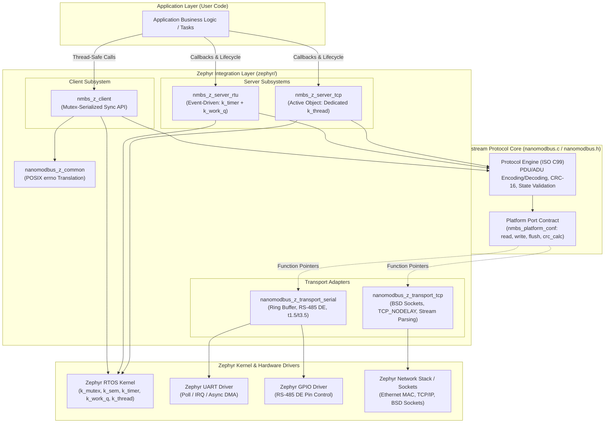
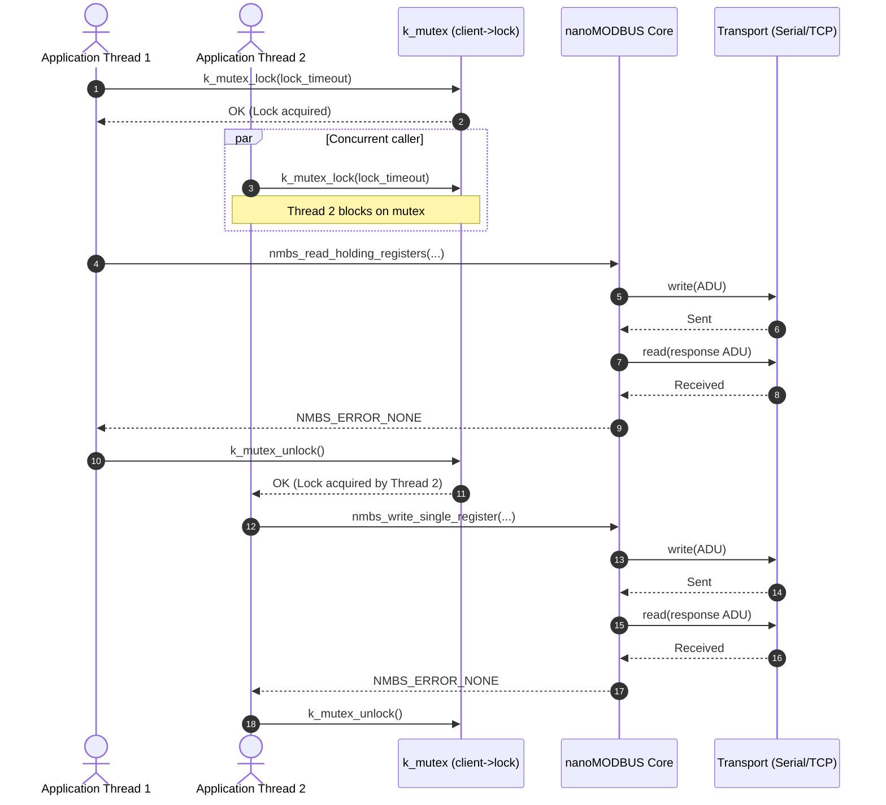
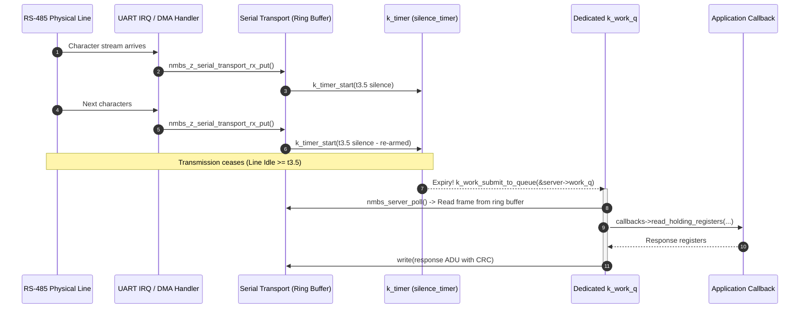
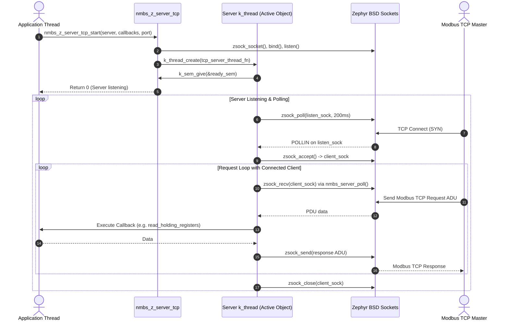

# nanoMODBUS on Zephyr RTOS — System Architecture

This document provides a comprehensive architectural analysis of the **nanoMODBUS Zephyr Module**. It details the system layering, component classification, clean architecture boundaries, concurrency models, and memory architecture.

---

## 1. High-Level System Overview

The nanoMODBUS Zephyr integration brings an ultra-compact, deterministic Modbus protocol engine to the Zephyr RTOS ecosystem. It supports both **Modbus RTU** (over UART/RS-485) and **Modbus TCP** (over Zephyr BSD sockets) across client and server roles.

---

## 2. Clean Architecture & Ports and Adapters Analysis

The architecture enforces strict separation of concerns following **Clean Architecture** and **Ports & Adapters (Hexagonal Architecture)**. The upstream protocol core acts as the hexagon interior (domain/application logic), while the Zephyr modules serve as adapters plugging into the core's abstract ports.

### 2.1 Component Classification Taxonomy

Every source file in the repository conforms to a single classification category:

| Taxonomy Category | File / Path | Responsibility & Constraints |
|:---|:---|:---|
| **Domain / Use Case** | [`nanomodbus.c`](file:///media/jeffry/jqb/GitHub/nanoMODBUS/nanomodbus.c), [`nanomodbus.h`](file:///media/jeffry/jqb/GitHub/nanoMODBUS/nanomodbus.h) | Pure ISO C99 Modbus protocol logic. ADU/PDU packing/unpacking, CRC-16 generation, table limits, exception responses. **Zero OS dependencies.** |
| **Interface** | [`zephyr/include/zephyr/nanomodbus/nanomodbus_z.h`](file:///media/jeffry/jqb/GitHub/nanoMODBUS/zephyr/include/zephyr/nanomodbus/nanomodbus_z.h), [`nanomodbus_z_serial.h`](file:///media/jeffry/jqb/GitHub/nanoMODBUS/zephyr/include/zephyr/nanomodbus/nanomodbus_z_serial.h), [`nanomodbus_z_tcp.h`](file:///media/jeffry/jqb/GitHub/nanoMODBUS/zephyr/include/zephyr/nanomodbus/nanomodbus_z_tcp.h) | Public API contracts, configuration structs, callback function prototypes, error enum definitions. Header-only contracts. |
| **Service / Middleware** | [`zephyr/src/nanomodbus_z_common.c`](file:///media/jeffry/jqb/GitHub/nanoMODBUS/zephyr/src/nanomodbus_z_common.c) | System-wide utilities: bidirectional mapping between `nmbs_error` enums and standard negative POSIX `errno` codes. |
| **Active Object** | [`zephyr/src/nanomodbus_z_server_tcp.c`](file:///media/jeffry/jqb/GitHub/nanoMODBUS/zephyr/src/nanomodbus_z_server_tcp.c) | Autonomous server thread (`k_thread`) encapsulating TCP socket polling, incoming client connections, and Modbus request loops. |
| **Event-Driven Server** | [`zephyr/src/nanomodbus_z_server_rtu.c`](file:///media/jeffry/jqb/GitHub/nanoMODBUS/zephyr/src/nanomodbus_z_server_rtu.c) | Asynchronous Modbus RTU server engine driven by character silence timeouts (`k_timer`) offloaded to a dedicated workqueue (`k_work_q`). |
| **Adapter** | [`zephyr/src/nanomodbus_z_client.c`](file:///media/jeffry/jqb/GitHub/nanoMODBUS/zephyr/src/nanomodbus_z_client.c), [`nanomodbus_z_transport_serial.c`](file:///media/jeffry/jqb/GitHub/nanoMODBUS/zephyr/src/nanomodbus_z_transport_serial.c), [`nanomodbus_z_transport_tcp.c`](file:///media/jeffry/jqb/GitHub/nanoMODBUS/zephyr/src/nanomodbus_z_transport_tcp.c) | Adapters binding Zephyr OS primitives (kernel mutexes, ring buffers, UART drivers, BSD sockets) to nanoMODBUS core transport callbacks. |
| **Driver / BSP** | `samples/*/boards/nucleo_h743zi.overlay`, `samples/*/prj.conf` | Hardware pinmuxing, peripheral clock assignment, RS-485 DE GPIO specifications, devicetree aliases. |

### 2.2 The Golden Invariant

> [!IMPORTANT]
> **The Golden Invariant: ZERO Vendor / OS Headers in the Core**
> The upstream files [`nanomodbus.c`](file:///media/jeffry/jqb/GitHub/nanoMODBUS/nanomodbus.c) and [`nanomodbus.h`](file:///media/jeffry/jqb/GitHub/nanoMODBUS/nanomodbus.h) MUST NEVER include `<zephyr/...>` headers, CMSIS, HAL, or vendor headers (e.g., `stm32*.h`, `nrf_*.h`). The core includes only `<stdbool.h>`, `<stdint.h>`, and standard C library headers.

All OS awareness and hardware interactions are strictly isolated in `zephyr/`:
- **Inward Dependency Direction**: `zephyr/` depends on `nanomodbus.h`; `nanomodbus.h` has zero knowledge of Zephyr.
- **Dependency Inversion via Function Pointers**: The core communicates with physical transport layers strictly via [`nmbs_platform_conf`](file:///media/jeffry/jqb/GitHub/nanoMODBUS/nanomodbus.h#L161-L172) callback function pointers (`read`, `write`, `flush`, `crc_calc`, `arg`).

```mermaid
flowchart LR
    subgraph INFRA["Infrastructure Layer (Zephyr RTOS)"]
        direction TB
        Z_UART["Zephyr UART Driver"]
        Z_NET["Zephyr BSD Sockets"]
        Z_MUTEX["Zephyr k_mutex"]
    end

    subgraph ADAPTERS["Adapters Layer (zephyr/src/)"]
        direction TB
        A_SER["Serial Adapter (nanomodbus_z_transport_serial.c)"]
        A_TCP["TCP Adapter (nanomodbus_z_transport_tcp.c)"]
        A_CLI["Client Adapter (nanomodbus_z_client.c)"]
    end

    subgraph INTERFACES["Interface Ports (Public Headers)"]
        direction TB
        I_PORT["Transport Port (nmbs_platform_conf)"]
        I_API["Zephyr Public API (nanomodbus_z*.h)"]
    end

    subgraph CORE_DOMAIN["Domain Core (nanomodbus.c / nanomodbus.h)"]
        direction TB
        NMBS_ENGINE["Protocol State Machine & PDU Validation"]
    end

    INFRA --> ADAPTERS
    ADAPTERS --> INTERFACES
    INTERFACES --> CORE_DOMAIN
```

---

## 3. Multi-Instance Support & State Isolation

A core architectural tenet of nanoMODBUS on Zephyr is **zero singleton pattern** and **zero mutable global state**:

1. **Caller-Owned Structs**:
   - Callers instantiate and own all context structures: [`nmbs_z_client_t`](file:///media/jeffry/jqb/GitHub/nanoMODBUS/zephyr/include/zephyr/nanomodbus/nanomodbus_z.h#L173-L180), [`nmbs_z_server_rtu_t`](file:///media/jeffry/jqb/GitHub/nanoMODBUS/zephyr/include/zephyr/nanomodbus/nanomodbus_z_serial.h#L247-L260), [`nmbs_z_server_tcp_t`](file:///media/jeffry/jqb/GitHub/nanoMODBUS/zephyr/include/zephyr/nanomodbus/nanomodbus_z_tcp.h#L93-L107), and [`nmbs_z_serial_transport_t`](file:///media/jeffry/jqb/GitHub/nanoMODBUS/zephyr/include/zephyr/nanomodbus/nanomodbus_z_serial.h#L115-L132).
   - There are no static file-scope client/server pointers or shared global buffers.
2. **Instance Isolation**:
   - Each instance contains its own core state machine ([`nmbs_t`](file:///media/jeffry/jqb/GitHub/nanoMODBUS/nanomodbus.h#L248-L271)), private request/response buffer (`msg.buf[260]`), private configuration, and dedicated synchronization primitives.
   - Faults or buffer overruns in one instance cannot corrupt neighboring instances.
3. **Multi-Bus Gateway Topology**:
   - The [`samples/modbus_gateway`](file:///media/jeffry/jqb/GitHub/nanoMODBUS/samples/modbus_gateway) demonstrator validates this architecture: an active TCP server bridges requests across two physically distinct RS-485 UART buses (`&usart2` and `&uart4`), each running an independent `nmbs_z_client_t` instance simultaneously without data aliasing.

---

## 4. Zephyr Concurrency Models

nanoMODBUS provides three tailored concurrency architectures matching the operational characteristics of Modbus clients, serial RTU servers, and Ethernet TCP servers.

### 4.1 Client Concurrency: Mutex-Wrapped Synchronous Execution

The Modbus Client ([`nmbs_z_client.c`](file:///media/jeffry/jqb/GitHub/nanoMODBUS/zephyr/src/nanomodbus_z_client.c)) executes synchronously in the context of the calling thread:

- **Locking Mechanism**: Every public API operation (e.g., [`nmbs_z_client_read_holding_registers`](file:///media/jeffry/jqb/GitHub/nanoMODBUS/zephyr/src/nanomodbus_z_client.c#L120-L149)) locks an internal [`struct k_mutex lock`](file:///media/jeffry/jqb/GitHub/nanoMODBUS/zephyr/include/zephyr/nanomodbus/nanomodbus_z.h#L174) with a caller-specified timeout (`k_timeout_t lock_timeout`).
- **Priority Inheritance**: By leveraging Zephyr's native `k_mutex`, priority inversion is mitigated when high-priority sensor threads contend with lower-priority telemetry threads.
- **Error Preservation**: Because POSIX errno mappings cannot distinguish between specific Modbus exception codes (e.g., Exception 01 vs 02 vs 03), each operation records the raw [`nmbs_error`](file:///media/jeffry/jqb/GitHub/nanoMODBUS/nanomodbus.h#L56-L73) in `client->last_error` while the lock is held, retrievable via [`nmbs_z_client_get_last_error()`](file:///media/jeffry/jqb/GitHub/nanoMODBUS/zephyr/src/nanomodbus_z_client.c#L44-L51).

### 4.2 RTU Server Concurrency: Event-Driven (`k_timer` + `k_work_q`)

The Modbus RTU Server ([`nmbs_z_server_rtu.c`](file:///media/jeffry/jqb/GitHub/nanoMODBUS/zephyr/src/nanomodbus_z_server_rtu.c)) does NOT burn an OS thread in a continuous polling loop. Instead, it employs an event-driven architecture based on Modbus serial line silence timing:

1. **Hardware UART Ingestion**: Incoming characters arrive via UART IRQ or Async DMA and are placed into the ring buffer via [`nmbs_z_serial_transport_rx_put()`](file:///media/jeffry/jqb/GitHub/nanoMODBUS/zephyr/src/nanomodbus_z_transport_serial.c#L592-L642).
2. **Silence Timer Reset**: Every received chunk re-arms a high-resolution one-shot timer ([`struct k_timer silence_timer`](file:///media/jeffry/jqb/GitHub/nanoMODBUS/zephyr/include/zephyr/nanomodbus/nanomodbus_z_serial.h#L251)) programmed to the Modbus $t_{3.5}$ frame silence interval.
3. **Work Submission**: When $t_{3.5}$ expires with no further characters arriving, [`on_silence_timer_expired()`](file:///media/jeffry/jqb/GitHub/nanoMODBUS/zephyr/src/nanomodbus_z_server_rtu.c#L20-L37) submits [`struct k_work work`](file:///media/jeffry/jqb/GitHub/nanoMODBUS/zephyr/include/zephyr/nanomodbus/nanomodbus_z_serial.h#L252) to a dedicated server workqueue ([`struct k_work_q work_q`](file:///media/jeffry/jqb/GitHub/nanoMODBUS/zephyr/include/zephyr/nanomodbus/nanomodbus_z_serial.h#L253)).
4. **Execution in Workqueue Thread**: [`on_server_work()`](file:///media/jeffry/jqb/GitHub/nanoMODBUS/zephyr/src/nanomodbus_z_server_rtu.c#L39-L60) executes [`nmbs_server_poll()`](file:///media/jeffry/jqb/GitHub/nanoMODBUS/nanomodbus.h#L328) on the dedicated workqueue thread (`CONFIG_NANOMODBUS_SERVER_RTU_WQ_PRIORITY`), invoking application callbacks and transmitting the Modbus response.

### 4.3 TCP Server Concurrency: Active Object Pattern

The Modbus TCP Server ([`nmbs_z_server_tcp.c`](file:///media/jeffry/jqb/GitHub/nanoMODBUS/zephyr/src/nanomodbus_z_server_tcp.c)) implements the **Active Object Pattern**:

- **Dedicated Thread**: Owns an autonomous listener thread ([`struct k_thread thread`](file:///media/jeffry/jqb/GitHub/nanoMODBUS/zephyr/include/zephyr/nanomodbus/nanomodbus_z_tcp.h#L101)) with its own embedded stack buffer ([`K_KERNEL_STACK_MEMBER(thread_stack, ...)` ](file:///media/jeffry/jqb/GitHub/nanoMODBUS/zephyr/include/zephyr/nanomodbus/nanomodbus_z_tcp.h#L102)).
- **Socket Polling Loop**: The thread executes [`tcp_server_thread_fn()`](file:///media/jeffry/jqb/GitHub/nanoMODBUS/zephyr/src/nanomodbus_z_server_tcp.c#L14-L144), using non-blocking `zsock_poll()` with a 200 ms timeout to allow clean termination when `atomic_get(&server->running)` becomes false.
- **Connection Processing**: Accepts incoming client connections. Once a connection is established, it runs an inner request loop with [`nmbs_server_poll()`](file:///media/jeffry/jqb/GitHub/nanoMODBUS/nanomodbus.h#L328) until the client disconnects or times out.
- **Synchronization Handshakes**: Uses [`ready_sem`](file:///media/jeffry/jqb/GitHub/nanoMODBUS/zephyr/include/zephyr/nanomodbus/nanomodbus_z_tcp.h#L105) to signal successful bind/listen to the caller of `nmbs_z_server_tcp_start()`, and [`stop_sem`](file:///media/jeffry/jqb/GitHub/nanoMODBUS/zephyr/include/zephyr/nanomodbus/nanomodbus_z_tcp.h#L104) to cleanly join thread exit during `nmbs_z_server_tcp_stop()`.

---

## 5. Memory Architecture & Determinism

nanoMODBUS guarantees zero dynamic memory allocation and hard real-time determinism:

### 5.1 Zero Heap Allocation (`malloc`/`k_malloc` = 0)

Neither the upstream core nor the Zephyr integration layer invokes `malloc()`, `k_malloc()`, `k_heap_alloc()`, or memory pool allocators. All memory structures are statically sized and allocated at compile time or caller scope:

- **Core Context Footprint**: The central [`struct nmbs_t`](file:///media/jeffry/jqb/GitHub/nanoMODBUS/nanomodbus.h#L248-L271) requires **~344 bytes**, which includes the 260-byte static request/response message buffer (`uint8_t buf[260]`), callback pointers, and configuration state.
- **Serial Transport Context**: [`struct nmbs_z_serial_transport`](file:///media/jeffry/jqb/GitHub/nanoMODBUS/zephyr/include/zephyr/nanomodbus/nanomodbus_z_serial.h#L115-L132) embeds the primary RX ring buffer ([`uint8_t rx_buffer[260]`](file:///media/jeffry/jqb/GitHub/nanoMODBUS/zephyr/include/zephyr/nanomodbus/nanomodbus_z_serial.h#L118)) and two ping-pong DMA buffers ([`uint8_t async_rx_buffer[2][128]`](file:///media/jeffry/jqb/GitHub/nanoMODBUS/zephyr/include/zephyr/nanomodbus/nanomodbus_z_serial.h#L127)), totaling **~640 bytes**.
- **RTU Server Context**: [`struct nmbs_z_server_rtu`](file:///media/jeffry/jqb/GitHub/nanoMODBUS/zephyr/include/zephyr/nanomodbus/nanomodbus_z_serial.h#L247-L260) embeds the workqueue thread stack ([`K_KERNEL_STACK_MEMBER(work_q_stack, 1024)`](file:///media/jeffry/jqb/GitHub/nanoMODBUS/zephyr/include/zephyr/nanomodbus/nanomodbus_z_serial.h#L254)), totaling **~2.1 KB RAM**.
- **TCP Server Context**: [`struct nmbs_z_server_tcp`](file:///media/jeffry/jqb/GitHub/nanoMODBUS/zephyr/include/zephyr/nanomodbus/nanomodbus_z_tcp.h#L93-L107) embeds the listener thread stack ([`K_KERNEL_STACK_MEMBER(thread_stack, 2048)`](file:///media/jeffry/jqb/GitHub/nanoMODBUS/zephyr/include/zephyr/nanomodbus/nanomodbus_z_tcp.h#L102)), totaling **~2.8 KB RAM**.

### 5.2 Determinism & Safety Benefits

| Architectural Property | nanoMODBUS on Zephyr | Benefit for Embedded & Safety Systems |
|:---|:---|:---|
| **Dynamic Allocation** | None (`k_malloc` count = 0) | Eliminates heap fragmentation, memory leaks, and out-of-memory crashes. |
| **Stack Determinism** | Fixed per-subsystem stack sizes | Predictable stack utilization verifiable via Zephyr stack analysis tools (`CONFIG_STACK_SENTINEL=y`, `CONFIG_THREAD_ANALYZER=y`). |
| **Buffer Overflow Protection** | Strict bounds checking on all ring buffers and PDU indices | Prevents remote arbitrary code execution via malformed Modbus frame lengths. |
| **Execution Predictability** | Fixed instruction-path table dispatch | Low jitter response times essential for industrial automation and SCADA integration. |
