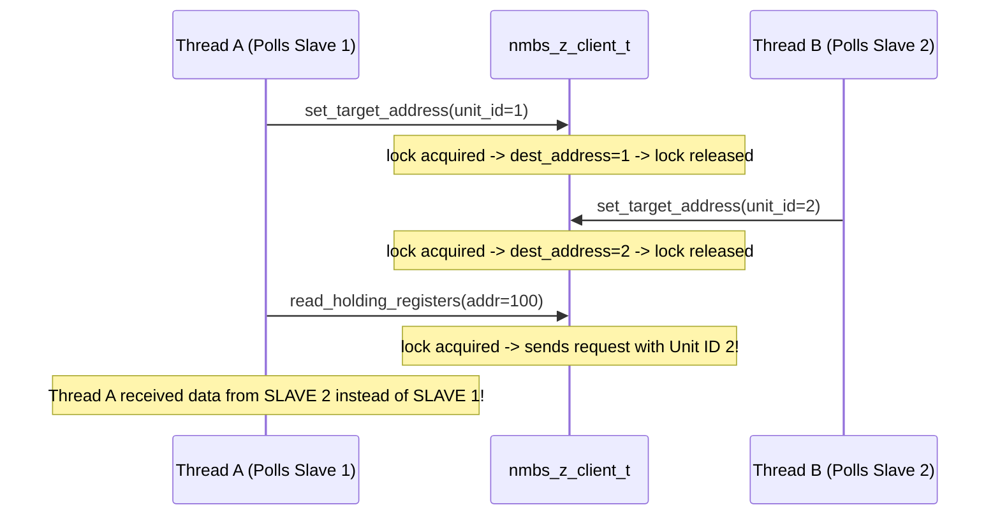
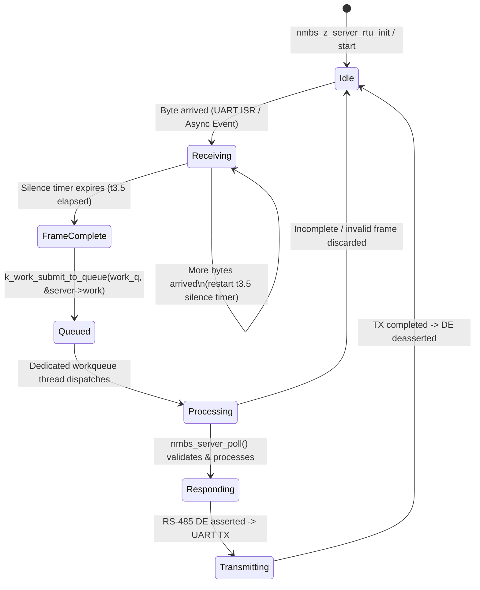
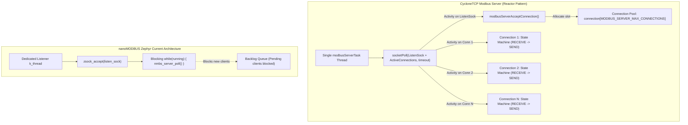

# Concurrency Models, State Machines & Cyclone Comparison

## 1. Concurrency Models in nanoMODBUS for Zephyr

nanoMODBUS for Zephyr implements three distinct threading and execution patterns:

### 1.1 Client Concurrency Model: Synchronous Mutex Facade
- **Execution Context**: The Modbus transaction executes entirely in the **context of the calling thread**.
- **Synchronization**: Protected by a Zephyr mutex (`struct k_mutex lock` in `nmbs_z_client_t`).
- **Lifecycle**:
  1. Thread calls `nmbs_z_client_read_holding_registers(...)`.
  2. Acquires `k_mutex` (with caller-defined `lock_timeout`).
  3. Formats request, flushes stale transport bytes, transmits PDU.
  4. Blocks on `platform.read()` until response PDU is received or timeout occurs.
  5. Stores raw Modbus error/exception in `client->last_error`.
  6. Releases `k_mutex`.
  7. Translates `nmbs_error` to negative POSIX errno (`-ETIMEDOUT`, `-EBADMSG`, etc.).

#### Critical Concurrency Flaw: Decoupled Target Address Race Condition
Currently, the client API exposes:
```c
int nmbs_z_client_set_target_address(nmbs_z_client_t *client, uint8_t unit_id, k_timeout_t timeout);
```
This acquires the mutex, sets `client->core.dest_address_rtu = unit_id`, and releases the mutex.

**The Race Condition**:

**Architectural Remedy**: Provide atomic request APIs that accept `unit_id` directly per-request, setting `core.dest_address_rtu` within the single mutex critical section of the call.

---

### 1.2 Server RTU Concurrency Model: Reactive Silence Timer & Dedicated Workqueue
The RTU Server operates entirely without a polling thread, using an event-driven hardware interrupt + timer architecture:



- **Silence Detection**:
  - For baud rates $\le 19200$: $t_{1.5} = 16.5 / \text{baud}$, $t_{3.5} = 38.5 / \text{baud}$.
  - For baud rates $> 19200$: $t_{1.5} = 750\,\mu\text{s}$, $t_{3.5} = 1750\,\mu\text{s}$.
  - A gap $> t_{1.5}$ between characters resets the receiver ring buffer (frame aborted as noise/resync).
  - A silence $\ge t_{3.5}$ marks frame termination, triggering `on_silence_timer_expired()`.
- **Workqueue Offload**:
  - Request processing does NOT execute in ISR context.
  - Offloaded to a dedicated workqueue (`k_work_q`) with configurable stack (`CONFIG_NANOMODBUS_SERVER_RTU_WQ_STACK_SIZE`, default 1024 bytes) and priority (`CONFIG_NANOMODBUS_SERVER_RTU_WQ_PRIORITY`, default 5).
  - System workqueue (`k_sys_work_q`) is untouched, preventing priority inversion.

---

### 1.3 Server TCP Concurrency Model: Dedicated Active Object Thread
- **Execution Context**: An independent Zephyr thread (`k_thread`) embedded inside `nmbs_z_server_tcp_t`.
- **Stack**: Statically allocated via `K_KERNEL_STACK_MEMBER(thread_stack, CONFIG_NANOMODBUS_SERVER_TCP_STACK_SIZE)` inside the server struct.
- **Current Limitation (Single Client Sequential Model)**:
  - The thread polls `listen_sock` with `zsock_poll(..., 200 ms)`.
  - When a connection arrives, it calls `zsock_accept()`.
  - It then enters a synchronous request loop:
    ```c
    while (atomic_get(&server->running)) {
        nmbs_error err = nmbs_server_poll(&server->core);
        if (err == NMBS_ERROR_NONE || err == NMBS_ERROR_TIMEOUT) continue;
        break; // Disconnected or transport error
    }
    ```
  - **Bottleneck**: While Client 1 is connected, Client 2 sits in the listen backlog queue (`CONFIG_NANOMODBUS_SERVER_TCP_BACKLOG`). If Client 1 maintains a persistent TCP session, Client 2 is starved indefinitely.

---

## 2. Comparison with Cyclone's Event-Driven Multi-Connection Architecture

In `/home/jeffry/Descargas/CycloneTCP_SSL_SSH_IPSEC_EAP_CRYPTO_Open_2_6_6/cyclone_tcp/modbus/`, Oryx Embedded implements an industrial multi-client Modbus TCP engine:



### 2.1 Deep Comparative Matrix: Concurrency & State Handling

| Architectural Dimension | nanoMODBUS (Current Zephyr Module) | CycloneTCP Modbus/TCP | Impact & Evaluation |
|---|---|---|---|
| **Server Concurrency Pattern** | Thread-per-Server, Single-Client Blocking Loop | Reactor Pattern with `socketPoll()` multiplexer | Cyclone serves multiple concurrent clients from 1 thread. nanoMODBUS starves pending clients. |
| **Max Concurrent TCP Clients** | 1 client per `nmbs_z_server_tcp_t` instance | Configurable (`MODBUS_SERVER_MAX_CONNECTIONS`, default 2) | Major gap for industrial SCADA + local HMI simultaneous access. |
| **RAM Footprint for Multi-Client** | Requires multiple server instances (each needs 2 KB stack + core) | 1 thread stack (~650 words) + connection structs (~520 bytes each) | Cyclone is much more RAM-efficient for 2–4 clients. |
| **Connection State Tracking** | Implicit inside socket read/write blocking calls | Explicit enum: `CLOSED`, `CONNECT_TLS`, `RECEIVE`, `SEND`, `SHUTDOWN` | Cyclone state machine handles packet fragmentation and partial sends deterministically. |
| **Atomic Table Locking** | None (callbacks called directly without synchronization) | `lockCallback()` & `unlockCallback()` around each transaction | Cyclone prevents data races if application threads update registers concurrently. |
| **Write Atomicity (Rollback)** | Callbacks execute step-by-step; no commit phase | Callbacks receive `bool_t commit` flag | In Cyclone, multi-register writes can be rolled back if validation fails mid-packet. |
| **Security (TLS)** | Not supported | Secure Modbus/TCP (Port 802, TLS 1.2/1.3, Client Role X.509 OID check) | Cyclone complies with Modbus Security Specification. |
| **RTU Server Concurrency** | Dedicated `k_work_q` + `k_timer` (Hardware-timed, event-driven) | Cyclone does not offer an official RTU serial server in TCP stack | nanoMODBUS RTU implementation on Zephyr is superior in hardware RTU timing and zero-CPU idle. |
