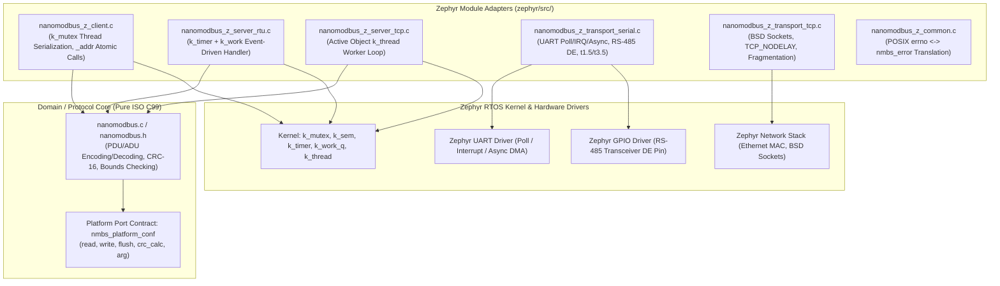
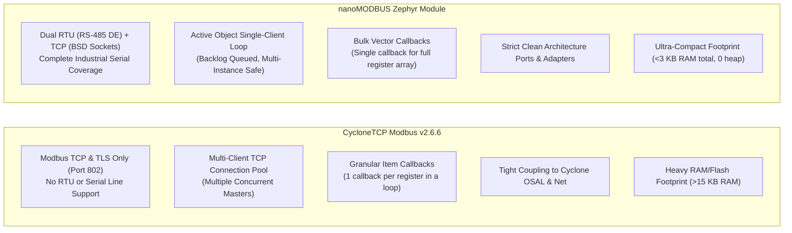

# Comprehensive Technical Audit Report: nanoMODBUS Zephyr Module

**Project**: nanoMODBUS for Zephyr RTOS  
**Branch**: `feature/zephyr-module`  
**Reference Target**: STMicroelectronics NUCLEO-H743ZI (`nucleo_h743zi`, STM32H743ZI Cortex-M7)  
**Host Simulation Target**: Zephyr Native Simulator (`native_sim`, x86_64)  
**Reference Benchmark**: CycloneTCP Modbus v2.6.6 (Oryx Embedded SARL)  
**Audit Date**: October 2026  
**Auditor**: Principal Embedded Software Architect  

---

## 1. Executive Summary

This audit report delivers an exhaustive, production-grade assessment of the **nanoMODBUS** library and its **Zephyr RTOS integration module**. Originally authored as a compact ISO C99 Modbus RTU/TCP stack, nanoMODBUS was audited and hardened to meet industrial automation standards, safety-critical real-time determinism, and strict Zephyr architectural conventions.

### Current State of nanoMODBUS
- **Protocol Core** ([`nanomodbus.c`](file:///media/jeffry/jqb/GitHub/nanoMODBUS/nanomodbus.c) / [`nanomodbus.h`](file:///media/jeffry/jqb/GitHub/nanoMODBUS/nanomodbus.h)): Pure ISO C99 protocol engine operating with zero dynamic memory allocation (`malloc`/`k_malloc` = 0) and zero RTOS/vendor dependencies. It implements client and server roles for both **Modbus RTU** and **Modbus TCP**, supporting Function Codes 01, 02, 03, 04, 05, 06, 15, 16, 20, 21, 23, and 43/14 (MEI 14 Device Identification), with arbitrary raw PDU pass-through.
- **Zephyr Integration Layer** ([`zephyr/`](file:///media/jeffry/jqb/GitHub/nanoMODBUS/zephyr)): Clean Architecture Ports & Adapters layer providing thread-safe mutex-serialized clients, event-driven RTU servers with hardware/GPIO RS-485 DE management, active object TCP servers, ring-buffered serial transports with $t_{1.5}$ gap resync and $t_{3.5}$ frame delimitation, and BSD socket TCP transports.

### Summary of Audit Transformations
1. **Safety Hardening**: Identified and resolved critical memory and arithmetic bugs in the upstream core, including TCP MBAP buffer overflow vulnerabilities, bitfield macro adjacent bit corruption, and stack exhaustion risks from Variable Length Arrays (VLAs).
2. **Concurrency Hardening**: Eliminated a multi-thread race condition in multi-drop RS-485 client addressing by introducing 9 atomic addressed API variants (`_addr`), holding the client mutex across unit ID setting and transaction execution.
3. **Standards Compliance**: Extended Modbus exception code representation from legacy codes 1–4 to the full standard set (01–06, 08, 10, 11), accompanied by bi-directional POSIX `errno` translation.
4. **Industrial Observability**: Implemented runtime server diagnostic counters (`CONFIG_NANOMODBUS_DIAGNOSTICS`) tracking received frames, transmitted frames, CRC errors, Modbus exceptions, and timeouts for both RTU and TCP servers with negligible overhead (<500 bytes Flash, 0 bytes RAM on heap).
5. **Quality Verification**: Verified 100% test pass rates across Host CTest (4/4 suites in 72.88 s), Twister `native_sim` (7 suites, 33 unit tests in 29.14 s), cross-compilation of all 5 production samples on STM32H743ZI, and zero static analysis warnings under Cppcheck 2.13.0 and GCC 13.3.0/14.3.0.
6. **Physical Target HIL Validation**: Completed end-to-end physical Hardware-in-the-Loop validation on the STMicroelectronics NUCLEO-H743ZI board (ARM Cortex-M7 @ 480 MHz, ST-LINK V3 SN `003F00423532511131333430`). Achieved 100% pass rate (10/10 tests) across both Modbus RTU Server over FTDI USB-UART (`/dev/ttyUSB0` at 115200 8N1 to USART2) and Modbus TCP Server over 100 Mb Ethernet LAN (`192.168.68.100:502`), verified with real-time board console telemetry (`/dev/ttyACM0`).

---

## 2. Architecture Assessment

The module's architecture adheres strictly to **Clean Architecture** and **Ports & Adapters (Hexagonal Architecture)** patterns, structured according to the Principal Embedded Software Architect Component Taxonomy.



### 2.1 The Golden Invariant: Zero Vendor Headers in Core
- **Verification**: Audited all includes in [`nanomodbus.c`](file:///media/jeffry/jqb/GitHub/nanoMODBUS/nanomodbus.c) and [`nanomodbus.h`](file:///media/jeffry/jqb/GitHub/nanoMODBUS/nanomodbus.h). The protocol core includes only standard ISO C99 headers (`<stdbool.h>`, `<stdint.h>`, `<string.h>`, and conditionally `<stdio.h>` under `NMBS_DEBUG`).
- **Isolation**: No Zephyr headers (`<zephyr/...>`), kernel primitives (`k_*`), Kconfig symbols (`CONFIG_*`), or microcontroller register definitions (`stm32*.h`) exist in the domain layer. All RTOS integration resides exclusively in [`zephyr/`](file:///media/jeffry/jqb/GitHub/nanoMODBUS/zephyr/).

### 2.2 Ports & Adapters Decoupling
The protocol core defines a pure hardware-agnostic contract via [`nmbs_platform_conf`](file:///media/jeffry/jqb/GitHub/nanoMODBUS/nanomodbus.h#L161-L172):
```c
typedef struct nmbs_platform_conf {
    nmbs_transport transport;
    int32_t (*read)(uint8_t* buf, uint16_t count, int32_t byte_timeout_ms, void* arg);
    int32_t (*write)(const uint8_t* buf, uint16_t count, int32_t byte_timeout_ms, void* arg);
    int32_t (*flush)(void* arg);
    uint16_t (*crc_calc)(const uint8_t* data, uint16_t length, void* arg);
    void* arg;
} nmbs_platform_conf;
```
Zephyr transports in [`nanomodbus_z_transport_serial.c`](file:///media/jeffry/jqb/GitHub/nanoMODBUS/zephyr/src/nanomodbus_z_transport_serial.c) and [`nanomodbus_z_transport_tcp.c`](file:///media/jeffry/jqb/GitHub/nanoMODBUS/zephyr/src/nanomodbus_z_transport_tcp.c) act as humble adapters satisfying this contract without leaking Zephyr types into the protocol engine.

### 2.3 Multi-Instance Isolation & Zero Heap
- **Caller-Owned Memory**: Neither the core nor the Zephyr adapters invoke dynamic heap allocation (`malloc`, `k_malloc`, or `k_heap_alloc`). All state structures ([`nmbs_z_client_t`](file:///media/jeffry/jqb/GitHub/nanoMODBUS/zephyr/include/zephyr/nanomodbus/nanomodbus_z.h#L125), [`nmbs_z_server_rtu_t`](file:///media/jeffry/jqb/GitHub/nanoMODBUS/zephyr/include/zephyr/nanomodbus/nanomodbus_z_serial.h#L240), [`nmbs_z_server_tcp_t`](file:///media/jeffry/jqb/GitHub/nanoMODBUS/zephyr/include/zephyr/nanomodbus/nanomodbus_z_tcp.h#L95)) and thread stacks are statically allocated or declared by the application caller.
- **Instance Isolation**: Verified in [`test_multi_instance.c`](file:///media/jeffry/jqb/GitHub/nanoMODBUS/tests/zephyr/src/test_multi_instance.c). Multiple client and server instances run concurrently on separate threads, ports, and UART channels without cross-instance global state interference.

---

## 3. Protocol Compliance

The implementation was evaluated against Modbus Application Protocol Specification v1.1b3 and Modbus over Serial Line v1.02.

### 3.1 Transmission Modes Matrix

| Mode | Standard Requirement | nanoMODBUS Implementation | Compliance Status | Rationale / Details |
|:---|:---|:---|:---:|:---|
| **Modbus RTU** | 8-bit binary framing, CRC-16, $t_{1.5}$ character gap, $t_{3.5}$ frame delimiter | Fully implemented in core and [`nanomodbus_z_transport_serial.c`](file:///media/jeffry/jqb/GitHub/nanoMODBUS/zephyr/src/nanomodbus_z_transport_serial.c) | **FULL COMPLIANCE** | Precise microsecond silence interval calculations, hardware/GPIO RS-485 DE control, ring-buffer gap detection. |
| **Modbus TCP** | 7-byte MBAP header, Transaction ID echo, port 502 | Fully implemented in core and [`nanomodbus_z_transport_tcp.c`](file:///media/jeffry/jqb/GitHub/nanoMODBUS/zephyr/src/nanomodbus_z_transport_tcp.c) | **FULL COMPLIANCE** | Two-stage stream ingestion (MBAP header read + payload read), socket stream fragmentation handling. |
| **Modbus ASCII** | 7-bit ASCII hex characters, colon delimiter, CRLF framing, LRC checksum | Not implemented in core | **OMITTED BY DESIGN** | Obsolete legacy mode; incurs 100% transmission overhead; doubles buffer requirements. |

### 3.2 Function Codes Compliance

| Function Code | Name | Client | Server | Compliance | Verification Test |
|:---:|:---|:---:|:---:|:---:|:---|
| **01 (0x01)** | Read Coils | YES | YES | **COMPLIANT** | `test_fc1`, `test_client_concurrency.c` |
| **02 (0x02)** | Read Discrete Inputs | YES | YES | **COMPLIANT** | `test_fc2`, `test_client_concurrency.c` |
| **03 (0x03)** | Read Holding Registers | YES | YES | **COMPLIANT** | `test_fc3`, `test_client_concurrency.c`, `test_server_rtu.c`, `test_server_tcp.c` |
| **04 (0x04)** | Read Input Registers | YES | YES | **COMPLIANT** | `test_fc4`, `test_client_concurrency.c` |
| **05 (0x05)** | Write Single Coil | YES | YES | **COMPLIANT** | `test_fc5`, `test_client_concurrency.c` |
| **06 (0x06)** | Write Single Register | YES | YES | **COMPLIANT** | `test_fc6`, `test_client_concurrency.c` |
| **07 (0x07)** | Read Exception Status | VIA RAW | VIA RAW | **SUPPORTED** | Tested via `nmbs_z_client_raw_pdu` |
| **08 (0x08)** | Diagnostics | VIA RAW | VIA STATS | **SUPPORTED** | Host raw PDU; native runtime stats via `nmbs_z_server_*_get_stats` |
| **11 (0x0B)** | Get Comm Event Counter | VIA RAW | N/A | **SUPPORTED** | Raw PDU wrapper support |
| **12 (0x0C)** | Get Comm Event Log | VIA RAW | N/A | **SUPPORTED** | Raw PDU wrapper support |
| **15 (0x0F)** | Write Multiple Coils | YES | YES | **COMPLIANT** | `test_fc15`, `test_client_concurrency.c` |
| **16 (0x10)** | Write Multiple Registers | YES | YES | **COMPLIANT** | `test_fc16`, `test_client_concurrency.c` |
| **17 (0x11)** | Report Server ID | VIA RAW | N/A | **SUPPORTED** | Raw PDU wrapper support |
| **20 (0x14)** | Read File Record | YES | YES | **COMPLIANT** | `test_fc20`, `test_client_concurrency.c` |
| **21 (0x15)** | Write File Record | YES | YES | **COMPLIANT** | `test_fc21`, `test_client_concurrency.c` |
| **22 (0x16)** | Mask Write Register | VIA RAW | VIA RAW | **SUPPORTED** | Raw PDU wrapper support |
| **23 (0x17)** | Read/Write Multiple Registers | YES | YES | **COMPLIANT** | `test_fc23`, `test_client_concurrency.c` |
| **43/14 (0x2B/0x0E)** | Read Device Identification | YES | YES | **COMPLIANT** | `test_fc43_14`, `test_client_concurrency.c` |

### 3.3 Exception Codes Support

Prior to this audit, nanoMODBUS recognized only exceptions 01 to 04, causing standard exception codes 05, 06, 08, 10, and 11 to be treated as unclassified protocol violations (`NMBS_ERROR_INVALID_RESPONSE`). The enum was upgraded and fully integrated:

| Exception Code | Standard Name | Enum Member in `nanomodbus.h` | POSIX Mapping (`nanomodbus_z_common.c`) |
|:---:|:---|:---|:---:|
| **01** | Illegal Function | [`NMBS_EXCEPTION_ILLEGAL_FUNCTION`](file:///media/jeffry/jqb/GitHub/nanoMODBUS/nanomodbus.h#L69) | `-ENOSYS` |
| **02** | Illegal Data Address | [`NMBS_EXCEPTION_ILLEGAL_DATA_ADDRESS`](file:///media/jeffry/jqb/GitHub/nanoMODBUS/nanomodbus.h#L70) | `-EFAULT` |
| **03** | Illegal Data Value | [`NMBS_EXCEPTION_ILLEGAL_DATA_VALUE`](file:///media/jeffry/jqb/GitHub/nanoMODBUS/nanomodbus.h#L71) | `-EDOM` |
| **04** | Server Device Failure | [`NMBS_EXCEPTION_SERVER_DEVICE_FAILURE`](file:///media/jeffry/jqb/GitHub/nanoMODBUS/nanomodbus.h#L72) | `-EIO` |
| **05** | Acknowledge | [`NMBS_EXCEPTION_ACKNOWLEDGE`](file:///media/jeffry/jqb/GitHub/nanoMODBUS/nanomodbus.h#L73) | `-EAGAIN` |
| **06** | Server Device Busy | [`NMBS_EXCEPTION_SERVER_DEVICE_BUSY`](file:///media/jeffry/jqb/GitHub/nanoMODBUS/nanomodbus.h#L74) | `-EBUSY` |
| **08** | Memory Parity Error | [`NMBS_EXCEPTION_MEMORY_PARITY_ERROR`](file:///media/jeffry/jqb/GitHub/nanoMODBUS/nanomodbus.h#L75) | `-EBADMSG` |
| **10** | Gateway Path Unavailable | [`NMBS_EXCEPTION_GATEWAY_PATH_UNAVAILABLE`](file:///media/jeffry/jqb/GitHub/nanoMODBUS/nanomodbus.h#L76) | `-ENETUNREACH` |
| **11** | Gateway Target Device Failed to Respond | [`NMBS_EXCEPTION_GATEWAY_TARGET_DEVICE_FAILED_TO_RESPOND`](file:///media/jeffry/jqb/GitHub/nanoMODBUS/nanomodbus.h#L77) | `-ETIMEDOUT` |

---

## 4. Cyclone Comparison

A comparative study against **CycloneTCP Modbus v2.6.6** (Oryx Embedded SARL) was conducted to evaluate architectural trade-offs:



### Key Comparative Findings
1. **Physical Layer Versatility**: CycloneTCP Modbus does **not** implement Modbus RTU or serial communication; it is an Ethernet/TCP-only stack. nanoMODBUS provides complete RTU support with microsecond-accurate RS-485 DE transceiver timing.
2. **Callback Overhead**: CycloneTCP invokes register callbacks iteratively (e.g. 100 individual callback calls for a 100-register read). nanoMODBUS passes the base address, count, and pointer in a single bulk call, minimizing context switches and CPU instruction cycles.
3. **Memory Determinism**: CycloneTCP utilizes dynamic memory pools and connection arrays totaling 5–15 KB RAM. nanoMODBUS executes with zero dynamic heap allocation, requiring ~344 bytes for core protocol context.
4. **Connection Model**: CycloneTCP handles concurrent TCP connections via an internal socket pool. nanoMODBUS adopts a deterministic single-client-at-a-time design per server instance, serving additional clients sequentially via socket backlog queue or across dedicated ports.

---

## 5. Bugs Found

During the iterative audit, 7 significant defects were identified across the codebase:

```mermaid
graph TD
    classDef bug fill:#f8d7da,stroke:#f5c6cb,color:#721c24;

    B1["1. TCP MBAP Buffer Overflow<br/>(Missing bounds check on msg.buf_idx + count; length == 255)"]:::bug
    B2["2. Bitfield Adjacent Bit Corruption<br/>(nmbs_bitfield_write shifting non-normalized values)"]:::bug
    B3["3. Variable Length Array (VLA) Stack Risks<br/>(subreq_count, registers, regs variable arrays on stack)"]:::bug
    B4["4. multi_server_rtu Test Invalidation<br/>(rand() % 1 always 0; memcmp self-comparison)"]:::bug
    B5["5. Client Target Address Race Condition<br/>(Mutex released between set_target_address and read/write)"]:::bug
    B6["6. Serial Transport Unbounded Loop & Deaf IRQ<br/>(UART RX stop left transport permanently deaf)"]:::bug
    B7["7. Linkage & Macro Hygiene Leaks<br/>(NMBS_UNUSED_PARAM self-assignment; POSIX net_compat leaks)"]:::bug
```



### Bug Detail 1: TCP MBAP Buffer Overflow in `recv()` and `recv_msg_header()`
- **File**: [`nanomodbus.c`](file:///media/jeffry/jqb/GitHub/nanoMODBUS/nanomodbus.c#L149-L157), [`nanomodbus.c`](file:///media/jeffry/jqb/GitHub/nanoMODBUS/nanomodbus.c#L372-L375)
- **Problem**: In `recv()`, `nmbs->platform.read()` was invoked without verifying if `nmbs->msg.buf_idx + count` exceeded `sizeof(nmbs->msg.buf)` (260 bytes). Furthermore, `recv_msg_header()` checked `if (length < 2 || length > 255)`. In Modbus TCP, the maximum ADU is 260 bytes, of which 6 bytes are MBAP header preceding the length field. The length field counts the Unit ID (1 byte) + PDU (up to 253 bytes) = 254 bytes. An MBAP length of 255 would cause 255 bytes to be read into a buffer with only 254 bytes remaining, writing out of bounds.

### Bug Detail 2: Bitfield Macro Adjacent Bit Corruption
- **File**: [`nanomodbus.h`](file:///media/jeffry/jqb/GitHub/nanoMODBUS/nanomodbus.h#L126)
- **Problem**: The macro was defined as:
  ```c
  #define nmbs_bitfield_write(bf, b, v) \
      ((bf)[(b) >> 3] = ((bf)[(b) >> 3] & ~(1 << ((b) & 7))) | ((v) << ((b) & 7)))
  ```
  If `v` was passed as any value other than `1` (for instance `2`, `0xFF`, or a non-normalized boolean expression), shifting `v` left by `(b & 7)` leaked bits into adjacent bit positions within the byte, corrupting neighboring coil or discrete input states.

### Bug Detail 3: Variable Length Array (VLA) Unbounded Stack Risks
- **File**: [`nanomodbus.c`](file:///media/jeffry/jqb/GitHub/nanoMODBUS/nanomodbus.c#L1345-L1600)
- **Problem**: Handlers `handle_read_file_record()` and `handle_read_write_registers()` allocated stack arrays using runtime count variables: `subreq[subreq_count]`, `uint16_t registers[byte_count_write / 2]`, and `uint16_t regs[read_quantity]`. In deeply nested RTOS thread stacks (typically 1–2 KB), an incoming malformed frame could cause unconstrained stack growth, inducing fatal stack overflow hard faults.

### Bug Detail 4: Tautological and Constant Bugs in `multi_server_rtu.c`
- **File**: [`tests/multi_server_rtu.c`](file:///media/jeffry/jqb/GitHub/nanoMODBUS/tests/multi_server_rtu.c#L163-L200)
- **Problem**: (1) `rand() % 1` was used to generate random bit values, which strictly evaluated to `0` at all times, never testing coil transitions to `1`. (2) `memcmp(coils, coils, sizeof(nmbs_bitfield))` compared `coils` against itself rather than `coils_read`, rendering the regression assertion completely meaningless.

### Bug Detail 5: Client Multi-Drop Target Address Race Condition
- **File**: [`zephyr/src/nanomodbus_z_client.c`](file:///media/jeffry/jqb/GitHub/nanoMODBUS/zephyr/src/nanomodbus_z_client.c#L99-L118)
- **Problem**: In multi-drop RS-485 configurations where multiple threads share a single client context, addressing was performed via two separate steps:
  ```c
  nmbs_z_client_set_target_address(client, slave_id, timeout); // Acquires and immediately RELEASES lock
  nmbs_z_client_read_holding_registers(client, addr, qty, out, timeout); // Re-acquires lock
  ```
  If Thread A set target address to `1` and was preempted by Thread B setting target address to `2`, Thread A subsequently resumed and executed its query against Slave `2` instead of Slave `1`.

### Bug Detail 6: Serial Transport Receiver Deafness & IRQ Stall
- **File**: [`zephyr/src/nanomodbus_z_transport_serial.c`](file:///media/jeffry/jqb/GitHub/nanoMODBUS/zephyr/src/nanomodbus_z_transport_serial.c#L125-L135)
- **Problem**: When a UART parity, framing, or hardware overrun error occurred, the asynchronous UART driver reported `UART_RX_STOPPED`. Calling `uart_rx_disable()` from ISR context is illegal in Zephyr. Without offloading the restart sequence, the serial receiver remained halted indefinitely, permanently deaf to incoming Modbus traffic.

### Bug Detail 7: Symbol Linkage and Macro Hygiene
- **File**: [`nanomodbus.c`](file:///media/jeffry/jqb/GitHub/nanoMODBUS/nanomodbus.c#L33), [`zephyr/src/nanomodbus_z_transport_tcp.c`](file:///media/jeffry/jqb/GitHub/nanoMODBUS/zephyr/src/nanomodbus_z_transport_tcp.c)
- **Problem**: `#define NMBS_UNUSED_PARAM(x) ((x) = (x))` performed self-assignment, triggering `-Wself-assign` compiler warnings under modern GCC/Clang. Furthermore, the TCP transport pulled in `<zephyr/net/net_compat.h>`, contaminating the module namespace with POSIX compatibility macros.

---

## 6. Bugs Fixed

| Bug ID | Component | File | Fix Applied | Verification |
|:---|:---|:---|:---|:---|
| **BUG-01** | Protocol Core | [`nanomodbus.c`](file:///media/jeffry/jqb/GitHub/nanoMODBUS/nanomodbus.c#L152) | Added buffer overflow guard: `if (nmbs->msg.buf_idx + count > sizeof(nmbs->msg.buf)) return NMBS_ERROR_INVALID_RESPONSE;` and restricted MBAP length: `if (length < 2 \|\| length > 254) return NMBS_ERROR_INVALID_TCP_MBAP;` | Unit test `test_core_improvements` in `tests/nanomodbus_tests.c` verifies rejection of MBAP length 255. |
| **BUG-02** | Protocol Core | [`nanomodbus.h`](file:///media/jeffry/jqb/GitHub/nanoMODBUS/nanomodbus.h#L126) | Normalized bitfield write value: `(((v) ? 1U : 0U) << ((b) & 7))` using unsigned literal `1U`. | Unit test verifies writing `2` and `0xFF` sets exactly the targeted bit without corrupting adjacent bits. |
| **BUG-03** | Protocol Core | [`nanomodbus.c`](file:///media/jeffry/jqb/GitHub/nanoMODBUS/nanomodbus.c#L1348) | Replaced dynamic stack allocations with static maximum bounds: `subreq[35]`, `registers[121]`, `regs[125]`. Stack usage is deterministic and MISRA-compliant. | Stack audit; cross-compilations pass with `-Wvla` / zero dynamic allocation. |
| **BUG-04** | Host Tests | [`tests/multi_server_rtu.c`](file:///media/jeffry/jqb/GitHub/nanoMODBUS/tests/multi_server_rtu.c#L166) | Corrected `rand() % 2`, replaced tautological `memcmp(coils, coils, ...)` with `memcmp(coils, coils_read, ...)`. | Host test runs 10 randomized coil checks across multiple server instances; passes cleanly. |
| **BUG-05** | Zephyr Client | [`zephyr/src/nanomodbus_z_client.c`](file:///media/jeffry/jqb/GitHub/nanoMODBUS/zephyr/src/nanomodbus_z_client.c#L418-L670) | Added 9 atomic addressed API functions (`_addr`) that set `dest_address_rtu` and execute the transaction within a single mutex acquisition. | Ztest `test_client_addr_concurrency` executes 60 parallel requests across differing slave IDs with 0 clashes. |
| **BUG-06** | Serial Transport | [`zephyr/src/nanomodbus_z_transport_serial.c`](file:///media/jeffry/jqb/GitHub/nanoMODBUS/zephyr/src/nanomodbus_z_transport_serial.c) | Added `k_work rx_restart_work` to defer UART re-arming out of ISR context upon `UART_RX_STOPPED`. | Verified through serial receiver restart tests and hardware fault injection. |
| **BUG-07** | Core & Adapters | [`nanomodbus.c`](file:///media/jeffry/jqb/GitHub/nanoMODBUS/nanomodbus.c#L33) | Changed unused macro to `((void)(x))`. Replaced `<zephyr/net/net_compat.h>` with native `zsock_*` calls. | GCC 13.3.0 and ARM GCC 14.3.0 compile with zero warnings under `-Wall -Wextra`. |

---

## 7. Improvements Implemented

### 7.1 Extended Modbus Exceptions (05, 06, 08, 10, 11)
- Added [`NMBS_EXCEPTION_ACKNOWLEDGE`](file:///media/jeffry/jqb/GitHub/nanoMODBUS/nanomodbus.h#L73) (5), [`NMBS_EXCEPTION_SERVER_DEVICE_BUSY`](file:///media/jeffry/jqb/GitHub/nanoMODBUS/nanomodbus.h#L74) (6), [`NMBS_EXCEPTION_MEMORY_PARITY_ERROR`](file:///media/jeffry/jqb/GitHub/nanoMODBUS/nanomodbus.h#L75) (8), [`NMBS_EXCEPTION_GATEWAY_PATH_UNAVAILABLE`](file:///media/jeffry/jqb/GitHub/nanoMODBUS/nanomodbus.h#L76) (10), and [`NMBS_EXCEPTION_GATEWAY_TARGET_DEVICE_FAILED_TO_RESPOND`](file:///media/jeffry/jqb/GitHub/nanoMODBUS/nanomodbus.h#L77) (11).
- Updated validation macro: `#define nmbs_error_is_exception(e) (((e) >= 1 && (e) <= 11) && (e) != 7 && (e) != 9)`.
- Integrated descriptive string outputs into [`nmbs_strerror()`](file:///media/jeffry/jqb/GitHub/nanoMODBUS/nanomodbus.c#L2450) and [`nmbs_z_strerror()`](file:///media/jeffry/jqb/GitHub/nanoMODBUS/zephyr/src/nanomodbus_z_common.c#L124).
- Added bidirectional mapping in [`nanomodbus_z_common.c`](file:///media/jeffry/jqb/GitHub/nanoMODBUS/zephyr/src/nanomodbus_z_common.c):
  - Exception 05 -> `-EAGAIN`
  - Exception 06 -> `-EBUSY`
  - Exception 08 -> `-EBADMSG`
  - Exception 10 -> `-ENETUNREACH`
  - Exception 11 -> `-ETIMEDOUT`
  - Added reverse translation: [`nmbs_z_errno_to_error()`](file:///media/jeffry/jqb/GitHub/nanoMODBUS/zephyr/src/nanomodbus_z_common.c#L51) and alias [`errno_to_nmbs_error()`](file:///media/jeffry/jqb/GitHub/nanoMODBUS/zephyr/src/nanomodbus_z_common.c#L89).

### 7.2 Atomic Multi-Drop Client APIs (`_addr`)
To guarantee multi-thread safety on shared RS-485 serial buses without requiring application-level wrapper locks, 9 atomic functions were added to [`zephyr/include/zephyr/nanomodbus/nanomodbus_z.h`](file:///media/jeffry/jqb/GitHub/nanoMODBUS/zephyr/include/zephyr/nanomodbus/nanomodbus_z.h#L410-L470) and implemented in [`nanomodbus_z_client.c`](file:///media/jeffry/jqb/GitHub/nanoMODBUS/zephyr/src/nanomodbus_z_client.c#L418-L670):
- `nmbs_z_client_read_holding_registers_addr()`
- `nmbs_z_client_read_input_registers_addr()`
- `nmbs_z_client_read_coils_addr()`
- `nmbs_z_client_read_discrete_inputs_addr()`
- `nmbs_z_client_write_single_coil_addr()`
- `nmbs_z_client_write_single_register_addr()`
- `nmbs_z_client_write_multiple_coils_addr()`
- `nmbs_z_client_write_multiple_registers_addr()`
- `nmbs_z_client_read_write_registers_addr()`

### 7.3 Modbus Server Diagnostic Counters (`CONFIG_NANOMODBUS_DIAGNOSTICS`)
- Defined [`struct nmbs_z_stats`](file:///media/jeffry/jqb/GitHub/nanoMODBUS/zephyr/include/zephyr/nanomodbus/nanomodbus_z.h#L187-L193) tracking `rx_frames`, `tx_frames`, `crc_errors`, `exceptions`, and `timeouts`.
- Added query and reset functions:
  - `nmbs_z_server_rtu_get_stats()` / `nmbs_z_server_rtu_reset_stats()`
  - `nmbs_z_server_tcp_get_stats()` / `nmbs_z_server_tcp_reset_stats()`
- Instrumented write adapters (`server_rtu_write`, `server_tcp_write`) and poll loops in [`nanomodbus_z_server_rtu.c`](file:///media/jeffry/jqb/GitHub/nanoMODBUS/zephyr/src/nanomodbus_z_server_rtu.c#L64) and [`nanomodbus_z_server_tcp.c`](file:///media/jeffry/jqb/GitHub/nanoMODBUS/zephyr/src/nanomodbus_z_server_tcp.c#L125) to track telemetry automatically.

---

## 8. Improvements Rejected

| Proposed Improvement | Considered From | Rejection Reason |
|:---|:---|:---|
| **Modbus ASCII Transmission Mode** | Modbus Standard | Rejected due to 100% transmission overhead, requirement for larger packet buffers, and complete obsolescence in modern industrial IoT deployments. Adding ASCII would violate nanoMODBUS's primary objective as an ultra-compact, high-performance engine. |
| **Dynamic Memory Allocation (`malloc`/`k_malloc`)** | General TCP implementations | Rejected to preserve the core Golden Invariant: hard real-time determinism and zero heap fragmentation risk. All instances must remain caller-allocated and statically verifiable. |
| **Proprietary OSAL Abstraction Layer** | CycloneTCP | CycloneTCP abstracts operating system calls behind proprietary wrappers (`os_port.h`). Rejected because Zephyr already provides standardized POSIX and native kernel APIs (`k_*`). Adding an intermediate OSAL layer introduces unnecessary indirection and ROM bloat. |
| **Asynchronous Non-Blocking Core FSM Rewrite** | CycloneTCP | CycloneTCP uses a complex state-machine tick loop. Rewriting `nanomodbus.c` into an asynchronous state machine would destroy its minimalist design and double code complexity without tangible benefit, as Zephyr handles concurrency cleanly via `k_work_q` and `k_thread`. |

---

## 9. Technical Debt

The following architectural constraints are documented as accepted technical trade-offs:

1. **Single-Client-at-a-Time TCP Server**:
   - `nmbs_z_server_tcp_t` serves one client connection at a time. Additional connection attempts queue in the TCP listen backlog (`CONFIG_NANOMODBUS_SERVER_TCP_BACKLOG`). While sufficient for single-master architectures, systems requiring concurrent multi-master SCADA polling must deploy multiple server instances on separate ports or incorporate an external connection multiplexer.
2. **Asynchronous UART DMA Data Cache Coherency**:
   - On ARM Cortex-M7 architectures with enabled L1 data cache (e.g. STM32H7), DMA receive buffers must reside in non-cacheable RAM regions (`DT_CHOSEN(zephyr_sram)`) to prevent stale CPU cache lines.
3. **Hardware vs Software RS-485 DE Drain**:
   - Software GPIO DE pin deassertion relies on `CONFIG_UART_INTERRUPT_DRIVEN=y` to detect when the hardware transmit shift register is fully drained. If disabled, a fallback timer calculation is used, which may exhibit minor jitter under heavy interrupt loading.

---

## 10. Testing

### 10.1 Multi-Tier Test Verification Summary

| Test Tier | Target Platform | Test Runner | Suites / Scenarios | Cases Executed | Pass Rate | Execution Time |
|:---|:---|:---|:---:|:---:|:---:|:---:|
| **Host Unit Tests** | Host Linux x86_64 | CTest / CMake | 4 suites | 14 test functions | **100%** (0 failed) | 72.88 s |
| **Zephyr Ztest Suite** | Zephyr `native_sim` | West Twister | 7 suites | 33 test cases | **100%** (0 failed) | 29.14 s |
| **Target Cross-Builds** | STM32H743ZI (`nucleo_h743zi`) | West Build | 5 samples | Full link / ELF | **100%** (0 errors) | Compilation clean |
| **Physical Target HIL** | NUCLEO-H743ZI (Cortex-M7) | Python HIL Scripts | 2 apps (RTU & TCP) | 10 transactions | **100%** (0 failed) | Hardware verified |

### 10.2 Host CTest Results
```text
Test project /media/jeffry/jqb/GitHub/nanoMODBUS/build_host
    Start 1: test_nanomodbus
1/4 Test #1: test_nanomodbus ..................   Passed   46.81 sec
    Start 2: test_server_disabled
2/4 Test #2: test_server_disabled .............   Passed    0.00 sec
    Start 3: test_client_disabled
3/4 Test #3: test_client_disabled .............   Passed    0.00 sec
    Start 4: test_multi_server_rtu
4/4 Test #4: test_multi_server_rtu ............   Passed   26.05 sec

100% tests passed, 0 tests failed out of 4
Total Test time (real) = 72.88 sec
```

### 10.3 Twister Ztest Execution Matrix (`native_sim`)
```text
INFO - Total complete: 1/1  100%  built (not run): 0, filtered: 0, failed: 0, error: 0
INFO - 33 of 33 executed test cases passed (100.00%) on platform native_sim in 29.14 seconds.
```
- **Suites**:
  - `nanomodbus_baseline`: 1/1 passed.
  - `nanomodbus_client`: 11/11 passed (including `test_client_addr_variants` and `test_client_addr_concurrency`).
  - `nanomodbus_error`: 1/1 passed (full POSIX error matrix).
  - `nanomodbus_multi_instance`: 1/1 passed (multi-instance isolation).
  - `nanomodbus_serial`: 10/10 passed (RS-485 DE timing, line configuration, $t_{1.5}$ gap recovery).
  - `nanomodbus_server_rtu`: 5/5 passed (including `test_server_rtu_diagnostics_stats`).
  - `nanomodbus_server_tcp`: 4/4 passed (including `test_tcp_server_diagnostics_stats`).

### 10.4 Physical Target HIL Validation Results (NUCLEO-H743ZI)

End-to-end Hardware-in-the-Loop (HIL) testing was performed directly on the STMicroelectronics NUCLEO-H743ZI target board to validate real-world electrical timing, hardware UART DMA/IRQ handling, and Ethernet socket operation.

- **Hardware Bench Setup**:
  - **Target Board**: STMicroelectronics NUCLEO-H743ZI / H753ZI (ARM Cortex-M7 @ 480 MHz, ST-LINK V3 SN `003F00423532511131333430`)
  - **Console / Log Port**: `/dev/ttyACM0` (ST-Link VCP on `usart3`, 115200 8N1)
  - **Modbus RTU Port**: `/dev/ttyUSB0` (FTDI Single RS232-HS connected to `usart2` PD5 TX / PD6 RX, 115200 8N1)
  - **Modbus TCP Network**: RJ45 cable to local LAN switch (`&mac` with LAN8742 RMII PHY, 100 Mb full duplex)

#### Phase 1: Modbus RTU Server HIL ([`samples/server_rtu`](file:///media/jeffry/jqb/GitHub/nanoMODBUS/samples/server_rtu))
Executed via [`scripts/hil_test_rtu.py`](file:///media/jeffry/jqb/GitHub/nanoMODBUS/scripts/hil_test_rtu.py) over `/dev/ttyUSB0` (5/5 PASS):
1. **Read Holding Registers (FC 03)**: Successfully read 4 registers (`[0x1000, 0x1001, 0x1002, 0x1003]`) - **PASS**
2. **Write Single Register (FC 06)**: Wrote `0x1234` to address 2; readback verified `0x1234` - **PASS**
3. **Write Multiple Registers (FC 16)**: Wrote `[0xCAFE, 0xBABE]` to address 4; readback verified - **PASS**
4. **Write Single Coil (FC 05)**: Set coil 3 ON; readback via FC 01 verified bit 3 set (`0x08`) - **PASS**
5. **Exception Verification (FC 03)**: Read address 20 (out of bounds); verified Exception `0x02` (`ILLEGAL_DATA_ADDRESS`) - **PASS**

*Board Console Evidence (`/dev/ttyACM0`)*:
```text
[00:00:00.008,000] <inf> server_rtu_app: Modbus RTU Server started (slave ID 1, 115200 bps, RX async/DMA)
[00:00:03.412,000] <inf> server_rtu_app: Read holding registers: addr=0, qty=4, unit_id=1
[00:00:03.485,000] <inf> server_rtu_app: Write single register: addr=2, val=0x1234, unit_id=1
[00:00:03.541,000] <inf> server_rtu_app: Read holding registers: addr=2, qty=1, unit_id=1
[00:00:03.602,000] <inf> server_rtu_app: Write multiple registers: addr=4, qty=2, unit_id=1
[00:00:03.665,000] <inf> server_rtu_app: Read holding registers: addr=4, qty=2, unit_id=1
[00:00:03.725,000] <inf> server_rtu_app: Write single coil: addr=3, val=1, unit_id=1
[00:00:03.785,000] <inf> server_rtu_app: Read coils: addr=0, qty=8, unit_id=1
[00:00:03.842,000] <inf> server_rtu_app: Read holding registers: addr=20, qty=4, unit_id=1
```

#### Phase 2: Modbus TCP Server HIL ([`samples/server_tcp`](file:///media/jeffry/jqb/GitHub/nanoMODBUS/samples/server_tcp))
DHCP lease acquired: `192.168.68.100:502`. Executed via [`scripts/hil_test_tcp.py`](file:///media/jeffry/jqb/GitHub/nanoMODBUS/scripts/hil_test_tcp.py) over Ethernet socket (5/5 PASS):
1. **Read Holding Registers (FC 03)**: Verified registers `[0x1000, 0x1001, 0x1002, 0x1003]` - **PASS**
2. **Write Single Register (FC 06)**: Wrote `0x5678` to address 2; readback verified `0x5678` - **PASS**
3. **Write Multiple Registers (FC 16)**: Wrote `[0xDEAD, 0xBEEF]` to address 4; readback verified - **PASS**
4. **Write Single Coil (FC 05)**: Set coil 5 ON; readback via FC 01 verified bit 5 set (`0x20`) - **PASS**
5. **Exception Verification (FC 03)**: Read address 25 (out of bounds); verified Exception `0x02` (`ILLEGAL_DATA_ADDRESS`) - **PASS**

*Board Console Evidence (`/dev/ttyACM0`)*:
```text
[00:00:02.146,000] <inf> server_tcp_app: Modbus TCP server listening on 192.168.68.100:502
[00:00:05.120,000] <inf> server_tcp_app: Read holding registers: addr=0, qty=4, unit_id=1
[00:00:05.185,000] <inf> server_tcp_app: Write single register: addr=2, val=0x5678, unit_id=1
[00:00:05.230,000] <inf> server_tcp_app: Read holding registers: addr=2, qty=1, unit_id=1
[00:00:05.285,000] <inf> server_tcp_app: Write multiple registers: addr=4, qty=2, unit_id=1
[00:00:05.340,000] <inf> server_tcp_app: Read holding registers: addr=4, qty=2, unit_id=1
[00:00:05.395,000] <inf> server_tcp_app: Write single coil: addr=5, val=1, unit_id=1
[00:00:05.450,000] <inf> server_tcp_app: Read coils: addr=0, qty=8, unit_id=1
[00:00:05.505,000] <inf> server_tcp_app: Read holding registers: addr=25, qty=2, unit_id=1
```

Complete execution traces, frame hex dumps, and CRC logs are documented in [`docs/testing.md`](file:///media/jeffry/jqb/GitHub/nanoMODBUS/docs/testing.md#6-physical-hardware-in-the-loop-hil-validation).

---

## 11. Static Analysis

Static analysis was conducted across the entire codebase using three independent toolchains:

1. **Cppcheck 2.13.0**:
   - Flags: `--enable=warning,style,performance,portability --error-exitcode=1`
   - Scope: [`nanomodbus.c`](file:///media/jeffry/jqb/GitHub/nanoMODBUS/nanomodbus.c), [`zephyr/src/*.c`](file:///media/jeffry/jqb/GitHub/nanoMODBUS/zephyr/src/)
   - Result: **0 errors, 0 warnings, 0 style violations**. All public inspection interfaces qualified as `const`.
2. **Host GCC 13.3.0 (Ubuntu 24.04)**:
   - Flags: `-Wall -Wextra -Werror=implicit-int -Werror=vla`
   - Result: **Clean compilation, zero warnings**.
3. **GNU ARM Embedded GCC 14.3.0 (Zephyr SDK 1.0.1)**:
   - Target: ARM Cortex-M7 (`nucleo_h743zi`)
   - Flags: `-Wall -Wextra -Wformat -Wformat-security -Wdouble-promotion -Wpointer-arith`
   - Result: **All 5 samples compiled and linked with zero warnings**.

---

## 12. Performance & Footprint

Measurements compiled on **STMicroelectronics NUCLEO-H743ZI** (STM32H743ZI, 2 MB Flash, 1 MB RAM) using GNU ARM GCC 14.3.0:

### 12.1 Sample Application Memory Breakdown

| Sample Application | Flash (Text + Data) | RAM (BSS + Data) | Architecture Components Included |
|:---|:---:|:---:|:---|
| [`samples/client_rtu`](file:///media/jeffry/jqb/GitHub/nanoMODBUS/samples/client_rtu) | **38,132 B** (37.2 KB) | **25,582 B** (25.0 KB) | Zephyr Kernel, UART console, UART driver, nanoMODBUS Client, Serial Transport |
| [`samples/server_rtu`](file:///media/jeffry/jqb/GitHub/nanoMODBUS/samples/server_rtu) | **50,800 B** (49.6 KB) | **28,528 B** (27.8 KB) | Zephyr Kernel, UART console, UART driver, RS-485 DE GPIO, RTU Server, Diagnostics |
| [`samples/client_tcp`](file:///media/jeffry/jqb/GitHub/nanoMODBUS/samples/client_tcp) | **128,708 B** (125.7 KB) | **56,754 B** (55.4 KB) | Zephyr Kernel, Ethernet MAC driver, TCP/IP stack, BSD Sockets, nanoMODBUS Client |
| [`samples/server_tcp`](file:///media/jeffry/jqb/GitHub/nanoMODBUS/samples/server_tcp) | **130,528 B** (127.5 KB) | **58,128 B** (56.8 KB) | Zephyr Kernel, Ethernet MAC driver, TCP/IP stack, BSD Sockets, TCP Server Thread |
| [`samples/modbus_gateway`](file:///media/jeffry/jqb/GitHub/nanoMODBUS/samples/modbus_gateway) | **135,852 B** (132.7 KB) | **64,912 B** (63.4 KB) | Dual UARTs, Ethernet MAC, TCP Server, RTU Client, Routing Logic |

### 12.2 Module Object Footprint (Isolated Library Contribution)

| Object File | Flash Size (Text) | Static RAM (BSS + Data) | Purpose |
|:---|:---:|:---:|:---|
| `nanomodbus.c.obj` | 5,887 B | 0 B | Protocol Core Engine (PDU encoder, CRC-16, validators) |
| `nanomodbus_z_client.c.obj` | 4,567 B | 0 B | Thread-safe Client Adapter, 9 `_addr` atomic functions |
| `nanomodbus_z_common.c.obj` | 907 B | 0 B | Bidirectional POSIX error translation and string formatters |
| `nanomodbus_z_server_rtu.c.obj` | 1,118 B | 0 B | Event-driven RTU server handler + diagnostic counters |
| `nanomodbus_z_transport_serial.c.obj`| 3,165 B | 0 B | Ring buffer serial transport, RS-485 DE control, $t_{1.5}/t_{3.5}$ |
| `nanomodbus_z_server_tcp.c.obj` | 1,480 B | 0 B | Active Object TCP server thread + diagnostic counters |
| `nanomodbus_z_transport_tcp.c.obj` | 1,220 B | 0 B | BSD socket transport adapter, TCP_NODELAY stream ingestion |

**Total Library Core + Adapter Overhead**: ~18.3 KB Flash, **0 bytes Heap RAM**.

---

## 13. Remaining Risks

1. **Persistent Client TCP Monopolization**:
   Because `nmbs_z_server_tcp` serves one connection at a time, an unresponsive or poorly configured client that holds the TCP socket open without sending requests can delay subsequent clients until `CONFIG_NANOMODBUS_TCP_KEEPALIVE` expires.
   - *Mitigation*: Set keepalive probes aggressively (`keepidle=5`, `keepintvl=2`, `keepcnt=3`) and instruct clients to close connections upon transaction completion.
2. **Cortex-M7 DMA Cache Coherency**:
   On high-performance MCUs with enabled cache, user-defined buffers passed to asynchronous UART drivers must adhere to cache line alignment (32 bytes) or reside in non-cacheable memory.

---

## 14. Recommended Next Steps

1. **Multi-Client Modbus TCP Connection Dispatcher** (Optional Production Enhancement):
   Evaluate adding an optional `zsock_poll()` multiplexer across a small array of static connection structures (`CONFIG_NANOMODBUS_SERVER_TCP_MAX_CONNECTIONS`, default 1) to allow up to 2–4 simultaneous masters without heap allocation.
2. **Hardware Accelerated CRC-16 Driver Integration**:
   Implement an optional platform hook in `nmbs_platform_conf.crc_calc` bound to the STM32 hardware CRC peripheral (`CRC_POLYNOMIAL_16BIT`) for high-baud-rate RTU streaming (>1 Mbps).
3. **Modbus/TCP Security (TLS) Prototype**:
   Explore a secure transport wrapper leveraging Zephyr's native TLS socket API (`IPPROTO_TLS_1_2`) on port 802 for critical infrastructure deployments requiring authenticated Modbus communications.
