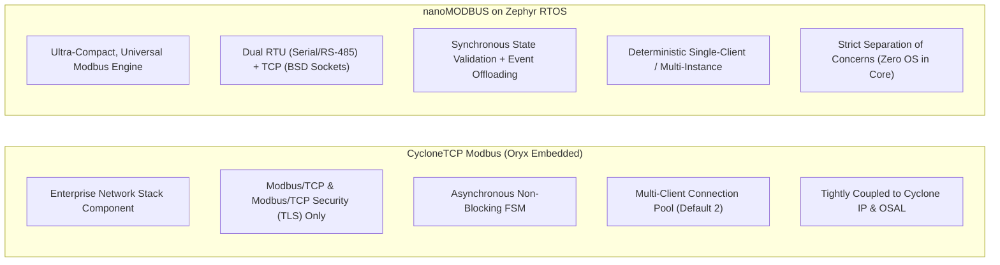

# Comparative Analysis: nanoMODBUS vs. CycloneTCP Modbus

This document provides a rigorous architectural and technical comparative analysis between **nanoMODBUS on Zephyr RTOS** and the reference implementation **CycloneTCP Modbus** (Oryx Embedded SARL, v2.6.6, located at `/home/jeffry/Descargas/CycloneTCP_SSL_SSH_IPSEC_EAP_CRYPTO_Open_2_6_6/cyclone_tcp/modbus/`).

---

## 1. Executive Summary & Philosophy Comparison

The two implementations target distinct operational sweet spots in embedded networking:



- **CycloneTCP Modbus**: An enterprise-grade, TCP/IP-centric Modbus subsystem designed to operate within the proprietary Oryx CycloneTCP ecosystem. It focuses on multi-client TCP concurrency, non-blocking finite state machines (FSM), Modbus/TCP Security (TLS v1.2/v1.3), and rich telemetry. It contains **no Modbus RTU or serial line support**.
- **nanoMODBUS on Zephyr**: An ultra-compact, deterministic Modbus engine designed for resource-constrained microcontrollers. It delivers both Modbus RTU (with microsecond RS-485 timing) and Modbus TCP, zero dynamic memory allocation (`k_malloc` = 0), and strict Clean Architecture isolation between the upstream protocol core and the Zephyr OS layer.

---

## 2. Comprehensive Comparison Matrix

The table below contrasts both architectures across 18 key technical dimensions:

| Architectural Area | nanoMODBUS on Zephyr | CycloneTCP Modbus (v2.6.6) | Comparative Evaluation & Trade-offs |
|:---|:---|:---|:---|
| **1. Primary Architecture** | Layered Clean Architecture. Domain core ([`nanomodbus.c`](file:///media/jeffry/jqb/GitHub/nanoMODBUS/nanomodbus.c)) is pure ISO C99; Zephyr adapters wrap core via Ports & Adapters. | Vertically integrated subsystem tightly bound to CycloneTCP stack (`core/net.h`) and Oryx OSAL (`os_port.h`). | nanoMODBUS achieves superior portability and vendor independence. CycloneTCP offers deeper network stack integration. |
| **2. Modbus Modes** | **Modbus RTU** (UART/RS-485) and **Modbus TCP** supported. ASCII omitted by design. | **Modbus TCP** and **Modbus/TCP Security** only. Modbus RTU is completely absent. | nanoMODBUS covers legacy and modern industrial serial fieldbuses; CycloneTCP is purely Ethernet/IP. |
| **3. API Design** | Bulk vector APIs passing register arrays/bitfields (e.g., `read_holding_registers(addr, qty, out)`). Low function call overhead. | Granular item callbacks (`readRegCallback`, `writeRegCallback` invoked in a loop per register) or raw PDU callback. | nanoMODBUS vector design reduces callback invocation overhead; Cyclone allows fine-grained per-register access control. |
| **4. Transport Port** | Abstract function pointer table ([`nmbs_platform_conf`](file:///media/jeffry/jqb/GitHub/nanoMODBUS/nanomodbus.h#L161-L172): `read`, `write`, `flush`, `crc_calc`, `arg`). | Direct calls to Cyclone socket layer (`socketOpenEx`, `socketReceive`, `socketSend`). No abstraction port. | nanoMODBUS allows swapping transports without modifying the core; Cyclone is permanently bound to CycloneTCP. |
| **5. Protocol State Machine** | Linear synchronous request/response processing with state validation in core. Asynchrony handled at adapter layer. | Explicit asynchronous FSM (`MODBUS_CLIENT_STATE_*`, `MODBUS_CONNECTION_STATE_*`) driven by periodic ticks and event loops. | Cyclone handles long-running non-blocking socket operations natively; nanoMODBUS maintains minimal footprint and determinism. |
| **6. Buffer Management** | Single unified 260-byte buffer (`msg.buf[260]`) in core shared between request and response. Zero copying. | Separate request and response buffers per connection: `requestAdu[260]`, `responseAdu[260]`, plus TLS buffers (2x 2048B). | nanoMODBUS uses half the RAM per instance; Cyclone allows pipelined request/response buffering. |
| **7. Error Handling** | Enum [`nmbs_error`](file:///media/jeffry/jqb/GitHub/nanoMODBUS/nanomodbus.h#L56-L73) mapped to negative POSIX `errno` codes. Raw exceptions preserved in client context. | Proprietary `error_t` enum translated to `ModbusExceptionCode` (1..11). | Both cleanly isolate transport faults from protocol exceptions. nanoMODBUS adheres to standard Zephyr POSIX conventions. |
| **8. Timeout Handling** | Dual configurable timeouts: `read_timeout_ms` (first byte) and `byte_timeout_ms` (inter-byte gaps). Mapped to Zephyr timers. | Timestamp-based timeouts (`systime_t timeout`, `systime_t timestamp`) evaluated during periodic state machine ticks. | nanoMODBUS provides microsecond-level hardware gap tracking; Cyclone uses millisecond tick polling. |
| **9. CRC Calculation** | Optimized CRC-16 table/bitwise generator with optional platform hook for hardware crypto/CRC accelerators. | Omitted entirely (Modbus TCP relies on standard Ethernet/TCP checksums). | Required for RTU; nanoMODBUS includes compliant CRC-16 with zero external dependencies. |
| **10. RTU Framing** | Complete microsecond timing engine: hardware/GPIO RS-485 DE pin control, $t_{1.5}$ frame resync, $t_{3.5}$ frame delimiter. | **Not Supported**. | Critical discriminator: nanoMODBUS can run as an RTU slave/master on RS-485 microcontrollers. |
| **11. TCP Framing** | Two-stage stream ingestion: 6-byte MBAP header read, length extraction, followed by payload loop read. | Formats and parses `ModbusHeader` struct directly over socket stream. | Both correctly handle TCP segment fragmentation and packet coalescing. |
| **12. Client Concurrency** | Thread-safe via Zephyr `struct k_mutex lock` with priority inheritance and timeout support. Synchronous caller context. | Not internally thread-safe; application must provide external synchronization if multiple tasks access client. | nanoMODBUS client is inherently multi-thread safe out of the box. |
| **13. Server Concurrency** | RTU: Event-driven (`k_timer` + `k_work_q`).<br/>TCP: Active Object (`k_thread`), serves 1 client at a time (backlog queue). | Active Object with **Connection Pool**: serves multiple concurrent TCP clients simultaneously (`connection[MAX_CONNECTIONS]`). | Cyclone scales better for multi-master SCADA on high-RAM systems; nanoMODBUS is optimized for deterministic single-master RTUs. |
| **14. Memory Footprint** | **Minimal**: Core ~344B RAM. Client ~400B. RTU Server ~2.1KB (w/ stack). TCP Server ~2.8KB (w/ stack). Flash ~3-8KB. | **Heavy**: Server ~5KB to 15KB RAM (multiple connections, sockets, tasks). Flash ~12-25KB (higher with TLS). | nanoMODBUS fits in tiny microcontrollers (e.g. Cortex-M0+/M3/M4/M7 with < 32KB RAM). |
| **15. Dynamic Allocation** | **Zero** dynamic allocation (`k_malloc` = 0). All structs and stacks caller-owned. | Mixed: Configurable static structures, but TLS and network stack utilize dynamic memory blocks/pools. | nanoMODBUS guarantees hard determinism and zero heap fragmentation risk. |
| **16. Testing & CI** | Dual test suite: Host-based Unity unit tests (14 suites) + native Zephyr Ztest suite (7 suites, 18 tests) in Twister. | Evaluation board examples and proprietary integration tests. | nanoMODBUS has superior automated regression testing and Twister native_sim automation. |
| **17. Diagnostics** | Raw PDU exchange support for FC 08. Lacks built-in server telemetry counters. | Native FC 08 diagnostic counters (`busMessageCount`, `exceptionErrorCount`, `commEventCounter`). | Cyclone provides production telemetry; nanoMODBUS requires application-level counter instrumentation. |
| **18. Cybersecurity** | Plaintext TCP and serial. (TLS not implemented). | **Modbus/TCP Security**: TLS v1.2/v1.3 on port 802, X.509 client certificate parsing, role OID access control. | Cyclone conforms to the modern Modbus Security specification for critical infrastructure. |

---

## 3. Deep-Dive Architectural Differences

### 3.1 Server Connection Handling: Single-Client vs Connection Pool

A fundamental design distinction exists between the TCP servers:

- **CycloneTCP Connection Pool**:
  CycloneTCP's `ModbusServerContext` embeds an array of connections:
  ```c
  typedef struct _ModbusServerContext {
      ...
      ModbusClientConnection connection[MODBUS_SERVER_MAX_CONNECTIONS];
  } ModbusServerContext;
  ```
  Its server task runs a multiplexed event loop polling all connection sockets. When a new master connects, it allocates an idle slot from the pool. This allows SCADA systems with redundant masters or operator panels to query the device simultaneously.
- **nanoMODBUS Single-Client Active Object**:
  nanoMODBUS allocates exactly one transport and one request buffer per server instance. In [`nanomodbus_z_server_tcp.c`](file:///media/jeffry/jqb/GitHub/nanoMODBUS/zephyr/src/nanomodbus_z_server_tcp.c#L106-L127), the server thread accepts one client, loops until that client disconnects, and then returns to accept the next. Additional connection attempts wait in the TCP listen backlog queue (`CONFIG_NANOMODBUS_SERVER_TCP_BACKLOG`). While this dramatically minimizes RAM consumption, a stalled or poorly behaved client can monopolize the server until the keepalive timeout expires.

### 3.2 Granular Callback Model vs Bulk Vector Callback Model

- **CycloneTCP**:
  ```c
  typedef error_t (*ModbusServerReadRegCallback)(ModbusClientConnection *connection,
      uint16_t address, uint16_t *value);
  ```
  When a master reads 100 registers via FC 03, CycloneTCP invokes `readRegCallback` **100 times in a loop**, passing the register address and a pointer to a single `uint16_t`. This allows per-register permissions and sparse address mapping, but incurs massive function-call overhead.
- **nanoMODBUS**:
  ```c
  nmbs_error (*read_holding_registers)(uint16_t address, uint16_t quantity,
      uint16_t* registers_out, uint8_t unit_id, void* arg);
  ```
  nanoMODBUS invokes the callback **exactly once**, passing the base address, quantity, and a contiguous destination array. The application can service the entire request using a single `memcpy` or direct pointer arithmetic, maximizing CPU efficiency.

---

## 4. Evaluation of Transferable Ideas

We classify architectural concepts from CycloneTCP into four engineering categories based on RAM, Flash, CPU, complexity, and Zephyr compatibility:

```mermaid
graph TD
    classDef must fill:#d9534f,stroke:#d43f3a,color:white;
    classDef should fill:#f0ad4e,stroke:#eea236,color:white;
    classDef nice fill:#5bc0de,stroke:#46b8da,color:white;
    classDef not fill:#777777,stroke:#555555,color:white;

    Ideas["Cyclone Architectural Concepts"]
    Ideas --> MUST["1. MUST HAVE (Immediate Priority)"]:::must
    Ideas --> SHOULD["2. SHOULD HAVE (Production Hardening)"]:::should
    Ideas --> NICE["3. NICE TO HAVE (Feature Expansion)"]:::nice
    Ideas --> NOT["4. NOT RECOMMENDED (Architectural Anti-Patterns)"]:::not

    MUST --> M1["Atomic Multi-Client RTU Targeting API"]
    MUST --> M2["Kconfig Client-Side Pruning Alignment"]

    SHOULD --> S1["Server Table Lock/Unlock Callbacks"]
    SHOULD --> S2["Modbus Standard Telemetry Counters (FC 08)"]
    SHOULD --> S3["Multi-Client TCP Connection Dispatcher"]

    NICE --> N1["Modbus/TCP Security (TLS via Zephyr mbedTLS)"]
    NICE --> N2["Mask Write Register (FC 22) Helper"]

    NOT --> R1["Proprietary OSAL / Network Coupling"]
    NOT --> R2["Dynamic Memory / TLS Heap Allocations"]
    NOT --> R3["Full Asynchronous Core FSM Rewrite"]
```



### 4.1 MUST HAVE (Correctness, Safety, and Critical Fixes)

#### 1. Atomic Multi-Client RTU Targeting API
- **Problem**: In [`nmbs_z_client.c`](file:///media/jeffry/jqb/GitHub/nanoMODBUS/zephyr/src/nanomodbus_z_client.c#L99-L118), [`nmbs_z_client_set_target_address()`](file:///media/jeffry/jqb/GitHub/nanoMODBUS/zephyr/src/nanomodbus_z_client.c#L99) acquires `client->lock`, mutates `client->core.dest_address_rtu`, and unlocks immediately. If Thread A sets target address to `1`, gets preempted by Thread B setting target address to `2`, Thread A resumes and calls `nmbs_z_client_read_holding_registers()`, sending the request to slave `2` instead of `1`.
- **Solution from Cyclone**: Cyclone passes the slave unit ID explicitly on every transaction call. nanoMODBUS Zephyr module must introduce atomic addressed helpers (e.g. `nmbs_z_client_read_holding_registers_addr(client, unit_id, addr, qty, out, timeout)`).
- **Trade-off**: RAM: 0 bytes, Flash: ~80 bytes, Complexity: Low. **Essential for multi-drop RS-485 buses.**

#### 2. Kconfig Client-Side Pruning Alignment
- **Problem**: Kconfig defines macros such as `CONFIG_NANOMODBUS_FC_READ_COILS_DISABLED` which map to `NMBS_CLIENT_READ_COILS_DISABLED` in [`nanomodbus_z.h`](file:///media/jeffry/jqb/GitHub/nanoMODBUS/zephyr/include/zephyr/nanomodbus/nanomodbus_z.h#L30-L37). However, upstream [`nanomodbus.c`](file:///media/jeffry/jqb/GitHub/nanoMODBUS/nanomodbus.c) only checks `NMBS_CLIENT_DISABLED`, ignoring all per-function client pruning macros.
- **Solution**: Align the upstream core or Zephyr CMake configuration so client function pruning is honored, realizing significant Flash savings on constrained SoCs.
- **Trade-off**: Flash savings: ~1.5 KB to 3.5 KB.

### 4.2 SHOULD HAVE (Production Hardening & Reliability)

#### 1. Server Table Locking Callbacks (`lock` / `unlock`)
- **Cyclone Pattern**: Cyclone provides `ModbusServerLockCallback` and `ModbusServerUnlockCallback` invoked immediately before and after the server accesses holding registers or coils.
- **Value for nanoMODBUS**: Currently, when an incoming Modbus request executes inside the workqueue or TCP server thread, user callbacks read/write application memory directly. If application worker threads are simultaneously updating sensor data, word shearing (partial register updates) can occur. Introducing table lock/unlock callbacks in `nmbs_callbacks` allows clean synchronization with user mutexes.
- **Trade-off**: Flash: ~40 bytes, RAM: 8 bytes callback pointers, CPU: trivial mutex lock overhead.

#### 2. Modbus Diagnostic Telemetry Counters (FC 08)
- **Cyclone Pattern**: Tracks `busMessageCount`, `crcErrorCount`, `slaveExceptionCount`, and `slaveMessageCount`.
- **Value for nanoMODBUS**: Industrial field diagnostics require measuring serial bus error rates to detect degraded RS-485 transceivers, bad termination, or ground loops.
- **Trade-off**: Flash: ~200 bytes, RAM: 32 bytes for counter structure.

#### 3. Multi-Client Modbus TCP Connection Dispatcher
- **Cyclone Pattern**: Connection pool serving multiple concurrent clients.
- **Value for nanoMODBUS**: While single-client operation is memory-efficient, modern industrial setups frequently have an HMI panel and a PLC querying the same device simultaneously. A configurable connection pool (`CONFIG_NANOMODBUS_SERVER_TCP_MAX_CONNECTIONS`, default 1, configurable up to 4) using `zsock_poll` over an array of connection structs would resolve client lockouts.
- **Trade-off**: RAM: ~300 bytes per additional connection context; Flash: ~400 bytes.

### 4.3 NICE TO HAVE (Feature Expansion)

#### 1. Modbus/TCP Security (TLS v1.2/v1.3)
- **Cyclone Pattern**: Full Modbus Security support over TCP port 802 with client certificate validation and role-based access control.
- **Evaluation**: Zephyr includes native TLS socket support (`zsock_socket(AF_INET, SOCK_STREAM, IPPROTO_TLS_1_2)`) backed by mbedTLS. This could be integrated into `nanomodbus_z_transport_tcp.c` as a selectable Kconfig option without modifying the core.
- **Trade-off**: Flash: ~40-60 KB (mbedTLS), RAM: ~8-16 KB for TLS context and crypto buffers. Suitable only for larger MCUs (e.g. STM32H7, ESP32).

#### 2. Mask Write Register (FC 22) Native Wrapper
- **Cyclone Pattern**: Native function code handler modifying registers using AND/OR bitmasks.
- **Evaluation**: Useful for industrial PLC bit manipulation without read-modify-write hazards. Can currently be done via Raw PDU, but a dedicated helper simplifies usage.

### 4.4 NOT RECOMMENDED (Architectural Anti-Patterns for nanoMODBUS)

#### 1. Proprietary OSAL / Network Stack Coupling
- CycloneTCP tightly couples its Modbus layer to its proprietary OSAL and network stack types (`NetContext`, `Socket`). nanoMODBUS MUST NOT emulate this: standard Zephyr BSD sockets (`zsock_*`) and pure ISO C99 core must remain intact.

#### 2. Dynamic Memory Allocation for Connection Contexts
- CycloneTCP relies on dynamic buffer allocation when TLS is enabled. nanoMODBUS's zero-heap guarantee (`k_malloc` = 0) is a paramount differentiator for safety-critical and high-reliability embedded firmware.

#### 3. Full Asynchronous Core FSM Rewrite
- Rewriting `nanomodbus.c` into a non-blocking asynchronous state machine like Cyclone's would dramatically increase code complexity, enlarge the memory footprint, and destroy its clean, minimalist design. Asynchrony is already cleanly solved at the Zephyr adapter layer via `k_work_q` and `k_thread`.
