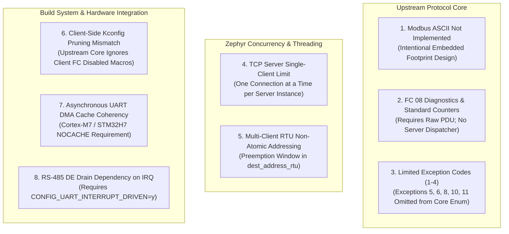

# nanoMODBUS Known Limitations & Technical Constraints

This document provides a transparent, rigorous analysis of known limitations, design trade-offs, and architectural constraints in **nanoMODBUS on Zephyr RTOS**, along with verified mitigations and workarounds.

---

## 1. Summary of Identified Technical Constraints



---

## 2. Upstream Protocol Core Limitations

### 2.1 Modbus ASCII Omitted by Design
- **Description**: The upstream protocol engine only implements **Modbus RTU** and **Modbus TCP**. Modbus ASCII (7-bit characters, colon framing delimiter, CRLF frame termination, and LRC longitudinal checksum) is not supported.
- **Architectural Justification**: Modbus ASCII incurs a 100% transmission overhead (2 bytes sent for every 1 byte of payload), requires larger buffers, and has been largely superseded by Modbus RTU and Modbus TCP across modern industrial equipment.
- **Mitigation / Workaround**:
  - Connect Modbus ASCII devices via an external protocol gateway converter (e.g., Moxa MGate or Anybus).
  - If ASCII support is strictly required on-chip, write a custom character-transcoding adapter leveraging `nmbs_z_serial_transport_rx_put()` to decode ASCII hex to binary before feeding the core.

### 2.2 Limited Modbus FC 08 Diagnostics & Telemetry Counters
- **Description**: Function Code 08 (Diagnostics) defines 19 standard subfunctions (such as `0x0000` Return Query Data, `0x0001` Restart Communications Option, `0x000A` Clear Counters, `0x000B` Bus Message Count, `0x000C` CRC Error Count, etc.). The upstream core contains no built-in FC 08 dispatcher in [`nanomodbus.c`](file:///media/jeffry/jqb/GitHub/nanoMODBUS/nanomodbus.c#L1810-L1885).
- **Impact**: While a client can issue FC 08 diagnostic requests using [`nmbs_z_client_raw_pdu()`](file:///media/jeffry/jqb/GitHub/nanoMODBUS/zephyr/include/zephyr/nanomodbus/nanomodbus_z.h#L434-L436), an RTU or TCP server will respond with Exception 01 (`ILLEGAL_FUNCTION`) unless handled by an external wrapper. Furthermore, serial communication error counters are not automatically tabulated by the server.
- **Mitigation / Workaround**:
  - Client applications can format and send raw FC 08 diagnostic packets using `nmbs_z_client_raw_pdu()`.
  - For server bus telemetry, query the underlying Zephyr UART and Ethernet interface drivers directly via Zephyr API stats (`net_if_get_stats()`).

### 2.3 Exception Code Representation Limited to Codes 01–04
- **Description**: The core error enum [`nmbs_error`](file:///media/jeffry/jqb/GitHub/nanoMODBUS/nanomodbus.h#L56-L73) defines values for:
  - `NMBS_EXCEPTION_ILLEGAL_FUNCTION = 1`
  - `NMBS_EXCEPTION_ILLEGAL_DATA_ADDRESS = 2`
  - `NMBS_EXCEPTION_ILLEGAL_DATA_VALUE = 3`
  - `NMBS_EXCEPTION_SERVER_DEVICE_FAILURE = 4`
  The validation macro [`nmbs_error_is_exception(e)`](file:///media/jeffry/jqb/GitHub/nanoMODBUS/nanomodbus.h#L80) strictly enforces `((e) > 0 && (e) < 5)`.
- **Impact**: Modbus standard exceptions `05` (Acknowledge), `06` (Server Device Busy), `08` (Memory Parity Error), `10` (Gateway Path Unavailable), and `11` (Gateway Target Device Failed to Respond) are not recognized as typed exceptions by the core. If a remote server returns Exception 05 or 06, the core treats it as an unclassified protocol violation (`NMBS_ERROR_INVALID_RESPONSE`).
- **Mitigation / Workaround**:
  - When communicating with slow field instruments that issue Exception 05/06 (Acknowledge / Busy), use `nmbs_z_client_raw_pdu()` to parse the response payload explicitly.

---

## 3. Concurrency & Multithreading Limitations

### 3.1 Modbus TCP Server Serves a Single Client at a Time
- **Description**: The TCP server implementation ([`nanomodbus_z_server_tcp.c`](file:///media/jeffry/jqb/GitHub/nanoMODBUS/zephyr/src/nanomodbus_z_server_tcp.c#L106-L127)) accepts and handles **exactly one client connection at a time**:
  ```c
  /* Request loop with client */
  while (atomic_get(&server->running)) {
      nmbs_error err = nmbs_server_poll(&server->core);
      if (err == NMBS_ERROR_NONE || err == NMBS_ERROR_TIMEOUT) {
          continue;
      }
      break; /* Disconnected or fatal error */
  }
  zsock_close(server->client_sock);
  ```
- **Root Cause**: To maintain a zero-heap footprint and minimal RAM usage (~2.8 KB total including thread stack), the server embeds a single `nmbs_t` instance and one transport socket.
- **Impact**: While one client is connected, additional clients attempting to connect are queued in the TCP listen backlog (`CONFIG_NANOMODBUS_SERVER_TCP_BACKLOG`). If a client stays connected indefinitely (e.g. persistent SCADA connection), other masters are locked out.
- **Mitigation / Workaround**:
  1. *Enable TCP Keepalive*: Ensure `CONFIG_NANOMODBUS_TCP_KEEPALIVE=y` with aggressive probes so orphaned connections are severed promptly.
  2. *Client Disconnect Policy*: Instruct client software to open a connection, execute transactions, and immediately close the socket (`close()` after transaction).
  3. *Multiple Server Instances*: If concurrent access is mandatory, instantiate multiple `nmbs_z_server_tcp_t` structures listening on distinct ports (e.g. port 502 for Master 1, port 503 for Master 2).

### 3.2 Non-Atomic Multi-Slave RTU Addressing in Standard Client API
- **Description**: In the Modbus RTU protocol, multiple slaves share the same physical RS-485 bus. The destination slave address is stored as internal state inside [`client->core.dest_address_rtu`](file:///media/jeffry/jqb/GitHub/nanoMODBUS/nanomodbus.h#L269).
  In [`nmbs_z_client.c`](file:///media/jeffry/jqb/GitHub/nanoMODBUS/zephyr/src/nanomodbus_z_client.c#L99-L118):
  ```c
  int nmbs_z_client_set_target_address(nmbs_z_client_t *client, uint8_t unit_id, k_timeout_t timeout)
  {
      int ret = client_lock(client, timeout);
      ...
      nmbs_set_destination_rtu_address(&client->core, unit_id);
      k_mutex_unlock(&client->lock); // LOCK RELEASED HERE!
      return 0;
  }
  ```
- **Concurrency Hazard**: If Thread 1 calls `nmbs_z_client_set_target_address(client, 1)` and is preempted before executing its read/write call, and Thread 2 calls `nmbs_z_client_set_target_address(client, 2)` and reads, Thread 1 subsequently wakes up and issues its read command to **Slave 2 instead of Slave 1**.
- **Mitigation / Workaround**:
  - *Caller Serialization*: Protect multi-slave access using an application-level mutex around the `set_target_address` + `read/write` pair:
    ```c
    k_mutex_lock(&app_bus_lock, K_FOREVER);
    nmbs_z_client_set_target_address(client, target_slave, K_FOREVER);
    nmbs_z_client_read_holding_registers(client, addr, qty, out, K_FOREVER);
    k_mutex_unlock(&app_bus_lock);
    ```
  - *Dedicated Atomic Addressing Helpers*: Proposed architectural improvement to provide `nmbs_z_client_read_holding_registers_addr(client, unit_id, addr, qty, out, timeout)`.

---

## 4. Build System & Configuration Limitations

### 4.1 Client-Side Kconfig Pruning Mismatch
- **Description**: [`zephyr/Kconfig`](file:///media/jeffry/jqb/GitHub/nanoMODBUS/zephyr/Kconfig) provides granular pruning flags (e.g. `CONFIG_NANOMODBUS_FC_READ_COILS_DISABLED`), which are translated to `NMBS_CLIENT_READ_COILS_DISABLED` in [`nanomodbus_z.h`](file:///media/jeffry/jqb/GitHub/nanoMODBUS/zephyr/include/zephyr/nanomodbus/nanomodbus_z.h#L30-L37).
- **Core Disconnect**: Upstream [`nanomodbus.c`](file:///media/jeffry/jqb/GitHub/nanoMODBUS/nanomodbus.c) only honors `NMBS_SERVER_*` macros for server pruning and `NMBS_CLIENT_DISABLED` for the entire client. It **completely ignores** `NMBS_CLIENT_*_DISABLED`.
- **Impact**: Disabling individual client function codes in Kconfig saves zero Flash memory in `nanomodbus.c`.
- **Mitigation / Workaround**:
  - If maximizing Flash reduction is critical, use `CONFIG_NANOMODBUS_CLIENT=n` to completely remove the client when building a server-only firmware image.
  - Upstream PR planned to introduce `#ifndef NMBS_CLIENT_READ_COILS_DISABLED` guards in `nanomodbus.c`.

---

## 5. Hardware & Device Driver Limitations

### 5.1 Asynchronous UART DMA Cache Coherency (Cortex-M7 / STM32H7)
- **Description**: In [`nanomodbus_z_transport_serial.c`](file:///media/jeffry/jqb/GitHub/nanoMODBUS/zephyr/src/nanomodbus_z_transport_serial.c#L186-L192), asynchronous DMA reception uses ping-pong buffers embedded directly within [`nmbs_z_serial_transport_t`](file:///media/jeffry/jqb/GitHub/nanoMODBUS/zephyr/include/zephyr/nanomodbus/nanomodbus_z_serial.h#L127) (`async_rx_buffer[2][128]`).
- **Hardware Hazard**: On MCUs featuring ARM Cortex-M7 cores with enabled data cache (`CONFIG_DCACHE=y`, such as STM32H743ZI on `nucleo_h743zi`), DMA writes directly to physical SRAM bypassing the CPU L1 data cache. Without cache invalidation or dedicated nocache MPU regions, the CPU reads stale cache lines, resulting in data corruption or `-EFAULT` errors from the STM32 UART DMA driver.
- **Mitigation / Workaround**:
  1. *Disable Data Cache*: For simple applications, set `CONFIG_DCACHE=n` in `prj.conf`.
  2. *Nocache RAM Placement*: On cache-enabled systems, place the `nmbs_z_serial_transport_t` instance in a non-cacheable linker section (e.g., using `__nocache` attribute or MPU non-cacheable region setup).
  3. *Use IRQ Mode*: Switch to `NMBS_Z_SERIAL_RX_IRQ` (`CONFIG_UART_INTERRUPT_DRIVEN=y`), which drains the UART FIFO byte-by-byte via CPU register reads and is completely immune to cache coherency issues.

### 5.2 RS-485 DE Deassertion Dependency on Interrupt-Driven UART
- **Description**: When controlling an RS-485 half-duplex transceiver via software GPIO, [`nmbs_z_transport_serial_write()`](file:///media/jeffry/jqb/GitHub/nanoMODBUS/zephyr/src/nanomodbus_z_transport_serial.c#L486-L491) waits for transmission completion before driving the DE pin low:
  ```c
  #if defined(CONFIG_UART_INTERRUPT_DRIVEN)
      uart_irq_update(transport->cfg.uart_dev);
      while (uart_irq_tx_complete(transport->cfg.uart_dev) == 0) {
          k_busy_wait(10);
      }
  #endif
  ```
- **Hardware Hazard**: If `CONFIG_UART_INTERRUPT_DRIVEN=y` is NOT enabled in the board or application configuration, the code bypasses `uart_irq_tx_complete()` and delays by only a single character time. If the UART driver's internal transmission queue contains more than one character, the DE pin will be pulled low prematurely, truncating the final bytes (usually the CRC-16) and causing remote slave CRC errors.
- **Mitigation / Workaround**:
  - Always ensure `CONFIG_UART_INTERRUPT_DRIVEN=y` is selected when RS-485 GPIO control is active.
  - Prefer hardware Driver Enable (`NMBS_Z_SERIAL_DE_HARDWARE` via Devicetree `de-enable`), which delegates transceiver timing directly to the UART hardware state machine.
