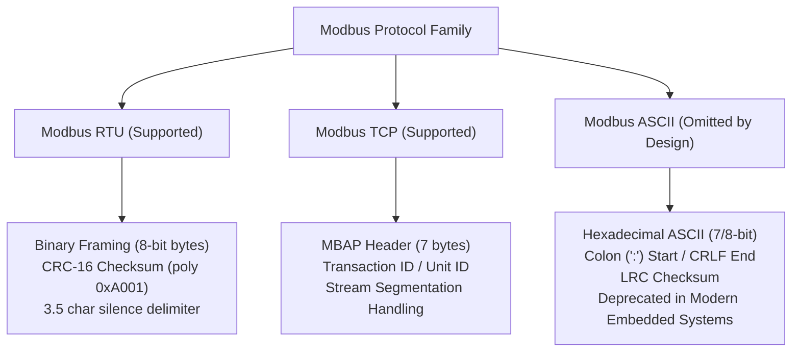

# nanoMODBUS Protocol Support & Standards Compliance

This document provides a comprehensive audit of the **nanoMODBUS** protocol implementation against official Modbus specifications, detailing supported function codes, transmission modes, exception codes, and formal compliance ratings.

---

## 1. Modbus Protocol Transmission Modes

The Modbus protocol defines three primary transmission modes across physical layers. nanoMODBUS implements the two industry-standard modes and deliberately omits the legacy ASCII mode:

### 1.1 Modbus RTU (Supported)
- **Status**: **Fully Supported** ([`nanomodbus.c`](file:///media/jeffry/jqb/GitHub/nanoMODBUS/nanomodbus.c#L141-L157), [`nanomodbus_z_transport_serial.c`](file:///media/jeffry/jqb/GitHub/nanoMODBUS/zephyr/src/nanomodbus_z_transport_serial.c)).
- **Framing**: Binary encoding where each 8-bit byte contains two 4-bit hexadecimal characters.
- **Error Checking**: 16-bit Cyclic Redundancy Check (CRC-16 IBM/ANSI with polynomial `0xA001`, initialized to `0xFFFF`).
- **Frame Delimitation**: Strict silence periods of at least $3.5$ character times ($t_{3.5}$) demarcate frame boundaries. Inter-character gaps must not exceed $1.5$ character times ($t_{1.5}$).

### 1.2 Modbus TCP (Supported)
- **Status**: **Fully Supported** ([`nanomodbus.c`](file:///media/jeffry/jqb/GitHub/nanoMODBUS/nanomodbus.c#L159-L195), [`nanomodbus_z_transport_tcp.c`](file:///media/jeffry/jqb/GitHub/nanoMODBUS/zephyr/src/nanomodbus_z_transport_tcp.c)).
- **Framing**: 7-byte Modbus Application Protocol (MBAP) header prepended to the standard Modbus PDU:
  - `Transaction Identifier`: 2 bytes (echoed by server for transaction matching).
  - `Protocol Identifier`: 2 bytes (`0x0000` = Modbus protocol).
  - `Length`: 2 bytes (big-endian count of following bytes, including Unit ID and PDU).
  - `Unit Identifier`: 1 byte (used for routing across Modbus gateways).
- **Transport**: TCP/IP stream via Zephyr BSD Sockets (`SOCK_STREAM`, default port `502`).

### 1.3 Modbus ASCII (Omitted by Design)
- **Status**: **NOT IMPLEMENTED / OMITTED BY DESIGN**.
- **Rationale**:
  1. *Footprint Efficiency*: Modbus ASCII encodes every byte as two ASCII hexadecimal characters (`'0'`-`'9'`, `'A'`-`'F'`), doubling the required transmission bandwidth and buffer sizes.
  2. *Obsolescence*: ASCII mode is a legacy serial protocol dating to 1979. Modern industrial installations, PLCs, and SCADA gateways overwhelmingly standardize on Modbus RTU (RS-485) and Modbus TCP.
  3. *Complexity vs Value*: Omitting ASCII saves flash memory, removes the need for Longitudinal Redundancy Check (LRC) calculation tables, and avoids stateful character decoding loops.

---

## 2. Modbus Function Code Support Matrix

The table below catalogs Modbus Function Codes (FC), detailing client and server availability in nanoMODBUS, implementation status, test coverage, and architectural observations:

| Function Code | Name | Client | Server | Implemented | Test Coverage | Observations |
|:---:|:---|:---:|:---:|:---:|:---|:---|
| **01 (0x01)** | Read Coils | YES | YES | **COMPLIANT** | Host: `test_fc1` Ztest: `test_client_concurrency.c` | Reads 1 to 2000 contiguous coils. Packed into [`nmbs_bitfield`](file:///media/jeffry/jqb/GitHub/nanoMODBUS/nanomodbus.h#L96). |
| **02 (0x02)** | Read Discrete Inputs | YES | YES | **COMPLIANT** | Host: `test_fc2` Ztest: `test_client_concurrency.c` | Reads 1 to 2000 contiguous discrete inputs into bitfield. Read-only table. |
| **03 (0x03)** | Read Holding Registers | YES | YES | **COMPLIANT** | Host: `test_fc3` Ztest: `test_client_concurrency.c`, `test_server_rtu.c`, `test_server_tcp.c` | Reads 1 to 125 16-bit registers. Primary telemetry command. |
| **04 (0x04)** | Read Input Registers | YES | YES | **COMPLIANT** | Host: `test_fc4` Ztest: `test_client_concurrency.c` | Reads 1 to 125 16-bit input registers. Read-only analog table. |
| **05 (0x05)** | Write Single Coil | YES | YES | **COMPLIANT** | Host: `test_fc5` Ztest: `test_client_concurrency.c` | Writes single coil (`0xFF00` = ON, `0x0000` = OFF). |
| **06 (0x06)** | Write Single Register | YES | YES | **COMPLIANT** | Host: `test_fc6` Ztest: `test_client_concurrency.c`, `test_server_rtu.c`, `test_server_tcp.c` | Writes single 16-bit register. Validated bounds. |
| **07 (0x07)** | Read Exception Status | NO* | NO | **PARTIAL\*** | Untested | Serial-only command in standard; returns 8 pre-defined exception status bits. Can be invoked via Raw PDU helper. |
| **08 (0x08)** | Diagnostics | NO* | NO | **PARTIAL\*** | Ztest: `test_client_concurrency.c` (via Raw PDU) | Serial diagnostic counters and loopback test. Subfunctions (e.g. `0x0000` Return Query Data) require Raw PDU. |
| **11 (0x0B)** | Get Comm Event Counter | NO* | NO | **PARTIAL\*** | Untested | Modbus serial communications counter. Supported only via Raw PDU. |
| **12 (0x0C)** | Get Comm Event Log | NO* | NO | **PARTIAL\*** | Untested | Provides status word, event count, message count, and event bytes. Raw PDU only. |
| **15 (0x0F)** | Write Multiple Coils | YES | YES | **COMPLIANT** | Host: `test_fc15` Ztest: `test_client_concurrency.c` | Writes 1 to 1968 coils from `nmbs_bitfield`. Validates byte count. |
| **16 (0x10)** | Write Multiple Registers | YES | YES | **COMPLIANT** | Host: `test_fc16` Ztest: `test_client_concurrency.c` | Writes 1 to 123 registers (RTU/TCP). Validates byte count = quantity * 2. |
| **17 (0x11)** | Report Server ID | NO* | NO | **PARTIAL\*** | Untested | Serial device-specific identification string. Modern applications prefer FC 43 (0x2B). |
| **20 (0x14)** | Read File Record | YES | YES | **COMPLIANT** | Host: `test_fc20` Ztest: `test_client_concurrency.c` | Reads extended file records (`file_number`, `record_number`, register count). |
| **21 (0x15)** | Write File Record | YES | YES | **COMPLIANT** | Host: `test_fc21` Ztest: `test_client_concurrency.c` | Writes extended file records. Sub-request parsing supported. |
| **22 (0x16)** | Mask Write Register | NO* | NO | **PARTIAL\*** | Untested | Modifies register contents using AND mask and OR mask without read-modify-write race. Raw PDU only. |
| **23 (0x17)** | Read/Write Multiple Registers | YES | YES | **COMPLIANT** | Host: `test_fc23` Ztest: `test_client_concurrency.c` | Atomic combination: writes 1..121 registers and reads 1..125 registers in one Modbus transaction. |
| **24 (0x18)** | Read FIFO Queue | NO* | NO | **PARTIAL\*** | Untested | Reads contents of a FIFO queue of registers. Raw PDU only. |
| **43 / 14 (0x2B / 0x0E)** | Read Device Identification | YES | YES | **COMPLIANT** | Host: `test_fc43_14` Ztest: `test_client_concurrency.c` | Encapsulated Interface Transport (MEI type 14). Supports Basic (VendorName, ProductCode, Revision), Regular, and Extended objects. |
| **RAW** | Arbitrary Raw PDU | YES | N/A | **COMPLIANT** | Ztest: `test_client_concurrency.c` | [`nmbs_z_client_raw_pdu()`](file:///media/jeffry/jqb/GitHub/nanoMODBUS/zephyr/include/zephyr/nanomodbus/nanomodbus_z.h#L434-L436) enables exchange of any custom or non-core function code. |

*\* Note: Function codes marked "PARTIAL\*" do not have dedicated high-level wrapper functions in `nanomodbus.h` or `nanomodbus_z.h`, but can be generated and parsed using the thread-safe Raw PDU exchange API.*

---

## 3. Modbus Exception Codes & Error Mapping

When a Modbus server encounters an issue while servicing a request, it returns an **Exception Response** consisting of the original Function Code with bit 7 set (`FC | 0x80`), followed by a 1-byte Exception Code.

### 3.1 Exception Code Coverage

| Code | Exception Name | Upstream Representation | POSIX Translation (`nmbs_z_error_to_errno`) | Handled by Server | Handled by Client |
|:---:|:---|:---|:---:|:---:|:---:|
| **01** | Illegal Function | [`NMBS_EXCEPTION_ILLEGAL_FUNCTION`](file:///media/jeffry/jqb/GitHub/nanoMODBUS/nanomodbus.h#L69) | `-ENOSYS` | YES | YES |
| **02** | Illegal Data Address | [`NMBS_EXCEPTION_ILLEGAL_DATA_ADDRESS`](file:///media/jeffry/jqb/GitHub/nanoMODBUS/nanomodbus.h#L70) | `-EFAULT` | YES | YES |
| **03** | Illegal Data Value | [`NMBS_EXCEPTION_ILLEGAL_DATA_VALUE`](file:///media/jeffry/jqb/GitHub/nanoMODBUS/nanomodbus.h#L71) | `-EDOM` | YES | YES |
| **04** | Server Device Failure | [`NMBS_EXCEPTION_SERVER_DEVICE_FAILURE`](file:///media/jeffry/jqb/GitHub/nanoMODBUS/nanomodbus.h#L72) | `-EIO` | YES | YES |
| **05** | Acknowledge | [`NMBS_EXCEPTION_ACKNOWLEDGE`](file:///media/jeffry/jqb/GitHub/nanoMODBUS/nanomodbus.h#L73) | `-EAGAIN` | YES | YES |
| **06** | Server Device Busy | [`NMBS_EXCEPTION_SERVER_DEVICE_BUSY`](file:///media/jeffry/jqb/GitHub/nanoMODBUS/nanomodbus.h#L74) | `-EBUSY` | YES | YES |
| **08** | Memory Parity Error | [`NMBS_EXCEPTION_MEMORY_PARITY_ERROR`](file:///media/jeffry/jqb/GitHub/nanoMODBUS/nanomodbus.h#L75) | `-EBADMSG` | YES | YES |
| **10** | Gateway Path Unavailable | [`NMBS_EXCEPTION_GATEWAY_PATH_UNAVAILABLE`](file:///media/jeffry/jqb/GitHub/nanoMODBUS/nanomodbus.h#L76) | `-ENETUNREACH` | YES | YES |
| **11** | Gateway Target Device Failed to Respond | [`NMBS_EXCEPTION_GATEWAY_TARGET_DEVICE_FAILED_TO_RESPOND`](file:///media/jeffry/jqb/GitHub/nanoMODBUS/nanomodbus.h#L77) | `-ETIMEDOUT` | YES | YES |

### 3.2 Non-Exception Library Error Codes

nanoMODBUS defines negative integer values for transport and parsing faults ([`nanomodbus.h`](file:///media/jeffry/jqb/GitHub/nanoMODBUS/nanomodbus.h#L56-L66)):

| Error Enum | Value | Description | POSIX Translation |
|:---|:---:|:---|:---:|
| `NMBS_ERROR_INVALID_REQUEST` | `-8` | Server received malformed or oversized PDU from client | `-EINVAL` |
| `NMBS_ERROR_INVALID_UNIT_ID` | `-7` | Server/Client received unexpected Unit ID in response | `-ENODEV` |
| `NMBS_ERROR_INVALID_TCP_MBAP` | `-6` | TCP MBAP protocol identifier != 0 or length mismatch | `-EPROTO` |
| `NMBS_ERROR_CRC` | `-5` | Calculated CRC-16 does not match received frame CRC | `-EBADMSG` |
| `NMBS_ERROR_TRANSPORT` | `-4` | Platform read/write transport returned unrecoverable error | `-EIO` |
| `NMBS_ERROR_TIMEOUT` | `-3` | Operation exceeded read or inter-byte timeout deadline | `-ETIMEDOUT` |
| `NMBS_ERROR_INVALID_RESPONSE` | `-2` | Server response length or format violates specification | `-EBADMSG` |
| `NMBS_ERROR_INVALID_ARGUMENT` | `-1` | Null pointer or invalid range passed to library API | `-EINVAL` |
| `NMBS_ERROR_NONE` | `0` | Success | `0` |

---

## 4. Formal Compliance Audit

The implementation has been formally audited against the standard specifications:
- **Spec 1**: *Modbus Application Protocol Specification V1.1b3* (December 28, 2006)
- **Spec 2**: *Modbus over Serial Line Specification and Implementation Guide V1.02* (December 20, 2006)
- **Spec 3**: *Modbus Messaging on TCP/IP Implementation Guide V1.0b* (October 24, 2006)

### 4.1 Specification Compliance Audit Matrix

| Section | Clause / Requirement | Status | Verification & Observations |
|:---|:---|:---:|:---|
| **PDU Framing** | Max Modbus PDU size is 253 bytes | **COMPLIANT** | Upstream buffer is 260 bytes (`uint8_t buf[260]`), strictly rejecting PDUs > 253 bytes. |
| **PDU Addressing** | 16-bit register addresses (`0x0000` - `0xFFFF`) | **COMPLIANT** | All client and server APIs take `uint16_t address`. |
| **PDU Endianness** | Big-endian (network byte order) for 16-bit values | **COMPLIANT** | High byte transmitted first across all PDU formats. |
| **FC 01 / 02** | Read 1 to 2000 contiguous bits | **COMPLIANT** | Bound check `if (quantity < 1 || quantity > 2000)` enforced in core. |
| **FC 03 / 04** | Read 1 to 125 contiguous registers | **COMPLIANT** | Bound check `if (quantity < 1 || quantity > 125)` enforced in core. |
| **FC 05 / 06** | Write Single Coil / Register | **COMPLIANT** | Strict coil value conversion (`0xFF00` vs `0x0000`), rejecting invalid non-zero values. |
| **FC 15** | Write 1 to 1968 contiguous coils | **COMPLIANT** | Bound check `if (quantity < 1 || quantity > 1968)` and byte count validation enforced. |
| **FC 16** | Write 1 to 123 contiguous registers | **COMPLIANT** | Bound check `if (quantity < 1 || quantity > 123)` and byte count validation enforced. |
| **FC 23** | Read 1..125 and Write 1..121 registers | **COMPLIANT** | Atomic verification of both read and write bounds prior to callback execution. |
| **FC 43 / 14** | Read Device Identification Basic/Regular/Extended | **COMPLIANT** | Conforms to MEI Type 14 specification, supporting object IDs `0x00`..`0x02`, `0x03`..`0x06`, and `0x80`..`0xFF`. |
| **RTU Frame Delimitation** | $t_{3.5}$ idle period demarcates frames | **COMPLIANT** | Serial transport computes exact $t_{3.5}$ in $\mu s$; server uses dedicated `k_timer` to detect frame completion. |
| **RTU Inter-char Gap** | $t_{1.5}$ maximum inter-character gap | **COMPLIANT** | Ingestion path in [`nmbs_z_serial_transport_rx_put()`](file:///media/jeffry/jqb/GitHub/nanoMODBUS/zephyr/src/nanomodbus_z_transport_serial.c#L606-L618) calculates cycle intervals; discards buffer if gap exceeds $t_{1.5}$. |
| **RTU Baud Timing** | Fixed timings for baud rates > 19200 bps | **COMPLIANT** | Uses exact standard constants: $t_{1.5} = 750 \mu s$, $t_{3.5} = 1750 \mu s$ for baud > 19200 bps. |
| **RTU Error Check** | CRC-16 with polynomial `0xA001`, init `0xFFFF` | **COMPLIANT** | Implemented in [`nmbs_crc_calc()`](file:///media/jeffry/jqb/GitHub/nanoMODBUS/nanomodbus.c#L80-L102); low byte transmitted first per spec. |
| **RTU Broadcast** | Slave address `0` accepted without response | **COMPLIANT** | Core sets `msg.broadcast = true`; suppresses server transmission on address `0`. |
| **TCP MBAP Header** | 7-byte header with protocol ID 0 and length | **COMPLIANT** | Validates `protocol_id == 0`; checks that received bytes match MBAP length field. |
| **TCP Port** | Default IANA port 502 | **COMPLIANT** | Used by default across TCP samples and tests. |
| **TCP Fragmentation** | Handle fragmented TCP streams | **COMPLIANT** | [`nmbs_z_transport_tcp_read()`](file:///media/jeffry/jqb/GitHub/nanoMODBUS/zephyr/src/nanomodbus_z_transport_tcp.c#L168-L212) implements a loop reading exact MBAP length across fragmented packets. |
| **Modbus ASCII** | 7-bit character framing with LRC checksum | **NOT_IMPLEMENTED** | Intentionally omitted to optimize footprint for resource-constrained microcontrollers. |
| **Modbus Security** | TLS encapsulation (port 802) | **NOT_IMPLEMENTED** | Plaintext TCP supported; TLS not currently integrated. |
