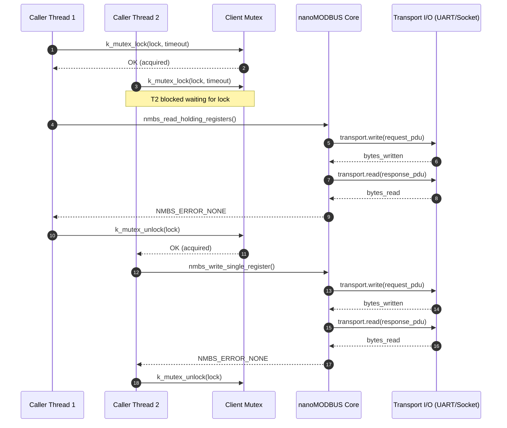
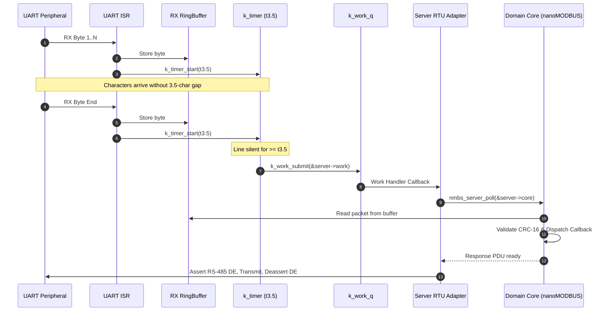
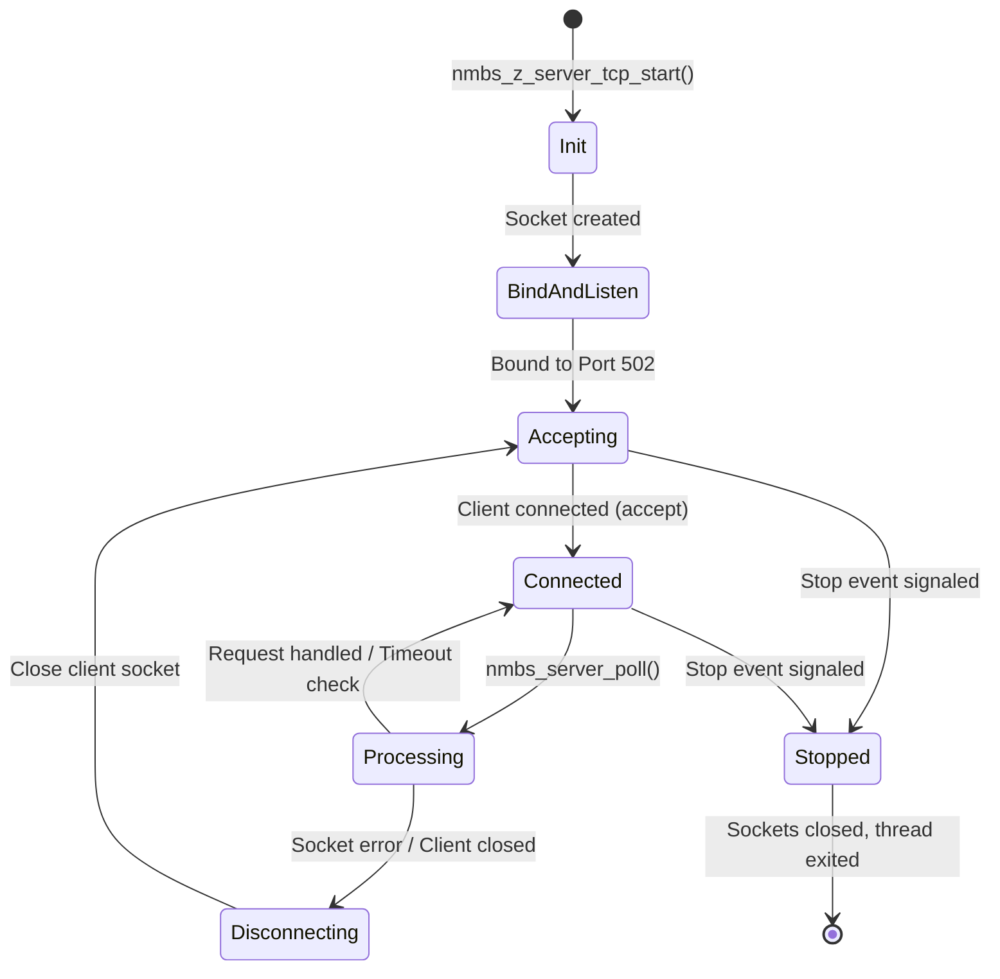

# nanoMODBUS Zephyr RTOS External Module Integration Specification

| Metadata | Details |
| :--- | :--- |
| **Document ID** | SPEC-NMBS-ZEPHYR-001 |
| **Author** | Principal Embedded Software Architect |
| **Status** | Approved / Architecture Baseline |
| **Date** | 2026-10-23 |
| **Target System** | Zephyr RTOS v3.5+ / v4.x, C99/C11 |
| **Upstream Library** | nanoMODBUS v2.x |

---

## 1. Executive Summary & Architectural Goals

### 1.1 Context & Motivation
nanoMODBUS is an ultra-compact, dependency-free C99 library implementing the Modbus RTU and TCP protocols. Its resource efficiency (zero heap allocation, minimal stack footprint, modular compile-time pruning) makes it ideal for embedded microcontrollers. However, modern industrial and IoT products utilizing Zephyr RTOS require first-class RTOS integration: thread safety, RTOS synchronization, hardware abstraction across diverse UART and network controllers, Devicetree configuration, Kconfig feature gating, and structured logging.

This specification defines the formal architecture for converting nanoMODBUS into a native **Zephyr RTOS External Module**.

### 1.2 The Golden Architectural Invariants

```
                      +------------------------------------------+
                      |         Application Domain Layer         |
                      |  (User Threads, Sensors, Actuators)      |
                      +--------------------+---------------------+
                                           | calls
                                           v
+===================================================================================+
|                              ZEPHYR ADAPTER LAYER                                 |
|                      (zephyr/src/, zephyr/include/zephyr/)                        |
|                                                                                   |
|  +--------------------+  +----------------------+  +---------------------------+  |
|  | nanomodbus_z_client|  | nanomodbus_z_server_ |  |  nanomodbus_z_server_tcp  |  |
|  | (Mutex, Caller Ctx)|  | rtu (k_work, k_timer)|  |  (Dedicated k_thread)     |  |
|  +---------+----------+  +----------+-----------+  +-------------+-------------+  |
|            |                        |                            |                |
|            +-------------------+    |    +-----------------------+                |
|                                |    |    |                                        |
|                                v    v    v                                        |
|                     +---------------------------+                                 |
|                     |    nanomodbus_z_serial /  |                                 |
|                     |    nanomodbus_z_tcp       |                                 |
|                     |    (Transport Adapters)   |                                 |
|                     +-------------+-------------+                                 |
+===================================|===============================================+
                                    | nmbs_platform_conf (read/write callbacks)
                                    v
+===================================================================================+
|                          PURE DOMAIN PROTOCOL CORE                                |
|                          (nanomodbus.c, nanomodbus.h)                             |
|                                                                                   |
|          * Pure ISO C99 / ZERO Zephyr Headers / Zero Dynamic Memory               |
|          * Frame validation, PDU serialization, CRC-16, Exception mapping         |
+===================================================================================+
                                    |
                                    | abstracts hardware
                                    v
+===================================================================================+
|                               ZEPHYR PLATFORM OSAL                                |
|  +-------------------------------------+  +------------------------------------+  |
|  |     Zephyr UART Driver Subsystem    |  |       Zephyr BSD Sockets API       |  |
|  |   (<zephyr/drivers/uart.h>, GPIO)   |  |        (<zephyr/net/socket.h>)     |  |
|  +-------------------------------------+  +------------------------------------+  |
+===================================================================================+
```

1. **Upstream Purity (Zero Zephyr Contamination in Core)**:
   - `nanomodbus.c` and `nanomodbus.h` remain 100% pure ISO C99 without a single Zephyr header (`<zephyr/...>`), macro, or type.
   - Core files can be compiled unmodified for standalone Linux, bare-metal, or other RTOS environments. Upstream updates can be pulled cleanly without merge conflicts.
2. **Clean Architecture / Ports & Adapters (Hexagonal)**:
   - The Zephyr integration acts strictly as an **Adapter** layer located under `zephyr/`.
   - Modbus logic is isolated from hardware details (UART peripheral registers, Ethernet MACs, socket file descriptors) via nanoMODBUS's abstract platform interface (`nmbs_platform_conf`).
3. **Static Allocation Guarantee (Zero `k_malloc`)**:
   - Zero dynamic heap allocation. All synchronization structures (`struct k_mutex`, `struct k_timer`, `struct k_work`), thread stacks (`K_THREAD_STACK_DEFINE`), and packet buffers are statically allocated or passed by reference.
4. **Strict Concurrency Safety & Determinism**:
   - Client access is protected by mutual exclusion (`struct k_mutex`) executed in the caller's context.
   - Server RTU operates asynchronously via character silence timers (`struct k_timer`) and system workqueue (`struct k_work`), avoiding CPU spinning.
   - Server TCP operates as a self-contained Active Object on a dedicated thread (`struct k_thread`).

---

## 2. Directory Structure and Component Classification

### 2.1 File Organization

```
nanoMODBUS/
├── CMakeLists.txt                       # Root legacy/standalone CMake build
├── Kconfig                              # Root Kconfig redirection stub
├── nanomodbus.c                         # [Domain] Pure C99 Modbus Core
├── nanomodbus.h                         # [Domain] Core Protocol Header
├── zephyr/
│   ├── module.yml                       # Zephyr Module Metadata Descriptor
│   ├── CMakeLists.txt                   # Zephyr Module Build System Definition
│   ├── Kconfig                          # Module Kconfig Options & Feature Hierarchy
│   ├── include/
│   │   └── zephyr/
│   │       └── nanomodbus/
│   │           ├── nanomodbus_z.h       # [Interface] Common types, error mappings, config
│   │           ├── nanomodbus_z_serial.h# [Interface] Serial RTU transport contracts
│   │           └── nanomodbus_z_tcp.h   # [Interface] TCP transport contracts
│   └── src/
│       ├── nanomodbus_z_client.c        # [Adapter] Thread-safe client wrapper
│       ├── nanomodbus_z_server_rtu.c    # [Active Object] Event-driven RTU server engine
│       ├── nanomodbus_z_server_tcp.c    # [Active Object] Threaded TCP server engine
│       ├── nanomodbus_z_transport_serial.c # [Driver Adapter] UART & RS-485 DE driver
│       └── nanomodbus_z_transport_tcp.c # [Driver Adapter] Zephyr BSD socket adapter
├── examples/
│   ├── client_tcp/                      # TCP Client polling sample application
│   │   ├── CMakeLists.txt
│   │   ├── prj.conf
│   │   └── src/main.c
│   ├── server_rtu/                      # RTU Server RS-485 sample application
│   │   ├── CMakeLists.txt
│   │   ├── prj.conf
│   │   ├── boards/
│   │   │   └── native_sim.overlay
│   │   └── src/main.c
│   └── modbus_gateway/                  # Multi-instance Gateway: Dual RTU Clients + TCP Server
│       ├── CMakeLists.txt
│       ├── prj.conf
│       ├── boards/
│       │   └── native_sim.overlay
│       └── src/main.c
└── tests/
    └── zephyr/                          # Ztest verification test suite
        ├── CMakeLists.txt
        ├── testcase.yaml
        └── src/
            ├── test_client_concurrency.c
            ├── test_server_rtu.c
            ├── test_server_tcp.c
            └── test_error_mapping.c
```

### 2.2 Component Taxonomy

| Component | Layer Classification | Responsibilities | Invariants |
| :--- | :--- | :--- | :--- |
| `nanomodbus.c`, `nanomodbus.h` | **Domain / Core Protocol** | PDU encoding/decoding, CRC-16 generation/validation, Modbus state machine. | Pure C99, Standard libc only (`stdint.h`, `stdbool.h`, `string.h`), zero RTOS headers. |
| `nanomodbus_z.h` | **Interface / Contract** | Common adapter types, context wrappers, POSIX error code mappings. | Header-only contract, safe for inclusion by application layers. |
| `nanomodbus_z_serial.h` | **Interface / Contract** | RTU transport options, RS-485 Devicetree GPIO pin spec, baud timing calculations. | Contracts for serial transport creation and configuration. |
| `nanomodbus_z_tcp.h` | **Interface / Contract** | TCP transport contracts, socket configuration, peer addressing. | Contracts for BSD socket integration. |
| `nanomodbus_z_client.c` | **Adapter** | Mutex serialization around `nmbs_t`, synchronous execution in caller context. | Thread-safe, no background threads created. |
| `nanomodbus_z_server_rtu.c` | **Active Object** | RTU frame reception, inter-frame t3.5 timing detection, workqueue offload. | Non-blocking, event-driven, zero polling busy-wait. |
| `nanomodbus_z_server_tcp.c` | **Active Object** | Socket lifecycle, client connection acceptance, request loop processing. | Runs on dedicated `k_thread`, graceful teardown. |
| `nanomodbus_z_transport_serial.c` | **Driver Adapter** | Connects nanoMODBUS platform I/O to Zephyr UART API, asserts/deasserts RS-485 DE pin. | Handles character timeouts and half-duplex direction switches. |
| `nanomodbus_z_transport_tcp.c` | **Driver Adapter** | Connects nanoMODBUS platform I/O to Zephyr BSD Sockets (`zsock_recv`, `zsock_send`). | Handles socket connection timeouts and link drops. |

---

## 3. Module Definition & Build System

### 3.1 Zephyr Module Descriptor (`zephyr/module.yml`)

The module configuration binds nanoMODBUS into the Zephyr build infrastructure:

```yaml
name: nanomodbus
build:
  cmake: zephyr
  kconfig: zephyr/Kconfig
```

### 3.2 Root Stub Files

To maintain compatibility with root-level builds and legacy workflows:
- **`Kconfig` (Root)**:
  ```kconfig
  # SPDX-License-Identifier: MIT
  # nanoMODBUS root Kconfig redirection
  rsource "zephyr/Kconfig"
  ```
- **`CMakeLists.txt` (Root)**:
  Maintains standalone build for desktop/unit testing, but conditionally defers to `zephyr/CMakeLists.txt` when invoked in Zephyr module mode:
  ```cmake
  if(ZEPHYR_BASE)
      add_subdirectory(zephyr)
  else()
      # Legacy / Standalone CMake library build
      add_library(nanomodbus nanomodbus.c)
      target_include_directories(nanomodbus PUBLIC ${CMAKE_CURRENT_SOURCE_DIR})
      # ... tests and examples ...
  endif()
  ```

### 3.3 Module CMake Specification (`zephyr/CMakeLists.txt`)

The module CMake handles target library definition, conditional compilation, public include directory exposure, and preprocessor macro injection:

```cmake
# SPDX-License-Identifier: MIT

if(CONFIG_NANOMODBUS)

  zephyr_library()

  # Public include directory exposed to application targets
  zephyr_include_directories(include)

  # Internal include directory for nanomodbus.h core header
  zephyr_library_include_directories(${CMAKE_CURRENT_SOURCE_DIR}/..)

  # Always include the core protocol engine
  zephyr_library_sources(${CMAKE_CURRENT_SOURCE_DIR}/../nanomodbus.c)

  # Error mapping and common adapter functions
  zephyr_library_sources(src/nanomodbus_z_common.c)

  # Role implementations
  zephyr_library_sources_ifdef(CONFIG_NANOMODBUS_CLIENT src/nanomodbus_z_client.c)
  zephyr_library_sources_ifdef(CONFIG_NANOMODBUS_SERVER_RTU src/nanomodbus_z_server_rtu.c)
  zephyr_library_sources_ifdef(CONFIG_NANOMODBUS_SERVER_TCP src/nanomodbus_z_server_tcp.c)

  # Transport adapters
  zephyr_library_sources_ifdef(CONFIG_NANOMODBUS_TRANSPORT_SERIAL src/nanomodbus_z_transport_serial.c)
  zephyr_library_sources_ifdef(CONFIG_NANOMODBUS_TRANSPORT_TCP src/nanomodbus_z_transport_tcp.c)

  # --- Preprocessor Definitions Injection into Core ---

  # Role Disabling
  if(NOT CONFIG_NANOMODBUS_SERVER)
    zephyr_library_compile_definitions(NMBS_SERVER_DISABLED)
  endif()

  if(NOT CONFIG_NANOMODBUS_CLIENT)
    zephyr_library_compile_definitions(NMBS_CLIENT_DISABLED)
  endif()

  # Granular Function Code Disables (Client & Server)
  zephyr_library_compile_definitions_ifdef(CONFIG_NANOMODBUS_FC_READ_COILS_DISABLED
    NMBS_SERVER_READ_COILS_DISABLED NMBS_CLIENT_READ_COILS_DISABLED)
  zephyr_library_compile_definitions_ifdef(CONFIG_NANOMODBUS_FC_READ_DISCRETE_INPUTS_DISABLED
    NMBS_SERVER_READ_DISCRETE_INPUTS_DISABLED NMBS_CLIENT_READ_DISCRETE_INPUTS_DISABLED)
  zephyr_library_compile_definitions_ifdef(CONFIG_NANOMODBUS_FC_READ_HOLDING_REGISTERS_DISABLED
    NMBS_SERVER_READ_HOLDING_REGISTERS_DISABLED NMBS_CLIENT_READ_HOLDING_REGISTERS_DISABLED)
  zephyr_library_compile_definitions_ifdef(CONFIG_NANOMODBUS_FC_READ_INPUT_REGISTERS_DISABLED
    NMBS_SERVER_READ_INPUT_REGISTERS_DISABLED NMBS_CLIENT_READ_INPUT_REGISTERS_DISABLED)
  zephyr_library_compile_definitions_ifdef(CONFIG_NANOMODBUS_FC_WRITE_SINGLE_COIL_DISABLED
    NMBS_SERVER_WRITE_SINGLE_COIL_DISABLED NMBS_CLIENT_WRITE_SINGLE_COIL_DISABLED)
  zephyr_library_compile_definitions_ifdef(CONFIG_NANOMODBUS_FC_WRITE_SINGLE_REGISTER_DISABLED
    NMBS_SERVER_WRITE_SINGLE_REGISTER_DISABLED NMBS_CLIENT_WRITE_SINGLE_REGISTER_DISABLED)
  zephyr_library_compile_definitions_ifdef(CONFIG_NANOMODBUS_FC_WRITE_MULTIPLE_COILS_DISABLED
    NMBS_SERVER_WRITE_MULTIPLE_COILS_DISABLED NMBS_CLIENT_WRITE_MULTIPLE_COILS_DISABLED)
  zephyr_library_compile_definitions_ifdef(CONFIG_NANOMODBUS_FC_WRITE_MULTIPLE_REGISTERS_DISABLED
    NMBS_SERVER_WRITE_MULTIPLE_REGISTERS_DISABLED NMBS_CLIENT_WRITE_MULTIPLE_REGISTERS_DISABLED)
  zephyr_library_compile_definitions_ifdef(CONFIG_NANOMODBUS_FC_READ_FILE_RECORD_DISABLED
    NMBS_SERVER_READ_FILE_RECORD_DISABLED NMBS_CLIENT_READ_FILE_RECORD_DISABLED)
  zephyr_library_compile_definitions_ifdef(CONFIG_NANOMODBUS_FC_WRITE_FILE_RECORD_DISABLED
    NMBS_SERVER_WRITE_FILE_RECORD_DISABLED NMBS_CLIENT_WRITE_FILE_RECORD_DISABLED)
  zephyr_library_compile_definitions_ifdef(CONFIG_NANOMODBUS_FC_READ_WRITE_REGISTERS_DISABLED
    NMBS_SERVER_READ_WRITE_REGISTERS_DISABLED NMBS_CLIENT_READ_WRITE_REGISTERS_DISABLED)
  zephyr_library_compile_definitions_ifdef(CONFIG_NANOMODBUS_FC_READ_DEVICE_IDENTIFICATION_DISABLED
    NMBS_SERVER_READ_DEVICE_IDENTIFICATION_DISABLED NMBS_CLIENT_READ_DEVICE_IDENTIFICATION_DISABLED)

  # Tuning & Configuration
  if(DEFINED CONFIG_NANOMODBUS_BITFIELD_MAX)
    zephyr_library_compile_definitions(NMBS_BITFIELD_MAX=${CONFIG_NANOMODBUS_BITFIELD_MAX})
  endif()

  if(CONFIG_NANOMODBUS_DEBUG)
    zephyr_library_compile_definitions(NMBS_DEBUG)
  endif()

endif()
```

### 3.4 Kconfig Hierarchy (`zephyr/Kconfig`)

```kconfig
# SPDX-License-Identifier: MIT

menuconfig NANOMODBUS
	bool "nanoMODBUS support"
	help
	  Enable support for the nanoMODBUS compact Modbus RTU/TCP library.

if NANOMODBUS

module = NANOMODBUS
module-str = nanomodbus
source "subsys/logging/Kconfig.template.log_config"

config NANOMODBUS_DEBUG
	bool "Enable nanoMODBUS core debug prints"
	default n
	help
	  Defines NMBS_DEBUG, enabling stdout debug printing in nanomodbus core.

comment "Roles"

config NANOMODBUS_CLIENT
	bool "Enable Modbus Client (Master) role"
	default y
	help
	  Enables Modbus Client functionality and APIs.

config NANOMODBUS_SERVER
	bool "Enable Modbus Server (Slave) role"
	default y
	help
	  Enables Modbus Server functionality and request dispatching.

comment "Transports"

config NANOMODBUS_TRANSPORT_SERIAL
	bool "Enable Serial RTU Transport"
	depends on SERIAL
	default y
	help
	  Enables Modbus RTU communication over Zephyr UART devices.

config NANOMODBUS_TRANSPORT_TCP
	bool "Enable TCP Transport"
	depends on NET_SOCKETS
	default n
	help
	  Enables Modbus TCP communication over Zephyr BSD Sockets.

comment "Server Engines"

config NANOMODBUS_SERVER_RTU
	bool "Enable Modbus RTU Server Engine"
	depends on NANOMODBUS_SERVER && NANOMODBUS_TRANSPORT_SERIAL
	default y
	help
	  Enables the event-driven RTU server engine with t3.5 character silence timer.

config NANOMODBUS_SERVER_TCP
	bool "Enable Modbus TCP Server Engine"
	depends on NANOMODBUS_SERVER && NANOMODBUS_TRANSPORT_TCP
	default n
	help
	  Enables the multi-threaded Modbus TCP server engine.

if NANOMODBUS_SERVER_TCP

config NANOMODBUS_SERVER_TCP_PORT
	int "Modbus TCP Server listen port"
	default 502
	range 1 65535
	help
	  TCP port on which the Modbus server listens for incoming connections.

config NANOMODBUS_SERVER_TCP_STACK_SIZE
	int "Modbus TCP Server thread stack size"
	default 2048
	help
	  Stack size in bytes for the dedicated Modbus TCP server listener thread.

config NANOMODBUS_SERVER_TCP_PRIORITY
	int "Modbus TCP Server thread priority"
	default 7
	help
	  Thread priority for the Modbus TCP server listener thread.

config NANOMODBUS_SERVER_TCP_TIMEOUT_MS
	int "Modbus TCP socket receive timeout in milliseconds"
	default 5000
	help
	  Timeout for socket receive operations before checking connection health.

endif # NANOMODBUS_SERVER_TCP

comment "Buffer and Protocol Tuning"

config NANOMODBUS_BITFIELD_MAX
	int "Maximum bitfield size for coils and discrete inputs"
	default 2000
	range 8 2000
	help
	  Maximum number of coils or discrete inputs that can be addressed in a single
	  bitfield operation. Must be a multiple of 8.

config NANOMODBUS_SERVER_RTU_RX_BUF_SIZE
	int "RTU Server RX Ring Buffer Size"
	depends on NANOMODBUS_SERVER_RTU
	default 260
	range 64 1024
	help
	  Size of internal buffer used to assemble incoming Modbus RTU frames.

menu "Function Code Memory Pruning"

config NANOMODBUS_FC_READ_COILS_DISABLED
	bool "Disable FC 01 (Read Coils)"
	default n

config NANOMODBUS_FC_READ_DISCRETE_INPUTS_DISABLED
	bool "Disable FC 02 (Read Discrete Inputs)"
	default n

config NANOMODBUS_FC_READ_HOLDING_REGISTERS_DISABLED
	bool "Disable FC 03 (Read Holding Registers)"
	default n

config NANOMODBUS_FC_READ_INPUT_REGISTERS_DISABLED
	bool "Disable FC 04 (Read Input Registers)"
	default n

config NANOMODBUS_FC_WRITE_SINGLE_COIL_DISABLED
	bool "Disable FC 05 (Write Single Coil)"
	default n

config NANOMODBUS_FC_WRITE_SINGLE_REGISTER_DISABLED
	bool "Disable FC 06 (Write Single Register)"
	default n

config NANOMODBUS_FC_WRITE_MULTIPLE_COILS_DISABLED
	bool "Disable FC 15 (Write Multiple Coils)"
	default n

config NANOMODBUS_FC_WRITE_MULTIPLE_REGISTERS_DISABLED
	bool "Disable FC 16 (Write Multiple Registers)"
	default n

config NANOMODBUS_FC_READ_FILE_RECORD_DISABLED
	bool "Disable FC 20 (Read File Record)"
	default y

config NANOMODBUS_FC_WRITE_FILE_RECORD_DISABLED
	bool "Disable FC 21 (Write File Record)"
	default y

config NANOMODBUS_FC_READ_WRITE_REGISTERS_DISABLED
	bool "Disable FC 23 (Read/Write Multiple Registers)"
	default y

config NANOMODBUS_FC_READ_DEVICE_IDENTIFICATION_DISABLED
	bool "Disable FC 43/14 (Read Device Identification)"
	default y

endmenu # Function Code Memory Pruning

endif # NANOMODBUS
```

---

## 4. Concurrency & Synchronization Model

```
+-----------------------------------------------------------------------------------------+
|                               CONCURRENCY TOPOLOGY                                      |
+-----------------------------------------------------------------------------------------+
|                                                                                         |
|  [ Thread A ] ----+                                                                     |
|                   | k_mutex_lock(client->lock, timeout)                                 |
|  [ Thread B ] ----+-----> [ nmbs_z_client_t ] ---> [ nmbs_t Core ] ---> [ Hardware I/O ]|
|                           (Executed synchronously in caller thread context;             |
|                            Zero background thread allocated)                            |
|                                                                                         |
|  [ UART RX ISR ] -> [ Ring Buffer ]                                                     |
|                           |                                                             |
|                           v (Byte received resets k_timer)                              |
|                     [ k_timer: t3.5 Silence ]                                           |
|                           | (On Expiry: submits work)                                   |
|                           v                                                             |
|                     [ k_system_work_q ] -> [ nmbs_server_poll() ] -> [ UART TX / DE ]   |
|                                                                                         |
|  [ TCP Network ] -> [ Dedicated k_thread ]                                              |
|                           | (Blocking zsock_accept / zsock_recv)                        |
|                           v                                                             |
|                     [ nmbs_server_poll() ] -> [ zsock_send ]                            |
|                                                                                         |
+-----------------------------------------------------------------------------------------+
```

### 4.1 Client Architecture: Thread-Safe Caller-Context Execution

- **Zero Dedicated Client Threads**: The client wrapper creates no background threads. Modbus request execution (PDU encoding, transmission, waiting for response, PDU parsing) occurs entirely within the calling thread's context.
- **Mutex Reentrancy Protection**: Access to the underlying `nmbs_t` instance is serialized by a `struct k_mutex lock`.
- **Deterministic Timeout Handling**: Every public client API accepts a `k_timeout_t lock_timeout`. If the mutex cannot be acquired within the allocated window, `-EBUSY` or `-ETIMEDOUT` is returned without blocking indefinitely.
- **Sequence Flow**:



### 4.2 Server RTU Architecture: Event-Driven Workqueue Execution

Modbus RTU uses silent intervals to delimit frames:
- **t1.5 (Character Silence)**: Maximum allowable interval between successive characters in a frame (750 µs for baud > 19200 bps).
- **t3.5 (Frame Silence)**: Interval indicating end of frame (1.75 ms for baud > 19200 bps).

**Architecture Components**:
1. **UART RX Ring Buffer**: Characters received via UART interrupt (`uart_irq_callback_user_data_set`) or polling ring buffer are stored into an internal FIFO.
2. **t3.5 Timer (`struct k_timer silence_timer`)**:
   - Each received byte resets/restarts the silence timer with duration `t3.5`.
   - While bytes stream in within `< t3.5`, the timer does not expire.
3. **Work Handler (`struct k_work work`)**:
   - When the line goes silent for `t3.5`, `silence_timer` expires.
   - The timer expiry callback calls `k_work_submit(&server->work)`.
   - The system workqueue thread executes the work handler, which invokes `nmbs_server_poll(&server->core)`.
   - nanoMODBUS reads the complete frame from the transport buffer, invokes user application callbacks, builds the response, asserts RS-485 DE, transmits the response via UART, waits for shift register drain, and deasserts DE.



### 4.3 Server TCP Architecture: Active Object Thread

Modbus TCP operates over stream-oriented TCP/IP connections on port 502.

**Architecture Components**:
1. **Server Thread (`struct k_thread thread`)**: Statically defined thread with stack `K_THREAD_STACK_DEFINE(stack, CONFIG_NANOMODBUS_SERVER_TCP_STACK_SIZE)`.
2. **Socket Lifecycle State Machine**:
   - **`STATE_INIT`**: Create server socket `zsock_socket(AF_INET, SOCK_STREAM, IPPROTO_TCP)`. Set `SO_REUSEADDR`.
   - **`STATE_BIND_LISTEN`**: `zsock_bind()` to `INADDR_ANY:port`, call `zsock_listen()`.
   - **`STATE_ACCEPTING`**: Call blocking `zsock_accept()`.
   - **`STATE_CONNECTED`**: Set `SO_RCVTIMEO` to `CONFIG_NANOMODBUS_SERVER_TCP_TIMEOUT_MS`. Call `nmbs_server_poll()` in a loop.
   - **`STATE_DISCONNECTING`**: On client disconnect or socket error (`ECONNRESET`, `ETIMEDOUT`), close client socket and revert to `STATE_ACCEPTING`.
3. **Shutdown Event (`struct k_event event`)**: Thread can be stopped cleanly by posting a stop event, closing sockets, and terminating.



---

## 5. Hardware & Transport Adapters (Ports & Adapters)

### 5.1 Serial RTU Transport Adapter (`nanomodbus_z_transport_serial.c`)

Modbus RTU requires fine-grained control over half-duplex RS-485 transceivers:
- **Driver Enable (DE)** and **Receiver Enable (/RE)** control pins.
- Strict inter-frame timings based on configured baud rate.

#### 5.1.1 Timing Calculations
Given baud rate $B$ (bits per second), 1 character time $T_{char}$ with 1 start bit, 8 data bits, 1 parity bit, 1 stop bit (11 bits total):
$$T_{char} = \frac{11}{B} \text{ seconds} = \frac{11 \times 10^6}{B} \ \mu\text{s}$$

According to MODBUS over Serial Line Specification V1.02:
- For baud rates **$\le 19200$ bps**:
  $$t_{1.5} = 1.5 \times T_{char} = \frac{16.5 \times 10^6}{B} \ \mu\text{s}$$
  $$t_{3.5} = 3.5 \times T_{char} = \frac{38.5 \times 10^6}{B} \ \mu\text{s}$$
- For baud rates **$> 19200$ bps**:
  $$t_{1.5} = 750 \ \mu\text{s} \quad (\text{fixed})$$
  $$t_{3.5} = 1750 \ \mu\text{s} \quad (\text{fixed})$$

#### 5.1.2 RS-485 DE Pin Toggling Invariants
When transmitting an RTU response or client request:
1. **Assert DE**: `gpio_pin_set_dt(&config->de_gpio, 1)`.
2. **Pre-Transmission Delay**: Spin/delay for `de_pre_delay_us` (typical 50–100 µs) to allow driver circuitry to stabilize.
3. **Transmit Payload**: Push bytes to UART TX FIFO / DMA.
4. **Wait for TX Complete**: Must block until the UART transmitter shift register is completely empty (`uart_irq_tx_complete()` or hardware TX empty flag). Dropping DE while the last stop bit is in the shift register causes frame corruption on the bus.
5. **Post-Transmission Delay**: Wait `de_post_delay_us` (typical 50–100 µs).
6. **Deassert DE**: `gpio_pin_set_dt(&config->de_gpio, 0)` (returning transceiver to receive mode).

### 5.2 TCP Transport Adapter (`nanomodbus_z_transport_tcp.c`)

Connects nanoMODBUS platform read/write to the Zephyr BSD Sockets layer:
- **Read Implementation**:
  ```c
  int32_t nmbs_z_transport_tcp_read(uint8_t *buf, uint16_t count, int32_t byte_timeout_ms, void *arg) {
      struct nmbs_z_tcp_transport *transport = (struct nmbs_z_tcp_transport *)arg;
      // Configure SO_RCVTIMEO if byte_timeout_ms changed
      // Loop zsock_recv(transport->sock, buf + recvd, count - recvd, 0)
      // Return total received count or -1 on error
  }
  ```
- **Write Implementation**:
  ```c
  int32_t nmbs_z_transport_tcp_write(const uint8_t *buf, uint16_t count, int32_t byte_timeout_ms, void *arg) {
      struct nmbs_z_tcp_transport *transport = (struct nmbs_z_tcp_transport *)arg;
      // Loop zsock_send(transport->sock, buf + sent, count - sent, 0)
      // Return total sent count or -1 on error
  }
  ```

---

## 6. Public Interface Specifications

### 6.1 Common Header (`zephyr/include/zephyr/nanomodbus/nanomodbus_z.h`)

```c
/*
 * Copyright (c) 2026 nanoMODBUS Contributors
 * SPDX-License-Identifier: MIT
 */

/**
 * @file nanomodbus_z.h
 * @brief Public interfaces and common definitions for nanoMODBUS Zephyr Module.
 */

#ifndef ZEPHYR_INCLUDE_NANOMODBUS_Z_H_
#define ZEPHYR_INCLUDE_NANOMODBUS_Z_H_

#include <stdint.h>
#include <stdbool.h>
#include <errno.h>
#include <zephyr/kernel.h>
#include <nanomodbus.h>

#ifdef __cplusplus
extern "C" {
#endif

/**
 * @brief Converts a nanoMODBUS nmbs_error enum to a negative POSIX errno.
 *
 * @param err The nmbs_error code from nanoMODBUS core.
 * @return Negative integer errno (e.g. -ETIMEDOUT, -EINVAL, 0 for success).
 */
int nmbs_z_error_to_errno(nmbs_error err);

/**
 * @brief Returns a human-readable string representation of an nmbs_error.
 *
 * @param err The nmbs_error code.
 * @return Constant string description.
 */
const char *nmbs_z_strerror(nmbs_error err);

#ifdef CONFIG_NANOMODBUS_CLIENT

/**
 * @brief Thread-safe nanoMODBUS Zephyr Client instance.
 */
typedef struct nmbs_z_client {
    nmbs_t core;                     /**< Core nanoMODBUS client instance */
    nmbs_platform_conf platform;     /**< Platform transport configuration */
    struct k_mutex lock;             /**< Mutex protecting core against concurrent callers */
} nmbs_z_client_t;

/**
 * @brief Initialize a thread-safe nanoMODBUS client instance.
 *
 * @param client Pointer to uninitialized nmbs_z_client structure.
 * @param transport Platform transport configuration.
 * @return 0 on success, negative errno on failure.
 */
int nmbs_z_client_init(nmbs_z_client_t *client, const nmbs_platform_conf *transport);

/**
 * @brief Set the target server RTU address for subsequent client requests.
 *
 * @param client Pointer to client instance.
 * @param unit_id Modbus RTU slave address (1-247).
 * @param timeout Lock acquisition timeout.
 * @return 0 on success, negative errno on lock timeout.
 */
int nmbs_z_client_set_target_address(nmbs_z_client_t *client, uint8_t unit_id, k_timeout_t timeout);

/**
 * @brief Thread-safe Read Holding Registers (FC 03).
 */
int nmbs_z_client_read_holding_registers(nmbs_z_client_t *client, uint16_t address,
                                        uint16_t quantity, uint16_t *registers_out,
                                        k_timeout_t lock_timeout);

/**
 * @brief Thread-safe Read Input Registers (FC 04).
 */
int nmbs_z_client_read_input_registers(nmbs_z_client_t *client, uint16_t address,
                                      uint16_t quantity, uint16_t *registers_out,
                                      k_timeout_t lock_timeout);

/**
 * @brief Thread-safe Read Coils (FC 01).
 */
int nmbs_z_client_read_coils(nmbs_z_client_t *client, uint16_t address,
                             uint16_t quantity, nmbs_bitfield coils_out,
                             k_timeout_t lock_timeout);

/**
 * @brief Thread-safe Read Discrete Inputs (FC 02).
 */
int nmbs_z_client_read_discrete_inputs(nmbs_z_client_t *client, uint16_t address,
                                       uint16_t quantity, nmbs_bitfield inputs_out,
                                       k_timeout_t lock_timeout);

/**
 * @brief Thread-safe Write Single Coil (FC 05).
 */
int nmbs_z_client_write_single_coil(nmbs_z_client_t *client, uint16_t address,
                                    bool value, k_timeout_t lock_timeout);

/**
 * @brief Thread-safe Write Single Register (FC 06).
 */
int nmbs_z_client_write_single_register(nmbs_z_client_t *client, uint16_t address,
                                        uint16_t value, k_timeout_t lock_timeout);

/**
 * @brief Thread-safe Write Multiple Coils (FC 15).
 */
int nmbs_z_client_write_multiple_coils(nmbs_z_client_t *client, uint16_t address,
                                       uint16_t quantity, const nmbs_bitfield coils,
                                       k_timeout_t lock_timeout);

/**
 * @brief Thread-safe Write Multiple Registers (FC 16).
 */
int nmbs_z_client_write_multiple_registers(nmbs_z_client_t *client, uint16_t address,
                                          uint16_t quantity, const uint16_t *registers,
                                          k_timeout_t lock_timeout);

#endif /* CONFIG_NANOMODBUS_CLIENT */

#ifdef __cplusplus
}
#endif

#endif /* ZEPHYR_INCLUDE_NANOMODBUS_Z_H_ */
```

### 6.2 Serial RTU Interface (`zephyr/include/zephyr/nanomodbus/nanomodbus_z_serial.h`)

```c
/*
 * Copyright (c) 2026 nanoMODBUS Contributors
 * SPDX-License-Identifier: MIT
 */

#ifndef ZEPHYR_INCLUDE_NANOMODBUS_Z_SERIAL_H_
#define ZEPHYR_INCLUDE_NANOMODBUS_Z_SERIAL_H_

#include <zephyr/device.h>
#include <zephyr/drivers/gpio.h>
#include <zephyr/drivers/uart.h>
#include <zephyr/sys/ring_buffer.h>
#include <nanomodbus.h>
#include "nanomodbus_z.h"

#ifdef __cplusplus
extern "C" {
#endif

/**
 * @brief Configuration for Modbus Serial RTU transport.
 */
typedef struct nmbs_z_serial_transport_config {
    const struct device *uart_dev;       /**< UART device handle */
    struct gpio_dt_spec de_gpio;         /**< RS-485 DE/RE GPIO pin spec (optional) */
    uint32_t baud_rate;                  /**< Baud rate in bps */
    uint32_t de_pre_delay_us;            /**< Guard time before TX with DE high (us) */
    uint32_t de_post_delay_us;           /**< Guard time after TX before DE low (us) */
} nmbs_z_serial_transport_config_t;

/**
 * @brief Serial RTU transport context instance.
 */
typedef struct nmbs_z_serial_transport {
    nmbs_z_serial_transport_config_t cfg;
    struct ring_buf rx_rb;
    uint8_t *rx_buf;
    uint32_t rx_buf_size;
    uint32_t t1_5_us;                    /**< 1.5 char silence interval in us */
    uint32_t t3_5_us;                    /**< 3.5 char silence interval in us */
} nmbs_z_serial_transport_t;

/**
 * @brief Initialize a Serial RTU transport instance.
 *
 * @param transport Pointer to transport context.
 * @param config Transport hardware and timing configuration.
 * @param platform_conf Out-parameter populated with nanoMODBUS platform callbacks.
 * @return 0 on success, negative errno on failure.
 */
int nmbs_z_serial_transport_init(nmbs_z_serial_transport_t *transport,
                                 const nmbs_z_serial_transport_config_t *config,
                                 nmbs_platform_conf *platform_conf);

#ifdef CONFIG_NANOMODBUS_SERVER_RTU

/**
 * @brief Modbus RTU Server context instance.
 */
typedef struct nmbs_z_server_rtu {
    nmbs_t core;
    nmbs_callbacks callbacks;
    nmbs_z_serial_transport_t transport;
    struct k_timer silence_timer;
    struct k_work work;
    uint8_t server_address;
} nmbs_z_server_rtu_t;

/**
 * @brief Initialize and start an event-driven Modbus RTU Server.
 *
 * @param server Pointer to server instance.
 * @param config Serial configuration.
 * @param callbacks Modbus request handling callbacks.
 * @param server_address Modbus RTU slave address (1-247).
 * @return 0 on success, negative errno on failure.
 */
int nmbs_z_server_rtu_init(nmbs_z_server_rtu_t *server,
                           const nmbs_z_serial_transport_config_t *config,
                           const nmbs_callbacks *callbacks,
                           uint8_t server_address);

#endif /* CONFIG_NANOMODBUS_SERVER_RTU */

#ifdef __cplusplus
}
#endif

#endif /* ZEPHYR_INCLUDE_NANOMODBUS_Z_SERIAL_H_ */
```

### 6.3 TCP Interface (`zephyr/include/zephyr/nanomodbus/nanomodbus_z_tcp.h`)

```c
/*
 * Copyright (c) 2026 nanoMODBUS Contributors
 * SPDX-License-Identifier: MIT
 */

#ifndef ZEPHYR_INCLUDE_NANOMODBUS_Z_TCP_H_
#define ZEPHYR_INCLUDE_NANOMODBUS_Z_TCP_H_

#include <zephyr/net/socket.h>
#include <nanomodbus.h>
#include "nanomodbus_z.h"

#ifdef __cplusplus
extern "C" {
#endif

/**
 * @brief TCP Client Transport context.
 */
typedef struct nmbs_z_tcp_transport {
    int sock;
    struct sockaddr_storage server_addr;
    socklen_t addr_len;
    int32_t timeout_ms;
} nmbs_z_tcp_transport_t;

/**
 * @brief Initialize a TCP Client Transport and connect to target.
 *
 * @param transport Pointer to transport context.
 * @param server_ip IPv4 or IPv6 string address of target Modbus server.
 * @param port Target TCP port (usually 502).
 * @param timeout_ms Connection and read/write timeout.
 * @param platform_conf Out-parameter populated with nanoMODBUS platform callbacks.
 * @return 0 on success, negative errno on failure.
 */
int nmbs_z_tcp_transport_connect(nmbs_z_tcp_transport_t *transport,
                                 const char *server_ip,
                                 uint16_t port,
                                 int32_t timeout_ms,
                                 nmbs_platform_conf *platform_conf);

/**
 * @brief Disconnect and close TCP client transport.
 */
int nmbs_z_tcp_transport_close(nmbs_z_tcp_transport_t *transport);

#ifdef CONFIG_NANOMODBUS_SERVER_TCP

/**
 * @brief Modbus TCP Server context instance.
 */
typedef struct nmbs_z_server_tcp {
    nmbs_t core;
    nmbs_callbacks callbacks;
    int listen_sock;
    int client_sock;
    uint16_t port;
    struct k_thread thread;
    k_tid_t thread_id;
    struct k_event event;
    K_KERNEL_STACK_MEMBER(stack, CONFIG_NANOMODBUS_SERVER_TCP_STACK_SIZE);
} nmbs_z_server_tcp_t;

/**
 * @brief Initialize and start the Modbus TCP Server thread.
 *
 * @param server Pointer to server instance.
 * @param callbacks Modbus request handling callbacks.
 * @param port TCP port to bind (typically 502).
 * @return 0 on success, negative errno on failure.
 */
int nmbs_z_server_tcp_start(nmbs_z_server_tcp_t *server,
                            const nmbs_callbacks *callbacks,
                            uint16_t port);

/**
 * @brief Stop the Modbus TCP Server thread and close listening sockets.
 */
int nmbs_z_server_tcp_stop(nmbs_z_server_tcp_t *server);

#endif /* CONFIG_NANOMODBUS_SERVER_TCP */

#ifdef __cplusplus
}
#endif

#endif /* ZEPHYR_INCLUDE_NANOMODBUS_Z_TCP_H_ */
```

---

## 7. Error Handling and Logging Architecture

### 7.1 Error Translation Matrix

nanoMODBUS returns negative integers for internal errors and positive integers (1 to 4) for Modbus protocol exceptions. The Zephyr adapter layer maps all non-zero return codes to standardized negative POSIX errnos:

| `nmbs_error` Code | Identifier | Mapped POSIX errno | Rationale / Semantic Context |
| :---: | :--- | :--- | :--- |
| `0` | `NMBS_ERROR_NONE` | `0` | Clean execution, no error. |
| `-1` | `NMBS_ERROR_INVALID_ARGUMENT` | `-EINVAL` | Caller provided null pointer, illegal count, or invalid address. |
| `-2` | `NMBS_ERROR_INVALID_RESPONSE` | `-EBADMSG` | Remote server returned an unparseable response frame. |
| `-3` | `NMBS_ERROR_TIMEOUT` | `-ETIMEDOUT` | I/O read or write timeout expired before full frame arrived. |
| `-4` | `NMBS_ERROR_TRANSPORT` | `-EIO` | Physical layer failure (UART framing error, socket reset). |
| `-5` | `NMBS_ERROR_CRC` | `-EBADMSG` | Frame checksum or CRC-16 check failed. |
| `-6` | `NMBS_ERROR_INVALID_TCP_MBAP`| `-EPROTO` | Modbus TCP Header mismatch (Transaction ID or Protocol ID $\ne 0$). |
| `-7` | `NMBS_ERROR_INVALID_UNIT_ID` | `-ENODEV` | Received response for an unexpected slave unit ID. |
| `-8` | `NMBS_ERROR_INVALID_REQUEST` | `-EINVAL` | Server received a malformed Modbus request. |
| `1` | `NMBS_EXCEPTION_ILLEGAL_FUNCTION` | `-ENOSYS` | Server does not support requested Modbus Function Code. |
| `2` | `NMBS_EXCEPTION_ILLEGAL_DATA_ADDRESS` | `-EFAULT` | Register or coil address outside allowable server range. |
| `3` | `NMBS_EXCEPTION_ILLEGAL_DATA_VALUE` | `-EDOM` | Value written to register or coil is out of range. |
| `4` | `NMBS_EXCEPTION_SERVER_DEVICE_FAILURE` | `-EIO` | Unrecoverable error occurred while server processed request. |

### 7.2 Zephyr Logging Integration

The module registers with Zephyr's logging subsystem via `LOG_MODULE_REGISTER`:

```c
#include <zephyr/logging/log.h>
LOG_MODULE_REGISTER(nanomodbus, CONFIG_NANOMODBUS_LOG_LEVEL);
```

**Logging Rules**:
- `LOG_ERR`: Transport disconnects, hardware register failures, CRC mismatches on valid addressed frames.
- `LOG_WRN`: Protocol exceptions returned by server, packet timeouts, dropped frames on busy workqueue.
- `LOG_INF`: Server thread started, client connected/disconnected, RS-485 baud rate initialized.
- `LOG_DBG`: PDU dumps, register address ranges, t3.5 timer resets, DE pin transitions.

---

## 8. Validation, Testing & Verification Plan

### 8.1 Automated Ztest Test Suite (`tests/zephyr/`)

The automated test suite runs under the Zephyr Twister harness (`twister -T tests/zephyr -p native_sim`):

```yaml
# tests/zephyr/testcase.yaml
tests:
  nanomodbus.concurrency:
    tags: modbus client
    platform_allow: native_sim
    integration_platforms:
      - native_sim
    extra_configs:
      - CONFIG_NANOMODBUS=y
      - CONFIG_NANOMODBUS_CLIENT=y
      - CONFIG_NANOMODBUS_SERVER=y
```

#### Test Cases:
1. **`test_client_concurrency`**:
   - Spawn 5 concurrent Zephyr threads at different priorities.
   - All threads issue interleaved Modbus read/write commands to a shared `nmbs_z_client_t` over a loopback mock transport.
   - Verify: Mutex guarantees sequential execution; no frame byte corruption, no memory leaks, all threads receive expected register values.
2. **`test_server_rtu_t3_5_silence`**:
   - Feed bytes of a valid Modbus RTU frame into the server's serial adapter.
   - Introduce variable inter-character delays:
     - Delay $< t3.5$: Frame is not dispatched early.
     - Delay $\ge t3.5$: Silence timer triggers workqueue execution; response is verified.
3. **`test_rs485_de_pin_timing`**:
   - Using a mock GPIO driver, record timestamp of DE pin state transitions relative to UART TX start and TX empty.
   - Assert: DE pin is driven HIGH before byte 0 starts; DE remains HIGH until the last bit is shifted out; DE goes LOW after post-delay.
4. **`test_tcp_server_connection_lifecycle`**:
   - Start TCP server on native simulator.
   - Client connects, sends valid queries, verifies responses.
   - Abruptly terminate client socket; verify server handles disconnection gracefully and accepts subsequent connections without resource leakage.
5. **`test_error_translation_matrix`**:
   - Exhaustively test `nmbs_z_error_to_errno()` for every negative and positive `nmbs_error` value against the mapping matrix.

### 8.2 Application Samples

1. **`examples/server_rtu`**:
   - Target: Any board with UART + RS-485 DE GPIO (or `native_sim` overlay).
   - Exposes holding registers 0–9 holding uptime seconds, CPU frequency, and LED status.
   - Demonstrates Devicetree binding and callback registration.
2. **`examples/client_tcp`**:
   - Target: `native_sim` or boards with Ethernet/Wi-Fi.
   - Connects to an external Modbus TCP PLC/simulator at `192.168.1.100:502`.
   - Polls 10 registers at 1 Hz and prints telemetry to console.

3. **`examples/modbus_gateway`**:
   - Target: `native_sim` (with dual UART overlay) or physical multi-UART hardware.
   - Architecture & Functionality:
     - Multi-instance Gateway / Data Concentrator: Dual RTU Clients + TCP Server.
     - Initializes 2 separate RTU clients on two independent UARTs (e.g. `UART_1` for power meters, `UART_2` for environmental sensors).
     - Initializes 1 Modbus TCP server listening on port 502.
     - Implements data concentration: background polling task reads from RTU slaves and populates internal register cache; TCP server serves these aggregated registers to incoming SCADA/PLC TCP clients.
     - Demonstrates complete independence of instances, zero global state, and concurrent execution without bus collisions.

---

## 9. Step-by-Step TDD Implementation Plan

The implementation follows a strict Test-Driven Development (Red-Green-Refactor) progression:

```
+-----------------------------------------------------------------------------+
|                         IMPLEMENTATION PHASES                               |
+-----------------------------------------------------------------------------+
|                                                                             |
|  Phase 1: Module Build System & Kconfig Baseline                            |
|           [module.yml] -> [zephyr/CMakeLists.txt] -> [zephyr/Kconfig]       |
|                                                                             |
|  Phase 2: Error Mapping & Interface Contracts                               |
|           [nanomodbus_z.h] -> [test_error_mapping.c] -> [common.c]          |
|                                                                             |
|  Phase 3: Serial RTU Transport & DE Pin Timing                              |
|           [nanomodbus_z_serial.h] -> [test_rs485_timing.c] -> [serial.c]    |
|                                                                             |
|  Phase 4: Thread-Safe Client Wrapper                                        |
|           [test_client_concurrency.c] -> [nanomodbus_z_client.c]            |
|                                                                             |
|  Phase 5: Event-Driven Server RTU                                           |
|           [test_server_rtu.c] -> [nanomodbus_z_server_rtu.c]                |
|                                                                             |
|  Phase 6: Multi-Threaded Server TCP                                         |
|           [nanomodbus_z_tcp.h] -> [test_server_tcp.c] -> [server_tcp.c]     |
|                                                                             |
|  Phase 7: End-to-End Samples & Twister CI Verification                      |
|           [samples/server_rtu] -> [samples/client_tcp] ->                   |
|           [samples/modbus_gateway] -> Twister Run                           |
|                                                                             |
+-----------------------------------------------------------------------------+
```

### Phase 1: Module Build System & Kconfig
- **Task 1.1**: Create `zephyr/module.yml` pointing to `cmake: zephyr` and `kconfig: zephyr/Kconfig`.
- **Task 1.2**: Write `zephyr/Kconfig` defining full configuration hierarchy, function code pruning options, server/client roles, and buffer sizes.
- **Task 1.3**: Write `zephyr/CMakeLists.txt` with `zephyr_library()`, compile definition forwarding, and source inclusion.
- **Verification**: Run `west build -b native_sim` on empty sample to verify module inclusion.

### Phase 2: Interface Headers & Error Translation
- **Task 2.1**: Author public header contracts `nanomodbus_z.h`, `nanomodbus_z_serial.h`, `nanomodbus_z_tcp.h`.
- **Task 2.2**: Write unit test `test_error_mapping.c` verifying `nmbs_z_error_to_errno()` for all codes.
- **Task 2.3**: Implement `nmbs_z_common.c` to satisfy tests.

### Phase 3: Serial Transport Adapter & RS-485 DE Control
- **Task 3.1**: Write test `test_rs485_timing.c` mocking UART and GPIO device.
- **Task 3.2**: Implement `nanomodbus_z_transport_serial.c` with accurate `t1.5`/`t3.5` formulas and DE pre/post transmission toggling.
- **Task 3.3**: Verify clean compilation and zero UART FIFO overrun.

### Phase 4: Thread-Safe Client Wrapper
- **Task 4.1**: Write concurrency test `test_client_concurrency.c` with multiple competing threads.
- **Task 4.2**: Implement `nanomodbus_z_client.c` with `struct k_mutex lock` wrapping all standard Modbus FC calls.
- **Task 4.3**: Confirm all concurrency tests pass under ASAN / TSAN in `native_sim`.

### Phase 5: Event-Driven Server RTU
- **Task 5.1**: Write test `test_server_rtu.c` feeding frames with varying inter-character timings.
- **Task 5.2**: Implement `nanomodbus_z_server_rtu.c` with `struct k_timer` silence timer and `struct k_work` offload.
- **Task 5.3**: Verify zero busy-waiting during frame reception.

### Phase 6: Multi-Threaded Server TCP
- **Task 6.1**: Implement `nanomodbus_z_transport_tcp.c` using Zephyr BSD Sockets (`zsock_*`).
- **Task 6.2**: Implement `nanomodbus_z_server_tcp.c` with dedicated listener thread and connection lifecycle state machine.
- **Task 6.3**: Write integration test `test_server_tcp.c` validating connect, query, disconnect, reconnect.

### Phase 7: Application Samples & Twister Verification
- **Task 7.1**: Build `examples/server_rtu` with overlay for `native_sim`.
- **Task 7.2**: Build `examples/client_tcp` with native TCP networking.
- **Task 7.3**: Build and verify `examples/modbus_gateway` (multi-instance gateway with dual RTU clients and TCP server).
- **Task 7.4**: Execute full validation suite via `twister -T tests/zephyr -p native_sim --coverage`.
