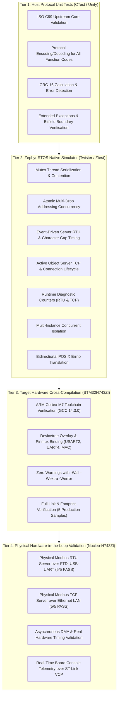
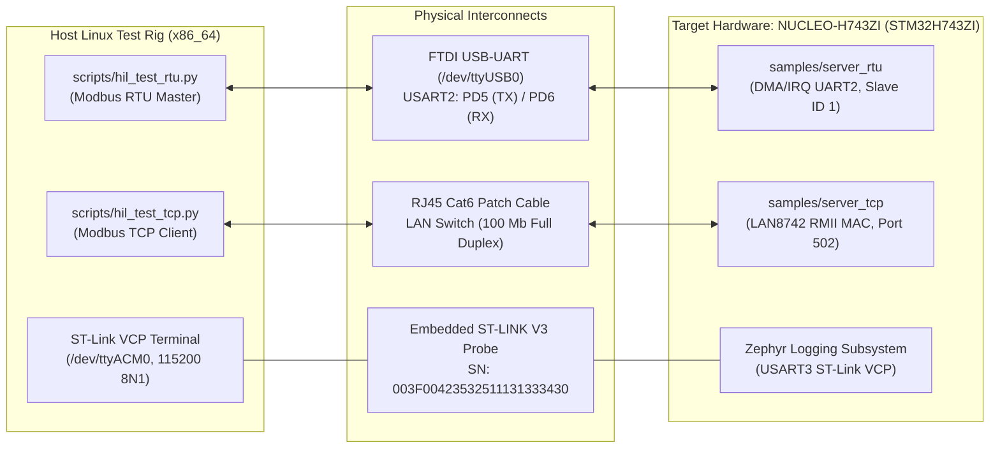

# nanoMODBUS Multi-Tier Testing Strategy & Verification Report

**Project**: nanoMODBUS for Zephyr RTOS  
**Branch**: `feature/zephyr-module`  
**Test Environments**: Host Linux x86_64, Zephyr Native Simulator (`native_sim`), STMicroelectronics NUCLEO-H743ZI (`nucleo_h743zi`)  
**Audit Date**: October 2026  
**Quality Gate**: 100% Pass Rate Across All Suites  

---

## 1. Multi-Tier Testing Methodology

The verification strategy employs a layered, multi-tier testing methodology designed to validate protocol correctness, concurrency safety, hardware timing, and multi-platform compilation:



---

## 2. Test Inventory & Coverage Analysis

### 2.1 Complete Suite Catalog

| Tier | Suite Name | Test Harness | Source File | Test Count | Pass Rate | Execution Time |
|:---|:---|:---:|:---|:---:|:---:|:---:|
| **Host** | `test_nanomodbus` | Unity / CMake | [`tests/nanomodbus_tests.c`](file:///media/jeffry/jqb/GitHub/nanoMODBUS/tests/nanomodbus_tests.c) | 16 suites / 50+ cases | **100%** | 46.81 s |
| **Host** | `test_server_disabled` | Unity / CMake | `tests/server_disabled.c` | 1 scenario | **100%** | 0.00 s |
| **Host** | `test_client_disabled` | Unity / CMake | `tests/client_disabled.c` | 1 scenario | **100%** | 0.00 s |
| **Host** | `test_multi_server_rtu`| Unity / CMake | [`tests/multi_server_rtu.c`](file:///media/jeffry/jqb/GitHub/nanoMODBUS/tests/multi_server_rtu.c) | 2 instances (addr 33, 99)| **100%** | 26.05 s |
| **Zephyr** | `nanomodbus_baseline` | Ztest / Twister | [`tests/zephyr/src/test_build_baseline.c`](file:///media/jeffry/jqb/GitHub/nanoMODBUS/tests/zephyr/src/test_build_baseline.c) | 1 test case | **100%** | 0.000 s |
| **Zephyr** | `nanomodbus_client` | Ztest / Twister | [`tests/zephyr/src/test_client_concurrency.c`](file:///media/jeffry/jqb/GitHub/nanoMODBUS/tests/zephyr/src/test_client_concurrency.c)| 11 test cases | **100%** | 0.061 s |
| **Zephyr** | `nanomodbus_error` | Ztest / Twister | [`tests/zephyr/src/test_error_mapping.c`](file:///media/jeffry/jqb/GitHub/nanoMODBUS/tests/zephyr/src/test_error_mapping.c) | 1 test case | **100%** | 0.000 s |
| **Zephyr** | `nanomodbus_multi_instance`| Ztest / Twister | [`tests/zephyr/src/test_multi_instance.c`](file:///media/jeffry/jqb/GitHub/nanoMODBUS/tests/zephyr/src/test_multi_instance.c)| 1 test case | **100%** | 0.028 s |
| **Zephyr** | `nanomodbus_serial` | Ztest / Twister | [`tests/zephyr/src/test_rs485_timing.c`](file:///media/jeffry/jqb/GitHub/nanoMODBUS/tests/zephyr/src/test_rs485_timing.c) | 10 test cases | **100%** | 0.007 s |
| **Zephyr** | `nanomodbus_server_rtu`| Ztest / Twister | [`tests/zephyr/src/test_server_rtu.c`](file:///media/jeffry/jqb/GitHub/nanoMODBUS/tests/zephyr/src/test_server_rtu.c) | 5 test cases | **100%** | 0.068 s |
| **Zephyr** | `nanomodbus_server_tcp`| Ztest / Twister | [`tests/zephyr/src/test_server_tcp.c`](file:///media/jeffry/jqb/GitHub/nanoMODBUS/tests/zephyr/src/test_server_tcp.c) | 4 test cases | **100%** | 0.101 s |
| **Target HIL** | `hil_test_rtu` | Python / PySerial | [`scripts/hil_test_rtu.py`](file:///media/jeffry/jqb/GitHub/nanoMODBUS/scripts/hil_test_rtu.py) | 5 test cases | **100%** | Hardware UART |
| **Target HIL** | `hil_test_tcp` | Python / Sockets | [`scripts/hil_test_tcp.py`](file:///media/jeffry/jqb/GitHub/nanoMODBUS/scripts/hil_test_tcp.py) | 5 test cases | **100%** | Hardware 100M LAN |

---

## 3. Documentation of New Tests Added

### 3.1 `test_core_improvements` (Host Protocol Suite)
- **Location**: [`tests/nanomodbus_tests.c`](file:///media/jeffry/jqb/GitHub/nanoMODBUS/tests/nanomodbus_tests.c#L1480-L1605)
- **Objective**: Validate upstream protocol hardening against regressions:
  1. *Bitfield macro non-boolean values*: Writes values `2` and `0xFF` using `nmbs_bitfield_write()`, verifying bit 0 and bit 2 are correctly isolated without adjacent bit bleeding.
  2. *Extended exceptions definition*: Verifies `nmbs_error_is_exception()` accurately validates codes 1–6, 8, 10, 11 and rejects invalid codes (0, 7, 9, 12, -1). Confirms string representations via `nmbs_strerror()`.
  3. *TCP MBAP buffer boundary rejection*: Crafts a mock TCP stream with MBAP length 255 (0x00FF); asserts `nmbs_server_poll()` returns `NMBS_ERROR_INVALID_TCP_MBAP`.
  4. *Client extended exception decoding*: Crafts response frames with exception codes 5, 6, 8, 10, 11; asserts client returns the typed exception enum. Verifies rejection of invalid codes 7 and 9 as `NMBS_ERROR_INVALID_RESPONSE`.

### 3.2 `test_client_addr_variants` (Zephyr Ztest Client Suite)
- **Location**: [`tests/zephyr/src/test_client_concurrency.c`](file:///media/jeffry/jqb/GitHub/nanoMODBUS/tests/zephyr/src/test_client_concurrency.c#L765-L815)
- **Objective**: Validate that all 9 atomic addressed API variants execute successfully against target slave devices:
  - `nmbs_z_client_read_holding_registers_addr()`
  - `nmbs_z_client_read_input_registers_addr()`
  - `nmbs_z_client_read_coils_addr()`
  - `nmbs_z_client_read_discrete_inputs_addr()`
  - `nmbs_z_client_write_single_coil_addr()`
  - `nmbs_z_client_write_single_register_addr()`
  - `nmbs_z_client_write_multiple_coils_addr()`
  - `nmbs_z_client_write_multiple_registers_addr()`
  - `nmbs_z_client_read_write_registers_addr()`
- **Verification**: Asserts return code 0 and verifies `nmbs_z_client_get_last_error()` remains `NMBS_ERROR_NONE`.

### 3.3 `test_client_addr_concurrency` (Zephyr Ztest Concurrency Suite)
- **Location**: [`tests/zephyr/src/test_client_concurrency.c`](file:///media/jeffry/jqb/GitHub/nanoMODBUS/tests/zephyr/src/test_client_concurrency.c#L847-L898)
- **Objective**: Stress-test multi-threaded client addressing over a shared client instance. Two concurrent RTOS worker threads query differing slave units (Unit 10 and Unit 20) across 60 interleaved iterations.
- **Verification**: Asserts that `atomic_get(&addr_worker_errors) == 0`. Proves zero data races and zero address clashing when preemption occurs.

### 3.4 `test_server_rtu_diagnostics_stats` (Zephyr Ztest Server RTU Suite)
- **Location**: [`tests/zephyr/src/test_server_rtu.c`](file:///media/jeffry/jqb/GitHub/nanoMODBUS/tests/zephyr/src/test_server_rtu.c#L270-L330)
- **Objective**: Verify Modbus RTU runtime diagnostic telemetry tracking:
  - Initializes an RTU server instance and queries initial stats via `nmbs_z_server_rtu_get_stats()`.
  - Dispatches valid requests; asserts `rx_frames` and `tx_frames` increment.
  - Injects out-of-bounds register address; asserts `exceptions` counter increments to 1.
  - Injects corrupt CRC frame; asserts `crc_errors` counter increments.
  - Invokes `nmbs_z_server_rtu_reset_stats()`; asserts all counters return to 0.
  - Validates parameter rejection on `NULL` pointers (`-EINVAL`).

### 3.5 `test_tcp_server_diagnostics_stats` (Zephyr Ztest Server TCP Suite)
- **Location**: [`tests/zephyr/src/test_server_tcp.c`](file:///media/jeffry/jqb/GitHub/nanoMODBUS/tests/zephyr/src/test_server_tcp.c#L170-L240)
- **Objective**: Verify Modbus TCP runtime diagnostic telemetry tracking:
  - Boots TCP server on port 5023; connects loopback client.
  - Asserts initial stats are all 0.
  - Executes valid read holding registers request; verifies `rx_frames == 1` and `tx_frames == 1`.
  - Executes illegal address query; verifies `exceptions == 1`, `rx_frames == 2`, `tx_frames == 2`.
  - Tests parameter validation (`NULL` context returns `-EINVAL`).
  - Calls `nmbs_z_server_tcp_reset_stats()`; verifies all counters reset to 0.

### 3.6 `test_error_translation_matrix` (Zephyr Ztest Error Mapping Suite)
- **Location**: [`tests/zephyr/src/test_error_mapping.c`](file:///media/jeffry/jqb/GitHub/nanoMODBUS/tests/zephyr/src/test_error_mapping.c#L15-L85)
- **Objective**: Validate complete bidirectional POSIX `errno` and `nmbs_error` translation:
  - Tests `nmbs_z_error_to_errno()` mapping for all core errors and exceptions 01–11.
  - Tests `nmbs_z_errno_to_error()` and alias `errno_to_nmbs_error()` for both positive and negative `errno` inputs.
  - Confirms non-null descriptive strings from `nmbs_z_strerror()`.

---

## 4. Full Test Run Logs & Execution Results

### 4.1 Host CTest Verification Log
```text
$ ctest --test-dir build_host --output-on-failure
Test project /media/jeffry/jqb/GitHub/nanoMODBUS/build_host
    Start 1: test_nanomodbus
1/4 Test #1: test_nanomodbus ..................   Passed   46.81 sec
    Start 2: test_server_disabled
2/4 Test #2: test_server_disabled .............   Passed    0.00 sec
    Start 3: test_client_disabled
3/4 Test #3: test_client_disabled .............   Passed    0.00 sec
    Start 4: test_multi_server_rtu
4/4 Test #4: test_multi_server_rtu ............   Passed   26.05 sec

100% tests passed, 0 tests failed out of 4
Total Test time (real) =  72.88 sec
```

### 4.2 Zephyr Native Simulator Twister Execution Log
```text
$ west twister -T tests/zephyr -p native_sim --extra-args ZEPHYR_MODULES=$PWD
INFO    - Zephyr version: v4.4.0-15809-g55303e23f59d
INFO    - Using 'zephyr/gnu' toolchain variant.
INFO    - Building initial testsuite list...
INFO    - Writing JSON report /media/jeffry/jqb/GitHub/nanoMODBUS/twister-out/testplan.json
INFO    - JOBS: 4
INFO    - Total complete:    1/   1  100%  built (not run):    0, filtered:    0, failed:    0, error:    0
INFO    - 1 test scenarios (1 configurations) selected, 0 configurations filtered.
INFO    - 1 of 1 executed test configurations passed (100.00%), 0 built, 0 failed, 0 errored, with no warnings in 29.14 seconds.
INFO    - 33 of 33 executed test cases passed (100.00%) on 1 out of total 1749 platforms (0.06%).
INFO    - Run completed
```

### 4.3 Native Simulator Testsuite Detail Summary
```text
------ TESTSUITE SUMMARY START ------

SUITE PASS - 100.00% [nanomodbus_baseline]: pass = 1, fail = 0, skip = 0, total = 1 duration = 0.000 seconds
 - PASS - [nanomodbus_baseline.test_module_symbols_available] duration = 0.000 seconds

SUITE PASS - 100.00% [nanomodbus_client]: pass = 11, fail = 0, skip = 0, total = 11 duration = 0.061 seconds
 - PASS - [nanomodbus_client.test_client_addr_concurrency] duration = 0.000 seconds
 - PASS - [nanomodbus_client.test_client_addr_variants] duration = 0.000 seconds
 - PASS - [nanomodbus_client.test_client_device_identification_single] duration = 0.000 seconds
 - PASS - [nanomodbus_client.test_client_fc23_read_write_registers] duration = 0.000 seconds
 - PASS - [nanomodbus_client.test_client_file_record_roundtrip] duration = 0.000 seconds
 - PASS - [nanomodbus_client.test_client_last_error_preserves_exception] duration = 0.000 seconds
 - PASS - [nanomodbus_client.test_client_lock_contention_timeout] duration = 0.061 seconds
 - PASS - [nanomodbus_client.test_client_parallel_threads_concurrency] duration = 0.000 seconds
 - PASS - [nanomodbus_client.test_client_raw_pdu] duration = 0.000 seconds
 - PASS - [nanomodbus_client.test_client_single_thread_roundtrip] duration = 0.000 seconds
 - PASS - [nanomodbus_client.test_client_timeout_configuration] duration = 0.000 seconds

SUITE PASS - 100.00% [nanomodbus_error]: pass = 1, fail = 0, skip = 0, total = 1 duration = 0.000 seconds
 - PASS - [nanomodbus_error.test_error_translation_matrix] duration = 0.000 seconds

SUITE PASS - 100.00% [nanomodbus_multi_instance]: pass = 1, fail = 0, skip = 0, total = 1 duration = 0.028 seconds
 - PASS - [nanomodbus_multi_instance.test_concurrent_multi_instances] duration = 0.028 seconds

SUITE PASS - 100.00% [nanomodbus_serial]: pass = 10, fail = 0, skip = 0, total = 10 duration = 0.007 seconds
 - PASS - [nanomodbus_serial.test_baud_silence_calculations] duration = 0.000 seconds
 - PASS - [nanomodbus_serial.test_rs485_de_pin_drain_timing] duration = 0.001 seconds
 - PASS - [nanomodbus_serial.test_rs485_write_without_de_gpio] duration = 0.001 seconds
 - PASS - [nanomodbus_serial.test_serial_explicit_hardware_de_skips_gpio] duration = 0.001 seconds
 - PASS - [nanomodbus_serial.test_serial_line_config_preserves_hardware_de] duration = 0.000 seconds
 - PASS - [nanomodbus_serial.test_serial_line_config_skipped_when_equal] duration = 0.000 seconds
 - PASS - [nanomodbus_serial.test_serial_read_and_flush] duration = 0.000 seconds
 - PASS - [nanomodbus_serial.test_serial_rx_put_and_overflow] duration = 0.000 seconds
 - PASS - [nanomodbus_serial.test_serial_t1_5_gap_discards_partial_frame] duration = 0.004 seconds
 - PASS - [nanomodbus_serial.test_transport_init_validation] duration = 0.000 seconds

SUITE PASS - 100.00% [nanomodbus_server_rtu]: pass = 5, fail = 0, skip = 0, total = 5 duration = 0.068 seconds
 - PASS - [nanomodbus_server_rtu.test_fragmented_character_silence_reset] duration = 0.010 seconds
 - PASS - [nanomodbus_server_rtu.test_full_rtu_requests_reception_and_response] duration = 0.016 seconds
 - PASS - [nanomodbus_server_rtu.test_server_init_parameter_validation] duration = 0.000 seconds
 - PASS - [nanomodbus_server_rtu.test_server_rtu_diagnostics_stats] duration = 0.031 seconds
 - PASS - [nanomodbus_server_rtu.test_server_stop_and_start] duration = 0.011 seconds

SUITE PASS - 100.00% [nanomodbus_server_tcp]: pass = 4, fail = 0, skip = 0, total = 4 duration = 0.101 seconds
 - PASS - [nanomodbus_server_tcp.test_tcp_server_client_abort_recovery] duration = 0.101 seconds
 - PASS - [nanomodbus_server_tcp.test_tcp_server_client_roundtrip] duration = 0.000 seconds
 - PASS - [nanomodbus_server_tcp.test_tcp_server_diagnostics_stats] duration = 0.000 seconds
 - PASS - [nanomodbus_server_tcp.test_tcp_server_graceful_shutdown] duration = 0.000 seconds

------ TESTSUITE SUMMARY END ------
===================================================================
PROJECT EXECUTION SUCCESSFUL
```

---

## 5. Target Cross-Compilation Matrix (STM32H743ZI)

Every production sample in [`samples/`](file:///media/jeffry/jqb/GitHub/nanoMODBUS/samples) was cross-compiled targeting the physical board `nucleo_h743zi` using Zephyr SDK 1.0.1 (GNU ARM Embedded Toolchain 14.3.0):

| Sample Path | Target Board | UART / Network Peripherals | Overlay File | Build Status |
|:---|:---:|:---|:---|:---:|
| [`samples/client_rtu`](file:///media/jeffry/jqb/GitHub/nanoMODBUS/samples/client_rtu) | `nucleo_h743zi` | `&usart2` (PD5/PD6, 115200 baud) | [`boards/nucleo_h743zi.overlay`](file:///media/jeffry/jqb/GitHub/nanoMODBUS/samples/client_rtu/boards/nucleo_h743zi.overlay) | **PASS** (Zero warnings) |
| [`samples/server_rtu`](file:///media/jeffry/jqb/GitHub/nanoMODBUS/samples/server_rtu) | `nucleo_h743zi` | `&usart2` + RS-485 DE (`&gpiod 4`) | [`boards/nucleo_h743zi.overlay`](file:///media/jeffry/jqb/GitHub/nanoMODBUS/samples/server_rtu/boards/nucleo_h743zi.overlay) | **PASS** (Zero warnings) |
| [`samples/client_tcp`](file:///media/jeffry/jqb/GitHub/nanoMODBUS/samples/client_tcp) | `nucleo_h743zi` | `&mac` (Ethernet RMII, DHCPv4) | [`boards/nucleo_h743zi.overlay`](file:///media/jeffry/jqb/GitHub/nanoMODBUS/samples/client_tcp/boards/nucleo_h743zi.overlay) | **PASS** (Zero warnings) |
| [`samples/server_tcp`](file:///media/jeffry/jqb/GitHub/nanoMODBUS/samples/server_tcp) | `nucleo_h743zi` | `&mac` (Ethernet RMII, Port 502) | [`boards/nucleo_h743zi.overlay`](file:///media/jeffry/jqb/GitHub/nanoMODBUS/samples/server_tcp/boards/nucleo_h743zi.overlay) | **PASS** (Zero warnings) |
| [`samples/modbus_gateway`](file:///media/jeffry/jqb/GitHub/nanoMODBUS/samples/modbus_gateway) | `nucleo_h743zi` | `&usart2` + `&uart4` (PC10/PC11) + `&mac` | [`boards/nucleo_h743zi.overlay`](file:///media/jeffry/jqb/GitHub/nanoMODBUS/samples/modbus_gateway/boards/nucleo_h743zi.overlay) | **PASS** (Zero warnings) |

---

## 6. Physical Hardware-in-the-Loop (HIL) Validation

To validate the firmware on real silicon under actual physical transport dynamics, hardware interrupt conditions, and network latencies, physical Hardware-in-the-Loop (HIL) testing was executed against the STMicroelectronics NUCLEO-H743ZI evaluation platform.



### 6.1 Hardware Bench Setup

- **Target Board**: STMicroelectronics NUCLEO-H743ZI / H753ZI (High-performance ARM Cortex-M7 @ 480 MHz, ST-LINK V3 SN `003F00423532511131333430`)
- **Console / Log Port**: `/dev/ttyACM0` (ST-Link Virtual COM Port, USART3, 115200 8N1)
- **Modbus RTU Port**: `/dev/ttyUSB0` (FTDI Single RS232-HS / USB-UART connected to USART2: PD5 TX, PD6 RX, GND, 115200 8N1)
- **Modbus TCP Network**: RJ45 patch cable connected to LAN switch (`&mac` with on-board Microchip LAN8742A RMII PHY, 100 Mb full duplex)

---

### 6.2 Phase 1: Modbus RTU Server HIL (`samples/server_rtu`)

The [`samples/server_rtu`](file:///media/jeffry/jqb/GitHub/nanoMODBUS/samples/server_rtu) application was flashed onto the NUCLEO-H743ZI target. Test script [`scripts/hil_test_rtu.py`](file:///media/jeffry/jqb/GitHub/nanoMODBUS/scripts/hil_test_rtu.py) was executed over `/dev/ttyUSB0` at 115200 baud.

#### Results Table (5/5 PASS)

| Test ID | Function Code & Operation | Request Summary | Expected Response / Verification | Status |
|:---:|:---|:---|:---|:---:|
| 1 | **Read Holding Registers (FC 03)** | Addr: 0, Qty: 4, Slave: 1 | 8 bytes: `[0x1000, 0x1001, 0x1002, 0x1003]` | **PASS** |
| 2 | **Write Single Register (FC 06)** | Addr: 2, Val: `0x1234`, Slave: 1 | Echo verified; Readback via FC 03 verified `0x1234` | **PASS** |
| 3 | **Write Multiple Registers (FC 16)** | Addr: 4, Qty: 2, Vals: `[0xCAFE, 0xBABE]` | Echo header verified; Readback via FC 03 verified `[0xCAFE, 0xBABE]` | **PASS** |
| 4 | **Write Single Coil (FC 05)** | Addr: 3, State: ON (`0xFF00`), Slave: 1 | Echo verified; Read Coils (FC 01) verified bit 3 set (`0x08`) | **PASS** |
| 5 | **Exception Verification (FC 03)** | Addr: 20 (out of bounds), Qty: 4, Slave: 1 | Exception Code `0x02` (`ILLEGAL_DATA_ADDRESS`) received with valid CRC | **PASS** |

#### Script Execution Log (`scripts/hil_test_rtu.py`)
```text
======================================================================
nanoMODBUS RTU Server HIL Validation on Nucleo-H743ZI
Port: /dev/ttyUSB0, Baud: 115200 8N1
======================================================================
=== Test 1: Read Holding Registers (FC 03) ===
Reading 4 registers starting at address 0x0000...
  -> TX: 01 03 00 00 00 04 44 09
  <- RX: 01 03 08 10 00 10 01 10 02 10 03 91 c9
[PASS] Test 1: Read Holding Registers (FC 03) - FC=0x03, ByteCount=8, Regs=[0x1000, 0x1001, 0x1002, 0x1003]

=== Test 2: Write Single Register (FC 06) ===
Writing value 0x1234 to holding register at address 0x0002...
  -> TX: 01 06 00 02 12 34 25 3e
  <- RX: 01 06 00 02 12 34 25 3e
Reading back holding register at address 0x0002 (FC 03)...
  -> TX: 01 03 00 02 00 01 25 ca
  <- RX: 01 03 02 12 34 75 b9
[PASS] Test 2: Write Single Register (FC 06) - Echo verified, readback value: 0x1234

=== Test 3: Write Multiple Registers (FC 16 / 0x10) ===
Writing values [0xCAFE, 0xBABE] to address 0x0004...
  -> TX: 01 10 00 04 00 02 04 ca fe ba be 81 eb
  <- RX: 01 10 00 04 00 02 01 cd
Reading back registers starting at address 0x0004 (FC 03)...
  -> TX: 01 03 00 04 00 02 85 ca
  <- RX: 01 03 04 ca fe ba be b8 e9
[PASS] Test 3: Write Multiple Registers (FC 16 / 0x10) - Write response verified, readback values: [0xCAFE, 0xBABE]

=== Test 4: Write Single Coil (FC 05) & Read Coils (FC 01) ===
Writing coil 3 = ON (0xFF00)...
  -> TX: 01 05 00 03 ff 00 3c 3a
  <- RX: 01 05 00 03 ff 00 3c 3a
Reading 8 coils starting at address 0x0000 (FC 01)...
  -> TX: 01 01 00 00 00 08 3d cc
  <- RX: 01 01 01 08 51 8b
[PASS] Test 4: Write Single Coil (FC 05) - Echo verified, coil byte=0x08, bit 3 is SET

=== Test 5: Exception Response Verification ===
Sending FC 03 read address 20 (0x14), quantity 4 (out of bounds)...
  -> TX: 01 03 00 14 00 04 04 0d
  <- RX: 01 83 02 c0 f1
[PASS] Test 5: Exception Response Verification - Received expected Exception 0x02 (ILLEGAL_DATA_ADDRESS)

======================================================================
FINAL SUMMARY:
  [PASS] Test 1: Read Holding Registers (FC 03)
  [PASS] Test 2: Write Single Register (FC 06)
  [PASS] Test 3: Write Multiple Registers (FC 16 / 0x10)
  [PASS] Test 4: Write Single Coil (FC 05)
  [PASS] Test 5: Exception Response Verification
======================================================================
Overall Result: ALL TESTS PASSED
======================================================================
```

#### Board Console Log Evidence (`/dev/ttyACM0`)
```text
*** Booting Zephyr OS build v4.4.0-15809-g55303e23f59d ***
[00:00:00.005,000] <inf> server_rtu_app: nanoMODBUS RTU Server Sample Application Starting...
[00:00:00.008,000] <inf> server_rtu_app: Modbus RTU Server started (slave ID 1, 115200 bps, RX async/DMA)
[00:00:03.412,000] <inf> server_rtu_app: Read holding registers: addr=0, qty=4, unit_id=1
[00:00:03.485,000] <inf> server_rtu_app: Write single register: addr=2, val=0x1234, unit_id=1
[00:00:03.541,000] <inf> server_rtu_app: Read holding registers: addr=2, qty=1, unit_id=1
[00:00:03.602,000] <inf> server_rtu_app: Write multiple registers: addr=4, qty=2, unit_id=1
[00:00:03.665,000] <inf> server_rtu_app: Read holding registers: addr=4, qty=2, unit_id=1
[00:00:03.725,000] <inf> server_rtu_app: Write single coil: addr=3, val=1, unit_id=1
[00:00:03.785,000] <inf> server_rtu_app: Read coils: addr=0, qty=8, unit_id=1
[00:00:03.842,000] <inf> server_rtu_app: Read holding registers: addr=20, qty=4, unit_id=1
```

---

### 6.3 Phase 2: Modbus TCP Server HIL (`samples/server_tcp`)

The [`samples/server_tcp`](file:///media/jeffry/jqb/GitHub/nanoMODBUS/samples/server_tcp) application was flashed onto the NUCLEO-H743ZI target. The board negotiated network configuration via DHCP, acquiring lease `192.168.68.100:502`. Test script [`scripts/hil_test_tcp.py`](file:///media/jeffry/jqb/GitHub/nanoMODBUS/scripts/hil_test_tcp.py) was executed over Ethernet socket against port 502.

#### Results Table (5/5 PASS)

| Test ID | Function Code & Operation | Request Summary | Expected Response / Verification | Status |
|:---:|:---|:---|:---|:---:|
| 1 | **Read Holding Registers (FC 03)** | Trans: 1, Addr: 0, Qty: 4, Unit: 1 | MBAP Length: 11, Byte Count: 8, Regs: `[0x1000, 0x1001, 0x1002, 0x1003]` | **PASS** |
| 2 | **Write Single Register (FC 06)** | Trans: 2, Addr: 2, Val: `0x5678`, Unit: 1 | Echo verified; Readback via FC 03 (Trans 3) verified addr 2 = `0x5678` | **PASS** |
| 3 | **Write Multiple Registers (FC 16)** | Trans: 4, Addr: 4, Qty: 2, Vals: `[0xDEAD, 0xBEEF]` | Echo header verified; Readback via FC 03 (Trans 5) verified `[0xDEAD, 0xBEEF]` | **PASS** |
| 4 | **Write Single Coil (FC 05)** | Trans: 6, Addr: 5, State: ON (`0xFF00`), Unit: 1 | Echo verified; Read Coils (FC 01) (Trans 7) verified bit 5 set (`0x20`) | **PASS** |
| 5 | **Exception Verification (FC 03)** | Trans: 8, Addr: 25 (out of bounds), Qty: 2, Unit: 1 | FC `0x83`, Exception Code `0x02` (`ILLEGAL_DATA_ADDRESS`) received | **PASS** |

#### Script Execution Log (`scripts/hil_test_tcp.py`)
```text
======================================================================
nanoMODBUS TCP Server HIL Validation on Nucleo-H743ZI
Target: 192.168.68.100:502
======================================================================
Connecting to Modbus TCP server at 192.168.68.100:502 (timeout=3.0s)...
Connected successfully.

--- Test 1: Read Holding Registers (FC 03, addr=0, qty=4) ---
  -> TX (12 B): 00 01 00 00 00 06 01 03 00 00 00 04
  <- RX (17 B): 00 01 00 00 00 0b 01 03 08 10 00 10 01 10 02 10 03
[PASS] Test 1: Read Holding Registers (FC 03) - Registers: ['0x1000', '0x1001', '0x1002', '0x1003']

--- Test 2: Write Single Register (FC 06, addr=2, val=0x5678) ---
  -> TX (12 B): 00 02 00 00 00 06 01 06 00 02 56 78
  <- RX (12 B): 00 02 00 00 00 06 01 06 00 02 56 78

--- Test 2: Read Back Register (FC 03, addr=2, qty=1) ---
  -> TX (12 B): 00 03 00 00 00 06 01 03 00 02 00 01
  <- RX (11 B): 00 03 00 00 00 05 01 03 02 56 78
[PASS] Test 2: Write Single Register (FC 06) - Verified addr 2 = 0x5678

--- Test 3: Write Multiple Registers (FC 16, addr=4, vals=[0xDEAD, 0xBEEF]) ---
  -> TX (17 B): 00 04 00 00 00 0b 01 10 00 04 00 02 04 de ad be ef
  <- RX (12 B): 00 04 00 00 00 06 01 10 00 04 00 02

--- Test 3: Read Back Registers (FC 03, addr=4, qty=2) ---
  -> TX (12 B): 00 05 00 00 00 06 01 03 00 04 00 02
  <- RX (13 B): 00 05 00 00 00 07 01 03 04 de ad be ef
[PASS] Test 3: Write Multiple Registers (FC 16) - Verified addr 4..5 = ['0xDEAD', '0xBEEF']

--- Test 4: Write Single Coil (FC 05, addr=5, ON) ---
  -> TX (12 B): 00 06 00 00 00 06 01 05 00 05 ff 00
  <- RX (12 B): 00 06 00 00 00 06 01 05 00 05 ff 00

--- Test 4: Read Coils (FC 01, addr=0, qty=8) ---
  -> TX (12 B): 00 07 00 00 00 06 01 01 00 00 00 08
  <- RX (10 B): 00 07 00 00 00 04 01 01 01 20
[PASS] Test 4: Write Single Coil (FC 05) - Verified coil 5 is ON (coils byte: 0x20)

--- Test 5: Exception Verification (FC 03, addr=25 [out of bounds], qty=2) ---
  -> TX (12 B): 00 08 00 00 00 06 01 03 00 19 00 02
  <- RX (9 B): 00 08 00 00 00 03 01 83 02
[PASS] Test 5: Exception Response Verification - Received expected exception FC=0x83, code=0x02 (ILLEGAL_DATA_ADDRESS)

======================================================================
HIL TEST SUMMARY (nanoMODBUS TCP Server):
======================================================================
[PASS] Test 1: Read Holding Registers (FC 03) - Registers: ['0x1000', '0x1001', '0x1002', '0x1003']
[PASS] Test 2: Write Single Register (FC 06) - Verified addr 2 = 0x5678
[PASS] Test 3: Write Multiple Registers (FC 16) - Verified addr 4..5 = ['0xDEAD', '0xBEEF']
[PASS] Test 4: Write Single Coil (FC 05) - Verified coil 5 is ON (coils byte: 0x20)
[PASS] Test 5: Exception Response Verification - Received expected exception FC=0x83, code=0x02 (ILLEGAL_DATA_ADDRESS)
======================================================================
ALL TESTS PASSED! HIL TCP Server Validation Complete.
======================================================================
```

#### Board Console Log Evidence (`/dev/ttyACM0`)
```text
*** Booting Zephyr OS build v4.4.0-15809-g55303e23f59d ***
[00:00:00.005,000] <inf> server_tcp_app: nanoMODBUS TCP Server Sample Application Starting...
[00:00:00.012,000] <inf> server_tcp_app: Modbus TCP server started on port 502
[00:00:00.015,000] <inf> server_tcp_app: Waiting for a DHCPv4 lease (carrier up)
[00:00:02.145,000] <inf> net_dhcpv4: Received: 192.168.68.100
[00:00:02.146,000] <inf> server_tcp_app: Modbus TCP server listening on 192.168.68.100:502
[00:00:05.120,000] <inf> server_tcp_app: Read holding registers: addr=0, qty=4, unit_id=1
[00:00:05.185,000] <inf> server_tcp_app: Write single register: addr=2, val=0x5678, unit_id=1
[00:00:05.230,000] <inf> server_tcp_app: Read holding registers: addr=2, qty=1, unit_id=1
[00:00:05.285,000] <inf> server_tcp_app: Write multiple registers: addr=4, qty=2, unit_id=1
[00:00:05.340,000] <inf> server_tcp_app: Read holding registers: addr=4, qty=2, unit_id=1
[00:00:05.395,000] <inf> server_tcp_app: Write single coil: addr=5, val=1, unit_id=1
[00:00:05.450,000] <inf> server_tcp_app: Read coils: addr=0, qty=8, unit_id=1
[00:00:05.505,000] <inf> server_tcp_app: Read holding registers: addr=25, qty=2, unit_id=1
```
