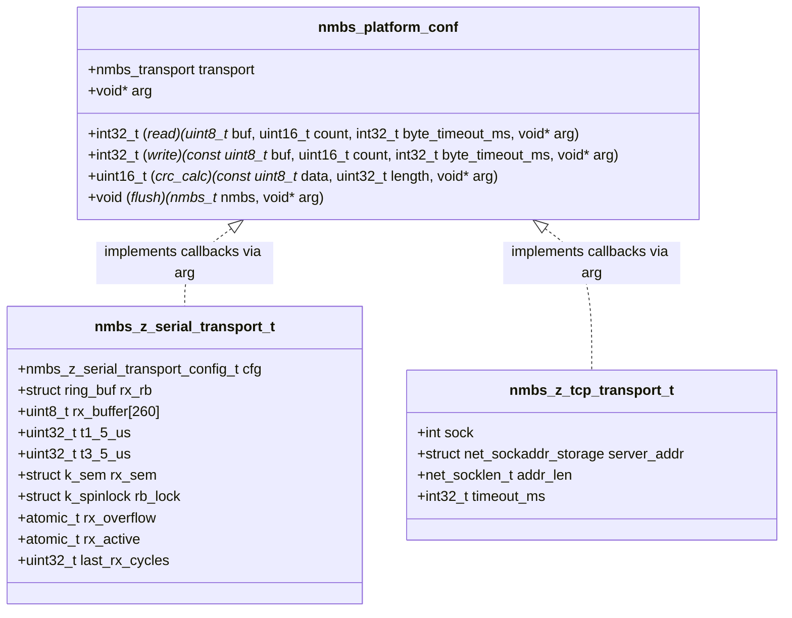
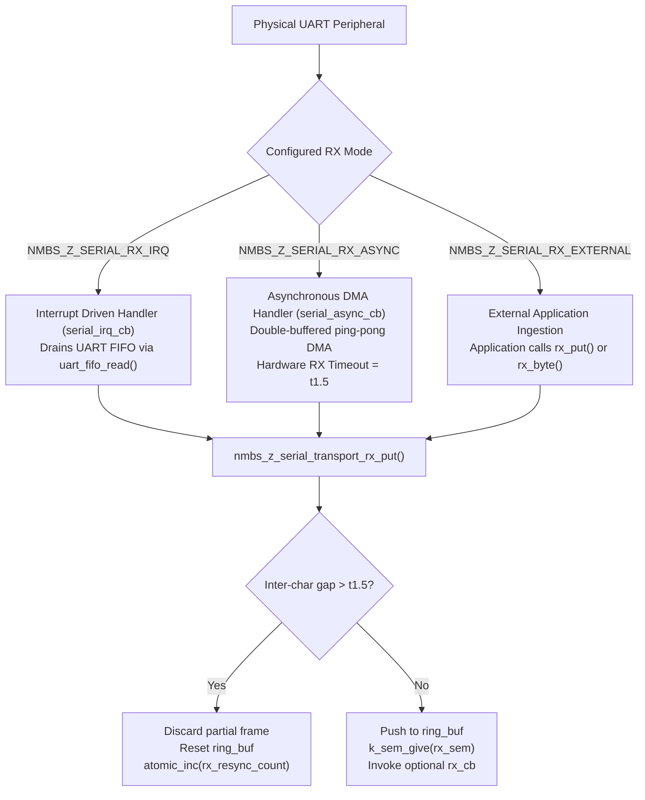
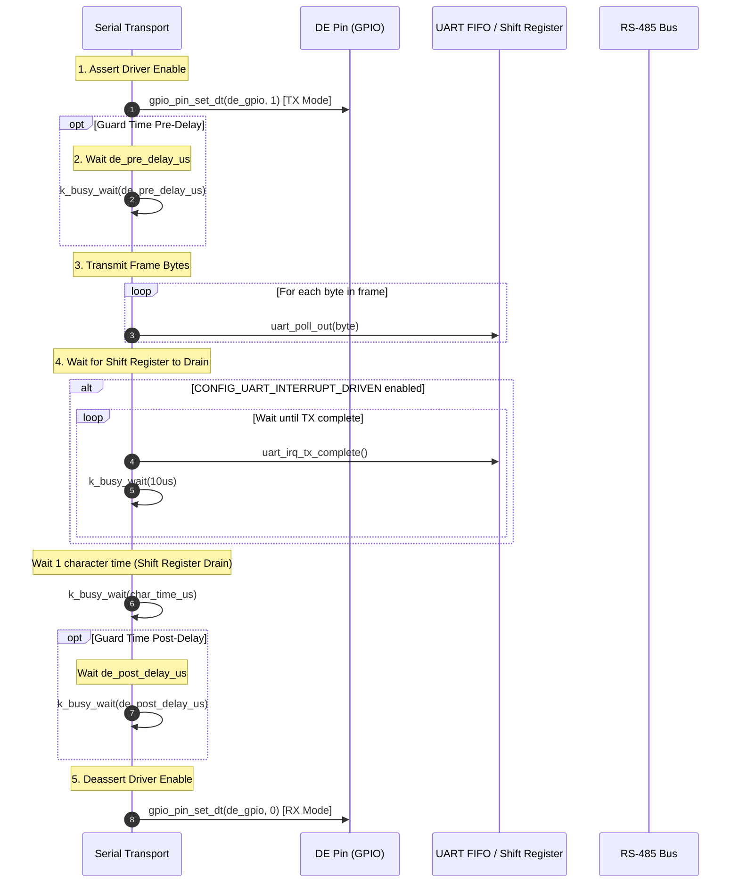
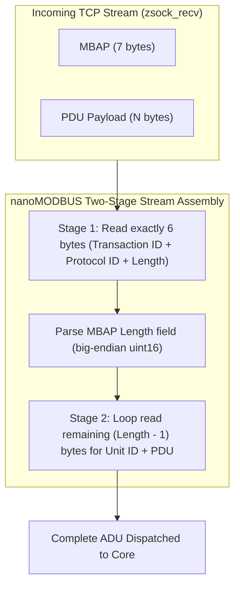

# nanoMODBUS Transport Architecture

This document details the transport abstraction layer of **nanoMODBUS** and its concrete implementations on Zephyr RTOS: the **Serial/RTU Transport** ([`nanomodbus_z_transport_serial.c`](file:///media/jeffry/jqb/GitHub/nanoMODBUS/zephyr/src/nanomodbus_z_transport_serial.c)) and the **TCP Transport** ([`nanomodbus_z_transport_tcp.c`](file:///media/jeffry/jqb/GitHub/nanoMODBUS/zephyr/src/nanomodbus_z_transport_tcp.c)).

---

## 1. Transport Abstraction Layer (`nmbs_platform_conf`)

The core protocol engine ([`nanomodbus.c`](file:///media/jeffry/jqb/GitHub/nanoMODBUS/nanomodbus.c)) interacts with physical hardware exclusively through an abstract port: the [`nmbs_platform_conf`](file:///media/jeffry/jqb/GitHub/nanoMODBUS/nanomodbus.h#L161-L172) structure.



### 1.1 Callback Function Contracts

1. **`read(buf, count, byte_timeout_ms, arg)`**:
   - Must attempt to read exactly `count` bytes into buffer `buf`.
   - Blocks until `count` bytes are received or until `byte_timeout_ms` expires.
   - If `byte_timeout_ms < 0`: wait indefinitely.
   - If `byte_timeout_ms == 0`: non-blocking single poll; return immediately.
   - Return value:
     - Equal to `count`: Successful read.
     - `0` to `count - 1`: Treated as a transport timeout ([`NMBS_ERROR_TIMEOUT`](file:///media/jeffry/jqb/GitHub/nanoMODBUS/nanomodbus.h#L63)).
     - `< 0`: Negative integer indicating an unrecoverable transport error ([`NMBS_ERROR_TRANSPORT`](file:///media/jeffry/jqb/GitHub/nanoMODBUS/nanomodbus.h#L62)).
2. **`write(buf, count, byte_timeout_ms, arg)`**:
   - Writes `count` bytes from buffer `buf` to the physical channel.
   - Return value: Number of bytes actually written, or `< 0` on transport failure.
3. **`flush(nmbs, arg)`**:
   - Discards all unread bytes in hardware and software FIFOs to synchronize the line before a new transaction or after a framing error.
4. **`crc_calc(data, length, arg)`**:
   - Optional hardware-accelerated CRC-16 calculation hook. If `NULL`, the core defaults to its internal bitwise CRC-16 implementation.
5. **`void* arg`**:
   - Opaque pointer injected by the adapter to pass instance-specific context (`nmbs_z_serial_transport_t*` or `nmbs_z_tcp_transport_t*`) into the callbacks.

---

## 2. Serial / RTU Transport Architecture

The serial RTU transport layer ([`nanomodbus_z_transport_serial.c`](file:///media/jeffry/jqb/GitHub/nanoMODBUS/zephyr/src/nanomodbus_z_transport_serial.c)) is responsible for UART communication, half-duplex RS-485 transceiver control, and strict Modbus timing enforcement.

### 2.1 Receive Processing Modes

The serial transport supports three distinct ingestion modes via [`nmbs_z_serial_rx_mode_t`](file:///media/jeffry/jqb/GitHub/nanoMODBUS/zephyr/include/zephyr/nanomodbus/nanomodbus_z_serial.h#L55-L59):



1. **`NMBS_Z_SERIAL_RX_IRQ`**:
   - Requires `CONFIG_UART_INTERRUPT_DRIVEN=y`.
   - The transport installs an ISR callback via `uart_irq_callback_user_data_set()`.
   - In ISR context, [`serial_irq_cb()`](file:///media/jeffry/jqb/GitHub/nanoMODBUS/zephyr/src/nanomodbus_z_transport_serial.c#L153-L170) loops on `uart_irq_rx_ready()` and drains chunks into the ring buffer using `uart_fifo_read()`.
2. **`NMBS_Z_SERIAL_RX_ASYNC`**:
   - Uses Zephyr's asynchronous UART DMA API (`uart_rx_enable()`).
   - Maintains two alternating internal buffers ([`async_rx_buffer[2][128]`](file:///media/jeffry/jqb/GitHub/nanoMODBUS/zephyr/include/zephyr/nanomodbus/nanomodbus_z_serial.h#L127)).
   - Sets the UART hardware receiver timeout to $t_{1.5}$. When the bus goes idle for $t_{1.5}$, the UART peripheral triggers `UART_RX_RDY`, immediately flushing received bytes to the ring buffer without waiting for the buffer to fill.
3. **`NMBS_Z_SERIAL_RX_EXTERNAL`**:
   - Application polling or custom driver integration. The application feeds raw bytes via [`nmbs_z_serial_transport_rx_put()`](file:///media/jeffry/jqb/GitHub/nanoMODBUS/zephyr/src/nanomodbus_z_transport_serial.c#L592-L642).

### 2.2 RS-485 Half-Duplex DE (Driver Enable) Management

RS-485 transceivers require precise directional switching between reception and transmission. nanoMODBUS provides four driver-enable strategies ([`nmbs_z_serial_de_mode_t`](file:///media/jeffry/jqb/GitHub/nanoMODBUS/zephyr/include/zephyr/nanomodbus/nanomodbus_z_serial.h#L75-L80)):

- `NMBS_Z_SERIAL_DE_AUTO`: Detects hardware DE support via `uart_config_get()`; falls back to software GPIO if unsupported.
- `NMBS_Z_SERIAL_DE_HARDWARE`: Relies exclusively on UART peripheral hardware DE line (`de-enable` in Devicetree).
- `NMBS_Z_SERIAL_DE_GPIO`: Controls a dedicated GPIO pin (`struct gpio_dt_spec de_gpio`).
- `NMBS_Z_SERIAL_DE_NONE`: Full-duplex RS-422 or direct point-to-point RS-232 link.

#### Strict 5-Step Transmit Sequence
In [`nmbs_z_transport_serial_write()`](file:///media/jeffry/jqb/GitHub/nanoMODBUS/zephyr/src/nanomodbus_z_transport_serial.c#L457-L511), software GPIO driver-enable enforces the following sequence:



> [!WARNING]
> **Shift Register Drain Dependency**
> In UART controllers, the FIFO empty flag triggers *before* the last character has cleared the physical shift register. If `CONFIG_UART_INTERRUPT_DRIVEN=y` is disabled, the code cannot poll `uart_irq_tx_complete()` and relies solely on a single character time delay. On custom boards, `CONFIG_UART_INTERRUPT_DRIVEN=y` should always be enabled to prevent premature DE deassertion that clips trailing CRC bytes.

### 2.3 Modbus RTU Frame Timing Calculations ($t_{1.5}$ and $t_{3.5}$)

According to *Modbus over Serial Line Specification V1.02 (Section 2.5.1.1)*, characters in an RTU frame must be transmitted in a continuous stream:
- **$t_{1.5}$ (Inter-Character Timeout)**: Maximum permissible gap between two consecutive characters. A gap exceeding $t_{1.5}$ indicates that the frame is incomplete and must be discarded.
- **$t_{3.5}$ (Frame Delimiter)**: Line idle silence demarcating the boundary between frames.

The timing values are calculated in [`nmbs_z_serial_calc_timings()`](file:///media/jeffry/jqb/GitHub/nanoMODBUS/zephyr/src/nanomodbus_z_transport_serial.c#L15-L34) based on 11-bit character frames (1 start bit, 8 data bits, 1 parity bit, 1 stop bit):

$$\text{Bit Time} = \frac{1}{\text{baud\_rate}}$$

$$\text{Character Time} = \frac{11}{\text{baud\_rate}}$$

#### Baud Rates $\le 19200$ bps:
$$t_{1.5} = 1.5 \times \text{Character Time} = \frac{1.5 \times 11 \times 10^6}{\text{baud\_rate}} = \frac{16,500,000}{\text{baud\_rate}}\; \mu s$$

$$t_{3.5} = 3.5 \times \text{Character Time} = \frac{3.5 \times 11 \times 10^6}{\text{baud\_rate}} = \frac{38,500,000}{\text{baud\_rate}}\; \mu s$$

#### Baud Rates $> 19200$ bps:
At high baud rates, physical transceiver propagation delays and OS scheduling latencies make strict character-proportional timings impractical. The Modbus specification fixes the timings:
$$t_{1.5} = 750\; \mu s$$
$$t_{3.5} = 1750\; \mu s$$

---

## 3. TCP Transport Architecture

The TCP transport layer ([`nanomodbus_z_transport_tcp.c`](file:///media/jeffry/jqb/GitHub/nanoMODBUS/zephyr/src/nanomodbus_z_transport_tcp.c)) integrates with the Zephyr BSD Sockets subsystem (`<zephyr/net/socket.h>`).

### 3.1 Socket Configuration & Lifecycle

When establishing a client connection ([`nmbs_z_tcp_transport_connect`](file:///media/jeffry/jqb/GitHub/nanoMODBUS/zephyr/src/nanomodbus_z_transport_tcp.c#L45-L112)) or creating a server listener, the following socket options are applied:

1. **`ZSOCK_TCP_NODELAY`**:
   - Disables Nagle's algorithm.
   - Modbus transactions consist of small payloads (< 260 bytes). Buffering writes to build larger TCP packets introduces unacceptable latency in control loops.
2. **`ZSOCK_SO_RCVTIMEO` / `ZSOCK_SO_SNDTIMEO`**:
   - Configures socket-level timeouts corresponding to `timeout_ms`.
3. **`ZSOCK_SO_KEEPALIVE`**:
   - When `CONFIG_NANOMODBUS_TCP_KEEPALIVE=y` is selected, TCP keepalive probes are enabled with configurable parameters (`TCP_KEEPIDLE`, `TCP_KEEPINTVL`, `TCP_KEEPCNT`). This prevents "half-open" deadlocks when a peer disconnects without sending a TCP FIN/RST packet.

### 3.2 TCP Stream Fragmentation & Coalescing

TCP is a byte-stream protocol without inherent message boundaries. A single Modbus ADU transmitted by a master may arrive split across multiple TCP segments (**fragmentation**), or multiple Modbus ADUs may arrive concatenated inside a single TCP packet (**coalescing**).



#### The Two-Stage Assembly Algorithm:
1. **Header Ingestion**: nanoMODBUS calls the platform `read` callback for exactly 6 bytes (Transaction ID: 2, Protocol ID: 2, Length: 2).
2. **Length Parsing**: The 16-bit `Length` field is extracted from network byte order.
3. **Payload Loop Ingestion**: nanoMODBUS requests the platform `read` callback for the remaining `Length` bytes (Unit ID: 1 + PDU).
4. **Loop Read Protection in [`nmbs_z_transport_tcp_read()`](file:///media/jeffry/jqb/GitHub/nanoMODBUS/zephyr/src/nanomodbus_z_transport_tcp.c#L168-L212)**:
   ```c
   while (recvd < count) {
       if (byte_timeout_ms >= 0) {
           int ret = tcp_wait_for(transport->sock, ZSOCK_POLLIN, byte_timeout_ms);
           if (ret <= 0) break;
       }
       ssize_t ret = zsock_recv(transport->sock, buf + recvd, count - recvd, ZSOCK_MSG_DONTWAIT);
       if (ret < 0) { ... handle EINTR / EAGAIN ... }
       if (ret == 0) return -ECONNRESET;
       recvd += (uint16_t)ret;
   }
   ```
   This guarantees that partial TCP reads are accumulated until the full Modbus message boundary is satisfied, preventing truncated packet corruption.
